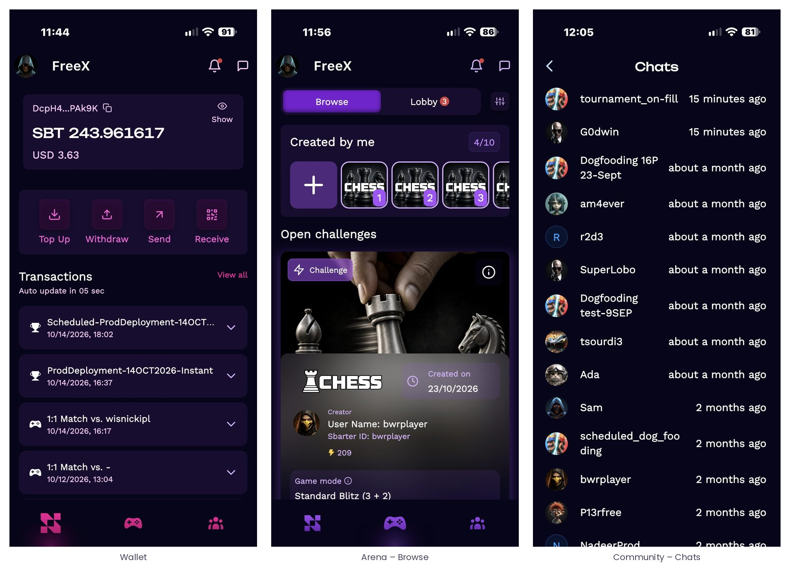

# 1 · Sbarter in brief

Sbarter enables players to run competitive gaming events with real stakes in the games they already play. It is a neutral competitive layer, not a game and not a destination: a player who competes on a title through Sbarter is still the VGP’s player, playing the VGP’s game on the VGP’s servers. Sbarter provides the infrastructure around the session – identity, wallet, contest creation, escrow, settlement, rankings, notifications and support – and nothing else.

## 1.1 Principles the app embodies

Four principles shape every screen described in this manual. They are structural – enforced by the smart contracts and by the way the app is built – rather than promises.

- **Skill only.** Player performance inside the game decides every outcome. Sbarter never sets odds, never relies on chance and never profits from a player’s loss: its revenue is a fixed protocol fee per contest, identical whoever wins.
- **Non-custodial.** Stakes and entry fees are escrowed by a smart contract on Solana at entry and released at settlement. Neither Sbarter nor the VGP can access the escrow or intervene in the execution of a contest. Sbarter never holds player funds and never intermediates fiat: funding runs through authorised third-party providers integrated in the app.
- **Neutral.** Sbarter is never the organiser of an event and never the arbiter of a result. Events are organised by VGPs and creators; results come exclusively from the VGP’s servers. There is no manual intervention and no dispute process: what the game reports is what the contract settles.
- **Verified before the first stake.** Browsing is open to everyone; competing requires an identity-verified adult player in a supported country. Verification happens once, at the first entry, and is enforced on-chain through a privacy-preserving eligibility attestation.

## 1.2 The app at a glance

The app is organised around three permanent tabs in the bottom bar, plus a header that is present on every main screen.

| Area | Icon | What it contains |
| --- | --- | --- |
| Arena | Controller (centre) | Browse open challenges and upcoming tournaments; Lobby for the contests the player has entered or created; filters; season leaderboards (chapters [3](./03-the-arena-finding-and-following-contests.md)–[6](./06-play-and-compare.md)). |
| Wallet | Sbarter mark (left) | Balance, top-up, send, receive, withdraw, transaction history with on-chain proof (chapter [7](./07-the-sbarter-wallet.md)). |
| Community | People (right) | Chats – tournament lobbies and private channels with opponents – and friends (chapter [8](./08-community-chats-friends-and-notifications.md)). |
| Header | Avatar · bell · bubble | Avatar and nickname open the Profile (chapter [9](./09-profile-and-statistics.md)); the bell opens Notifications; the bubble opens Chats. Settings are reached from the Profile (chapter [10](./10-settings-and-player-safety.md)). |

*Figure 1 – The three tabs of the bottom bar. The header (avatar, notifications, chats) is identical on each.*
