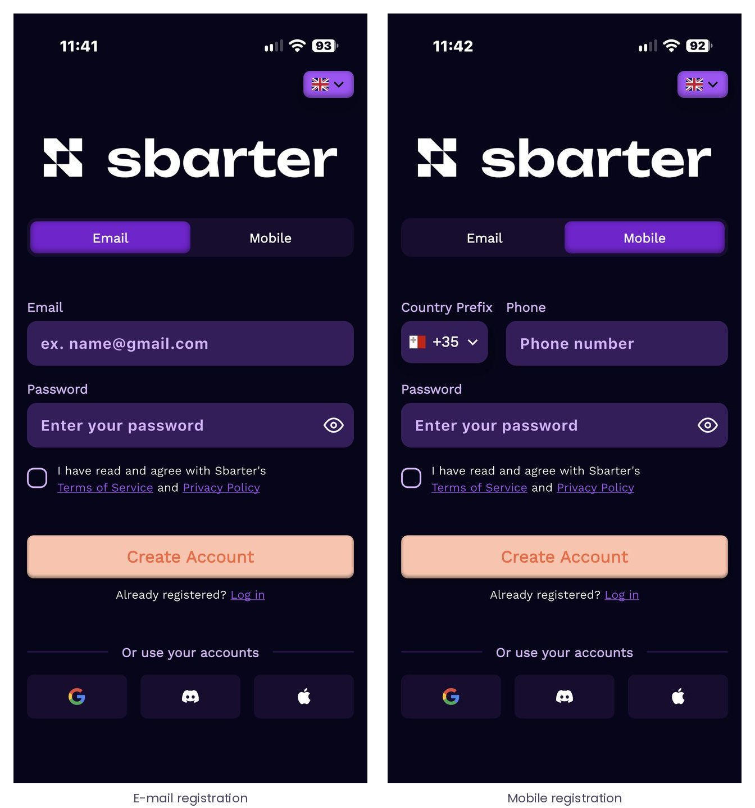
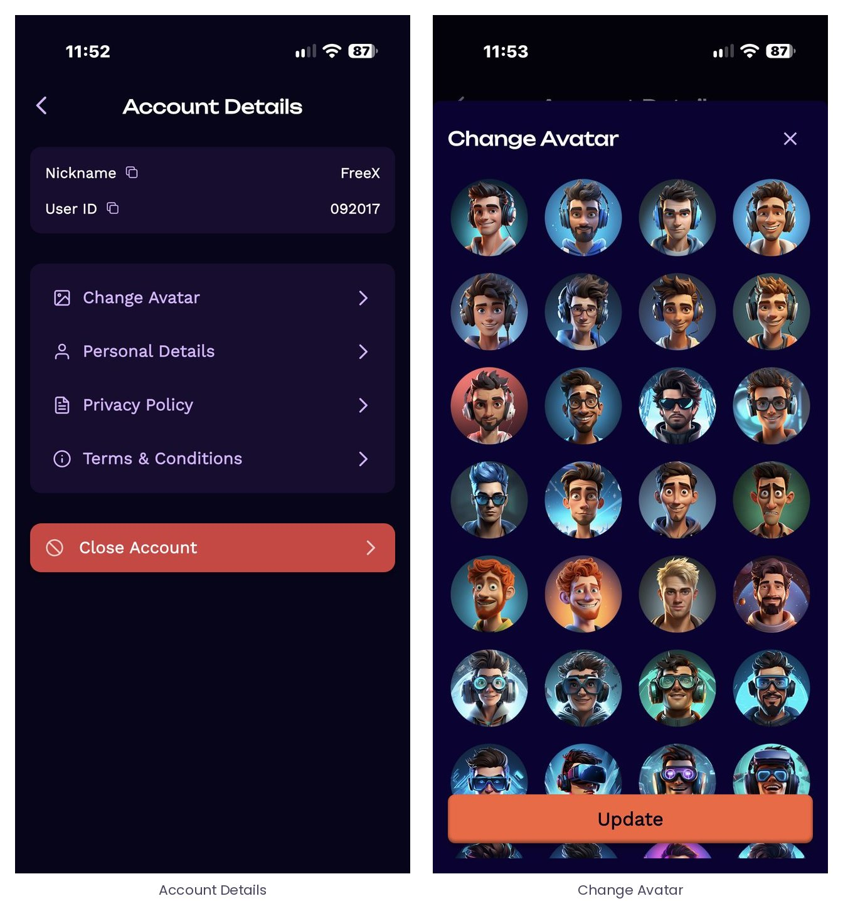
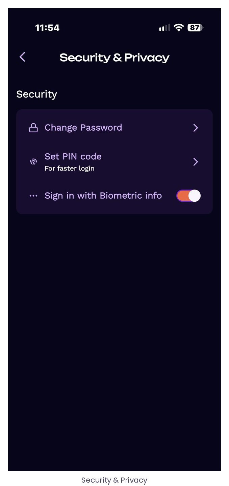
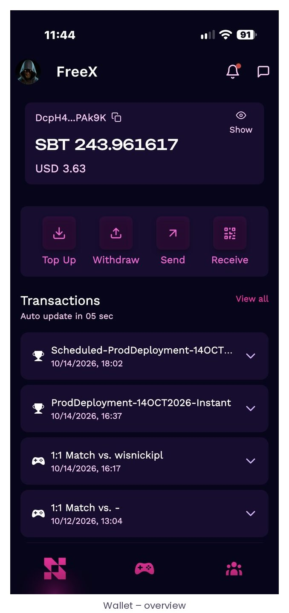

# 2 · Getting started

## 2.1 Installing the app

The Sbarter app is distributed on the Apple App Store and on Google Play, and is listed country by country as legal availability is confirmed. For players who reach Sbarter from inside a game, the entry link opens the app directly when it is installed and otherwise lands on a landing page carrying the download options for the player’s platform – store listing or, where the stores are not yet open in that country, a direct download – with the original destination preserved, so that the first open lands exactly where the tap in the game pointed (see [11.3](./11-how-the-game-and-the-app-work-together.md#113-entry-points-into-sbarter)).

## 2.2 Creating an account

Registration is designed to take one tap. The player can sign in with a Google, Discord or Apple account, or register with an e-mail address or a mobile number and a password. The Terms of Service and the Privacy Policy are accepted at this point; the language selector sits in the top-right corner of the screen.

*Figure 2 – Registration. One-tap sign-in with Google, Discord or Apple, or e-mail / mobile and password. The Sbarter Wallet is created automatically with the account – no seed phrase and no crypto knowledge are required.*

When the player arrives from a game through a linking link generated by the VGP, registration flows straight into linking: as soon as the player is signed in, the two accounts are bound and the app shows “Game connected” with the game account’s display name; the game nickname is shown next to the Sbarter ID, and results on that title are attributed from the very first contest without copying any identifier (see [2.7](#27-the-game-library-and-linking-a-game-account) and [11.2](./11-how-the-game-and-the-app-work-together.md#112-account-linking)).

## 2.3 Country and eligibility

At registration the app determines the player’s location and assigns a country to the account. The country governs what the player can do:

- In a **supported country** – one for which the country-level legal check is complete – the player can top up the wallet, create and accept challenges, register for tournaments and join Play & Compare contests.
- In a **country not yet supported**, the player can install the app, register, browse contests, leaderboards and profiles, and chat, but cannot top up or enter any contest. These features are disabled, not hidden, so that the player understands why.
- Players must be **18 or older**. Age is confirmed at identity verification ([2.4](#24-identity-verification--once-at-the-first-entry)).

The list of supported countries is maintained by Sbarter and extended as legal checks are completed; for an integrated title, the launch markets are agreed with the VGP and the relevant store listings opened accordingly.

## 2.4 Identity verification – once, at the first entry

Verification is deliberately placed at the entry to real-stakes play and nowhere else: a curious player can explore the whole app before being asked for anything. The first time the player attempts to top up the wallet or to enter a contest, the app opens the verification flow of Sumsub, the integrated identity provider. The same single verification covers both funding and contest access. Once completed, the player’s wallet receives an on-chain eligibility attestation – a non-transferable credential that lets the smart contracts enforce “verified, adult, in a supported country” without any personal data being stored on-chain.


Nothing from this step. Identity documents, biometric data and verification outcomes at individual level never leave Sbarter and its identity provider.


## 2.5 Sbarter ID, nickname and avatar

Every account has a nickname, chosen by the player and shown throughout the app, and a Sbarter ID – a short public identifier used to find players, send SBT and link profiles. Both are visible under Account Details, where the player can also change the avatar from a gallery, edit personal details, and read the Privacy Policy and the Terms & Conditions.

*Figure 3 – Account Details: nickname and Sbarter ID (both copyable), avatar gallery, personal details, legal documents and account closure.*

## 2.6 Sign-in security

Under Security & Privacy the player can change the password, set a PIN code for faster login and enable biometric sign-in. A persistent session with biometric re-authentication is what makes every later tap from the game land directly on target rather than on a login screen.

*Figure 4 – Security & Privacy: password, PIN code and biometric sign-in.*

## 2.7 The Game Library and linking a game account

The Game Library lists every title available on Sbarter (“All Games”) and the titles the player has linked (“My Games”). A linked title carries a link badge on its tile. The library is reached from Settings, from the “Add Game” tile on the profile and from the first step of challenge creation.

*Figure 5 – The Game Library and the Games section of the profile. A title must be linked before the player can compete on it.*

To compete on a title, the player’s game account must be linked to the Sbarter account, so that the result transmitted by the game can be attributed to the right player. There are two ways for this to happen:

- **From the game.** The player taps a single-use linking link issued by the VGP for their authenticated game account; after signing in or registering, the accounts are bound at once and the app shows “Game connected” with the game account’s display name. The game nickname then appears next to the Sbarter ID on the profile. This is the standard path for an integrated title ([11.2](./11-how-the-game-and-the-app-work-together.md#112-account-linking), Journey A).
- **From the app.** A player already on Sbarter who taps Join, Create or Accept on a title not yet linked is asked to confirm the link inside the game: the player types their game account identifier, Sbarter requests the confirmation from the VGP, the game shows it to the authenticated player, and the decision comes back to Sbarter, which tells the player by push notification ([11.2](./11-how-the-game-and-the-app-work-together.md#112-account-linking), Journey B).

The binding is one-to-one: a game account already linked to another Sbarter account, or a Sbarter account already linked to another account on the same title, cannot be linked again until that title is removed from the other account’s Game Library. For titles connected through their public API, the player links the account manually from “Add Game” by entering the game username.
