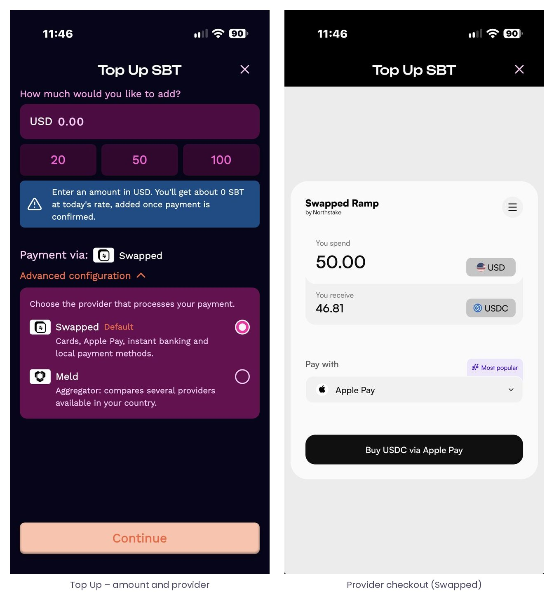
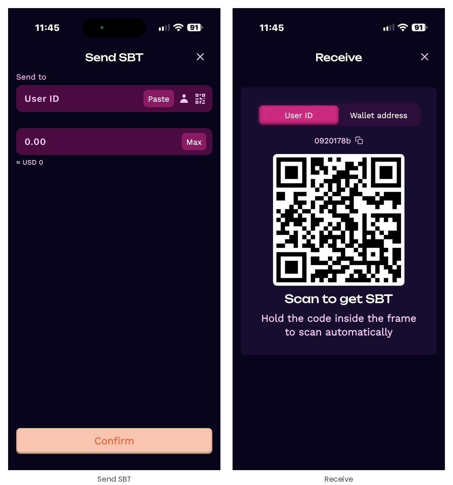
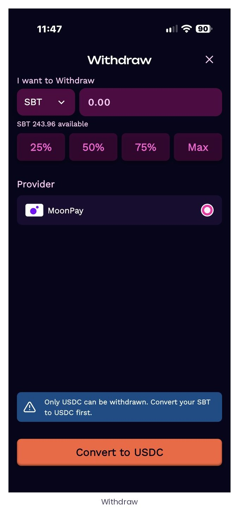
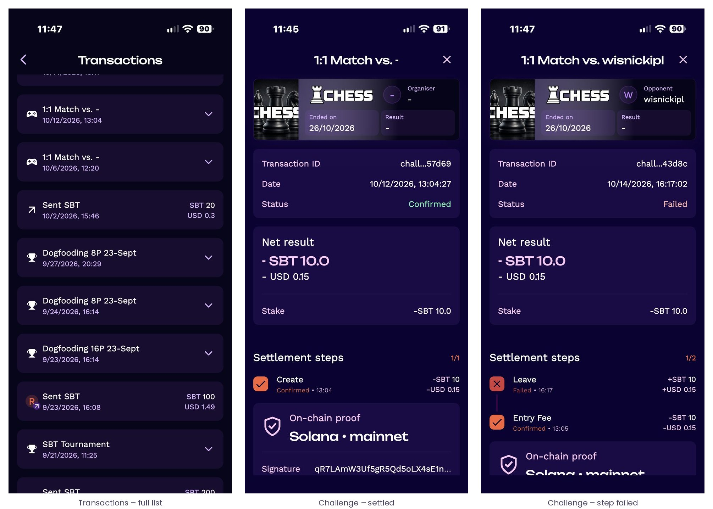

# 3 · The Arena: finding and following contests

The Arena is the central tab. It has two views – Browse and Lobby – and a filter panel. Browse is the public listing of everything the player can enter; Lobby is the player’s own space, holding the challenges they created and the contests they have entered.

## 3.1 Browse and Lobby

*Figure 6 – Browse lists the player’s own open challenges (“Created by me”) and the open challenges and tournaments of other players and organisers; Lobby holds the contests the player has entered, with a badge showing how many need attention.*

| View | What it shows |
| --- | --- |
| Browse | “Created by me”: the challenges the player has published and that are waiting for an opponent, with the count against the maximum number of simultaneous open challenges. “Open challenges”: challenges published by other players. Tournaments open for registration, with their status. |
| Lobby | Every contest the player is part of: accepted challenges awaiting the session, tournaments the player is registered for (with the countdown to the start), running tournaments. The Lobby badge counts the items that require the player’s attention. |
| Filter | Narrow Browse by format (challenges / tournaments), game, friends, stake range and reward-pool range ([3.3](#33-filters)). |

## 3.2 Anatomy of a contest card

Cards use one template across formats, so that a player who has read one card can read them all. The tournament card below is the richest example.

*Figure 7 – A tournament card in Browse. Top: format badge, name, registered participants and avatars, link to the participant list. Centre: game and status. Stat boxes: start time, expected duration, game mode, entry fee and reward pool – each with an information icon. Bottom: countdown and the action row.*

| Card element | Meaning |
| --- | --- |
| Format badge | “Challenge” for 1v1, “Tournament” for brackets, “Play & Compare” for score-based contests. |
| Participants | Registered players against the field size (e.g. 12/16) with their avatars; tap to open the list. |
| Status | “Filling” while registration is open; then “Preparing”, “In Play”, “Finished”. |
| Start at / duration | Scheduled start and expected duration of the whole event. |
| Game mode | The ruleset defined by the VGP for the contest – which mode is played, what counts as a result, timeouts. The information icon opens the rules. |
| Entry fee / stake | What the player commits at entry, in SBT with the indicative fiat value. |
| Reward pool (“Prize Pool” / “Potential win”) | What the winner – or the ranked winners – receive at settlement. |
| Action row | Join / Accept / Details / Share; once entered, a leave control appears on the left. |

## 3.3 Filters

*Figure 8 – Filters: format, game, friends, stake range and reward-pool range.*

## 3.4 Season leaderboards

Titles with an active season carry a leaderboard button on their cards, showing the current season pool. The season leaderboard is a web module – also embeddable inside the game – that shows the season name and dates, the countdown, the season cup pool with its sponsored minimum and progress towards it, and the ranked list of players with contests won and season points. The player can switch between the current and past seasons and search for a player.

*Figure 9 – The season leaderboard. The season cup minimum is funded by the organiser of the season and renewed each season.*
