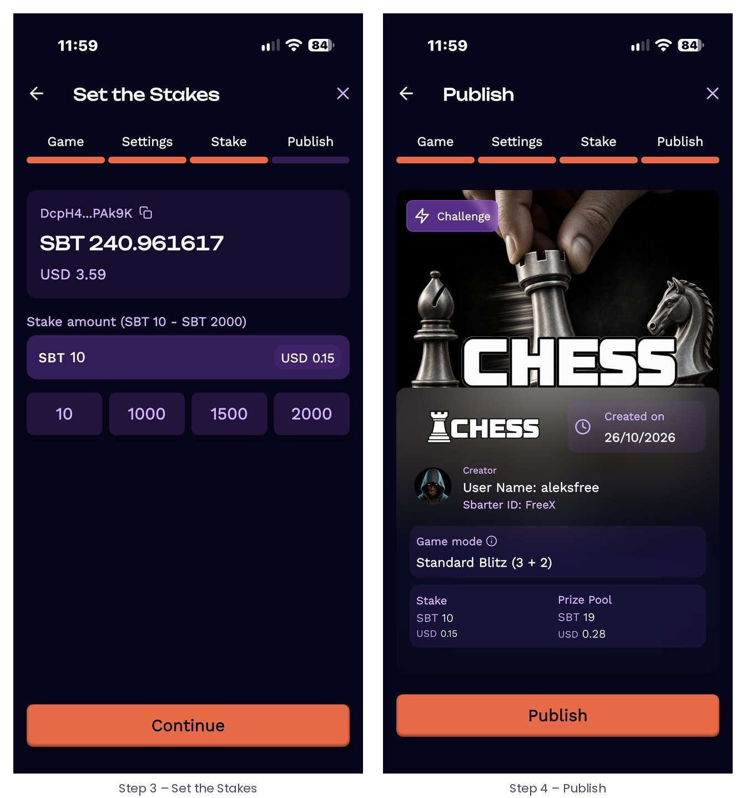
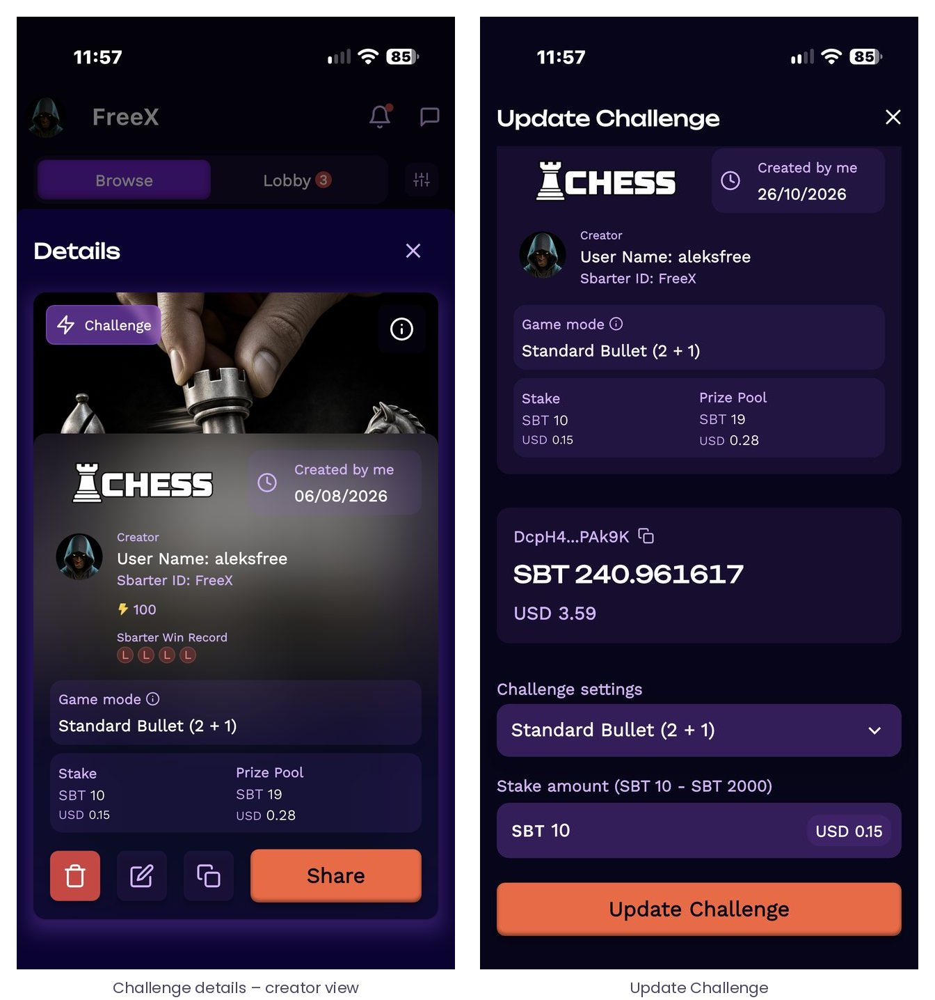
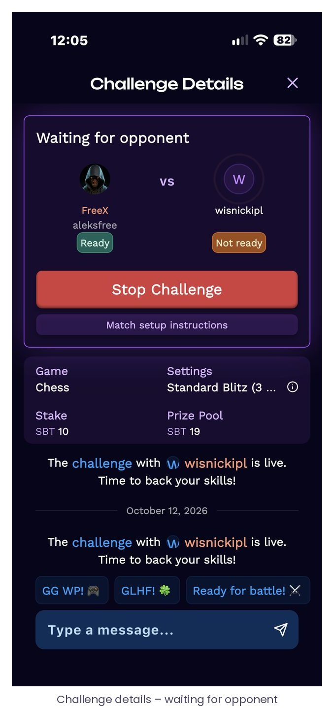
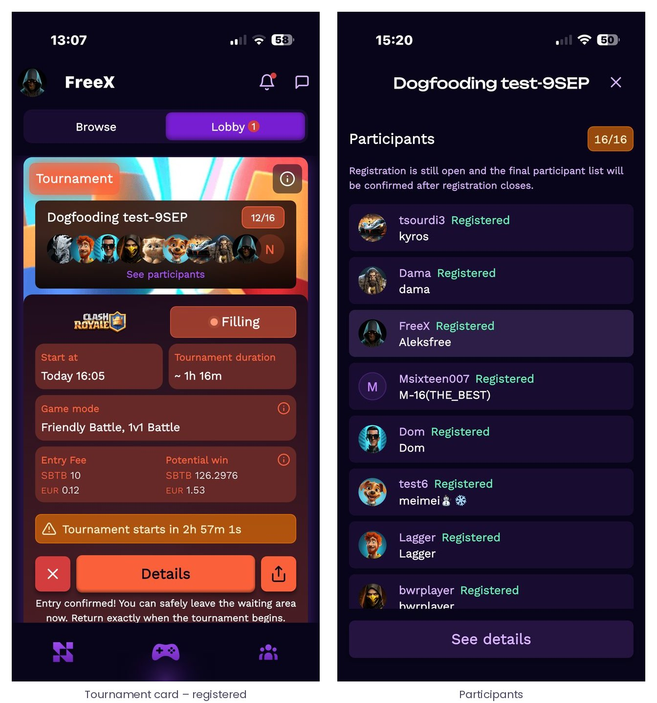
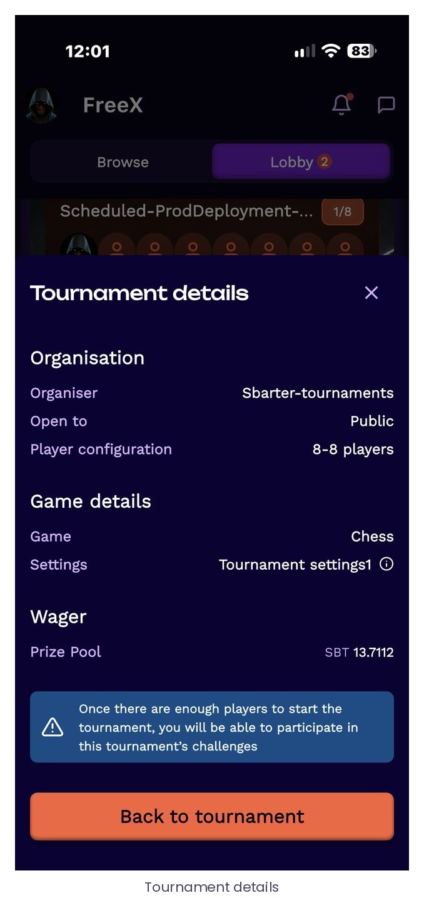
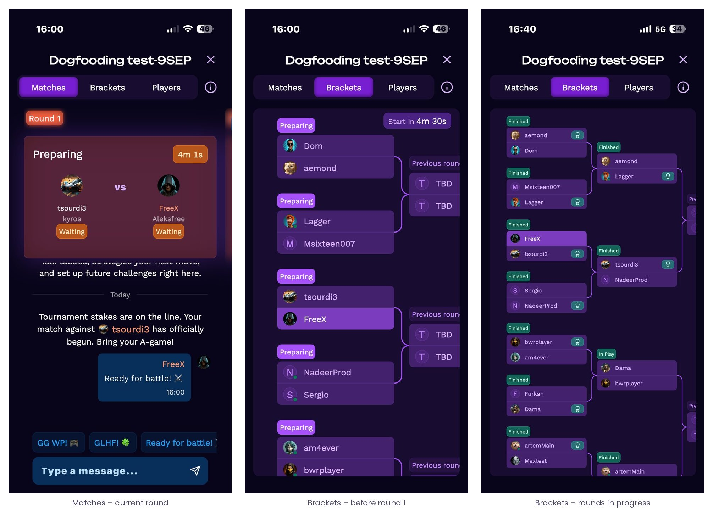

# 7 · The Sbarter Wallet

The Wallet is the first tab of the app. It is a non-custodial wallet on Solana, created automatically with the account and secured through embedded wallet infrastructure. It holds SBT – the token in which every stake, entry fee and reward is denominated – and shows, next to every amount, an indicative value in the display currency chosen in App Settings (USD in the screens of this manual).

## 7.1 Overview

*Figure 18 – The Wallet tab: wallet address (copyable), SBT balance with its indicative fiat value, the four actions, and the transaction list that refreshes automatically every few seconds.*

| Element | Description |
| --- | --- |
| Wallet address | The player’s public Solana address, abbreviated with a copy button. “Show” reveals or hides the balance. |
| Balance | SBT balance, with the indicative fiat equivalent at the current rate. |
| Top Up | Fund the wallet in local currency through an integrated provider ([7.2](#72-topping-up)). |
| Withdraw | Convert SBT to USDC and withdraw through an integrated off-ramp provider ([7.4](#74-withdrawing)). |
| Send / Receive | Transfer SBT to another Sbarter player by Sbarter ID or wallet address, or receive SBT by sharing an ID or a QR code ([7.3](#73-sending-and-receiving-sbt)). |
| Transactions | Every contest entry, settlement, transfer and top-up, each with its settlement steps and on-chain proof ([7.5](#75-transactions-and-on-chain-proof)). |

## 7.2 Topping up

The player enters the amount to add in the display currency – quick amounts are offered – and the app shows how much SBT this represents at the current rate, to be credited once the payment is confirmed. The payment is processed by an integrated on-ramp provider. The providers available depend on the player’s country: the provider offered by default for that country is pre-selected, and under “Advanced configuration” the player can choose among the other providers available there – covering cards, instant banking, mobile wallets and local payment methods.

*Figure 19 – Top-up. The provider sells USDC for the amount paid; the USDC is then swapped automatically into SBT in the player’s wallet. The player only ever sees “add USD 50, receive about X SBT”.*


The purchase is a transaction between the player and the provider. Sbarter does not sell SBT, does not operate an exchange, does not take a share of the provider’s fees and never touches the fiat. The USDC bought by the provider is swapped into SBT within the player’s own wallet against a liquidity pool on a decentralised exchange.


## 7.3 Sending and receiving SBT

Players can transfer SBT between Sbarter wallets. “Send” takes a recipient – pasted, picked from contacts or scanned from a QR code – and an amount; “Receive” shows the player’s own Sbarter ID or wallet address as text and as a QR code.

*Figure 20 – Send and Receive. Transfers are on-chain transactions between two non-custodial wallets.*

## 7.4 Withdrawing

Withdrawals are made in USDC: the player first converts the desired amount of SBT into USDC inside the wallet (“Convert to USDC”), then withdraws the USDC through the integrated off-ramp provider available in their country, which pays out to the player in fiat under its own terms. As for top-ups, Sbarter is not a party to the off-ramp transaction.

*Figure 21 – Withdraw: choose the amount of SBT (25 % / 50 % / 75 % / Max), convert to USDC, then withdraw through the provider.*

## 7.5 Transactions and on-chain proof

The transaction list shows every movement of the wallet: challenge stakes and settlements, tournament entry fees and rewards, Play & Compare entries, transfers and top-ups. Opening an entry shows the contest it relates to, the transaction identifier, the date and the status, the net result for the player, the stake or entry fee, the settlement steps executed by the smart contract, and the on-chain proof – the signature of the transaction on Solana mainnet, which anyone can verify on a public explorer.

*Figure 22 – Transaction history and detail. Each settlement step (“Create”, “Entry Fee”, “Leave”…) is an on-chain instruction with its own status; a failed step is shown as such and the amount concerned stays where it was.*

Because every step is an on-chain instruction, the detail screen is also the player’s audit trail: it shows exactly when a stake was escrowed, when a reward was released, and – should a step not complete – which one, with the corresponding amount unaffected.

## 7.6 Wallet settings and export

Wallet Settings offers two options. “Standard mode” keeps the wallet in the simplified in-app experience. “Export wallet” opens the wallet management page, where the player can export the seed phrase of the wallet after re-authenticating. This is what makes the wallet non-custodial in practice: the player can take the keys and use the same wallet in any Solana wallet application, independently of Sbarter.

*Figure 23 – Wallet Settings and the export page: wallet status, authentication status and seed-phrase export.*


Sbarter cannot recover a seed phrase and cannot move funds on a player’s behalf. Support can help with the app, with providers and with the contest lifecycle; it cannot access the wallet.

