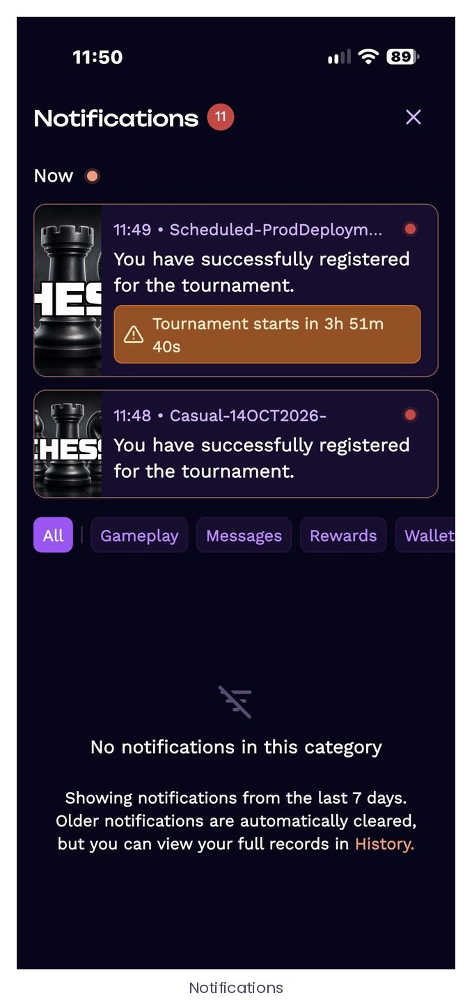
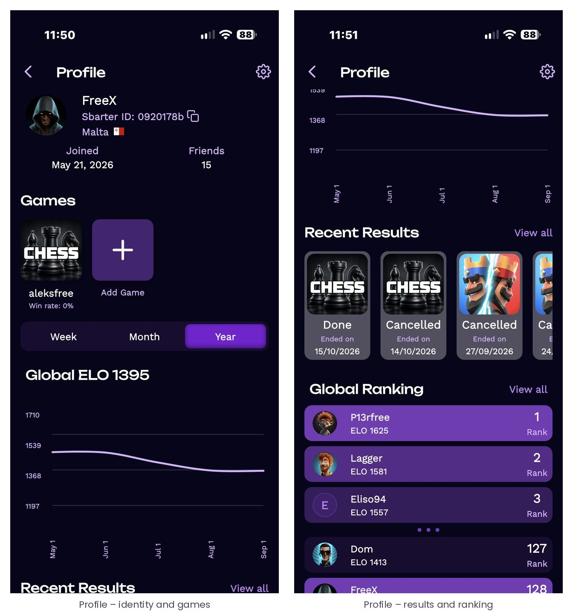

# 9 · Profile and statistics

## 9.1 The player profile

The profile is reached from the avatar in the header. It brings together the player’s identity on Sbarter – avatar, nickname, Sbarter ID, country, date joined, number of friends – the linked titles with their win rate, the global ELO with its evolution over the week, month or year, the recent results across titles with their state, and the global ranking among Sbarter players with the player’s own position.

*Figure 26 – The player profile. Each title tile opens the game profile ([9.2](#92-game-profile-statistics-and-rankings)); “View all” opens the full results history and the full ranking.*

Other players’ profiles are reachable from every place a nickname appears – contest cards, participant lists, leaderboards, chats – and show the same public elements: nickname, Sbarter ID, linked titles, win record and ratings. Personal details are never public.

## 9.2 Game profile, statistics and rankings

Each linked title has its own profile page: the game account and the Sbarter ID side by side, the player’s recent results against Sbarter opponents, the win rate, the ELO rating for that title with its evolution over the week, month or year, and the ranking among Sbarter players on that title, with the player’s own row highlighted. “Sync Game Stats” refreshes the statistics from the game; “Your Leaderboard” jumps to the player’s position in the ranking.

*Figure 27 – Game profile: linked account, recent results, title ELO and ranking.*

Rankings are per title and are driven only by contests settled on Sbarter. They allow the VGP to configure skill brackets – contests reserved to players within a rating band – so that newcomers are not systematically paired with the strongest players (see [5.1](./05-tournaments.md#51-format-and-configuration)).
