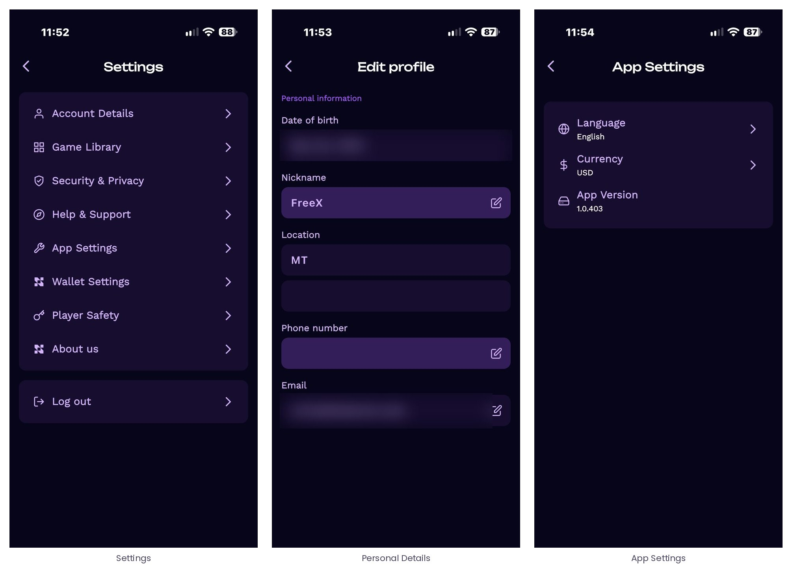
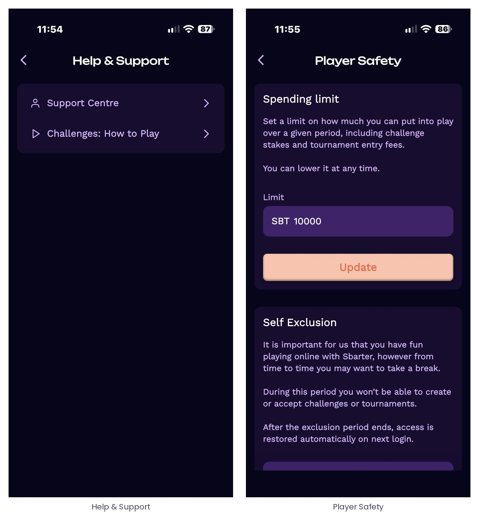

# 10 · Settings and player safety

## 10.1 The Settings menu

*Figure 28 – Settings. Personal details (date of birth, nickname, location, phone, e-mail) are editable by the player; App Settings hold the language, the display currency and the app version.*

| Entry | Content |
| --- | --- |
| Account Details | Nickname, User ID, avatar, personal details, Privacy Policy, Terms & Conditions, Close Account ([2.5](./02-getting-started.md#25-sbarter-id-nickname-and-avatar)). |
| Game Library | Linked and available titles ([2.7](./02-getting-started.md#27-the-game-library-and-linking-a-game-account)). |
| Security & Privacy | Password, PIN code, biometric sign-in ([2.6](./02-getting-started.md#26-sign-in-security)). |
| Help & Support | Support Centre and the “How to Play” guide for challenges ([10.2](#102-help--support)). |
| App Settings | Language, display currency (used for every indicative fiat value in the app), app version. |
| Wallet Settings | Standard mode and wallet export ([7.6](./07-the-sbarter-wallet.md#76-wallet-settings-and-export)). |
| Player Safety | Spending limit and self-exclusion ([10.3](#103-player-safety)). |
| About us | Information on Sbarter. |

## 10.2 Help & Support

*Figure 29 – Help & Support and Player Safety.*

The Support Centre handles everything related to the Sbarter app – account, wallet, providers, contest lifecycle – and the “How to Play” guide walks a new player through a challenge.

## 10.3 Player Safety

Two tools let a player set their own boundaries, in line with Sbarter’s view that stakes should mean something and never become a problem.

- **Spending limit.** A cap on how much the player can put into play over a given period, including challenge stakes and tournament entry fees. The limit can be lowered at any time.
- **Self-exclusion.** The player can suspend their own access to competition for a chosen period. During the exclusion the player cannot create or accept challenges or register for tournaments; access is restored automatically at the first login after the period ends.

## 10.4 Closing an account

An account can be closed from Account Details. Before closing, the player should withdraw or transfer the SBT held in the wallet, or export the wallet ([7.6](./07-the-sbarter-wallet.md#76-wallet-settings-and-export)): closing the Sbarter account does not transfer the keys to anyone, and Sbarter cannot recover them afterwards.
