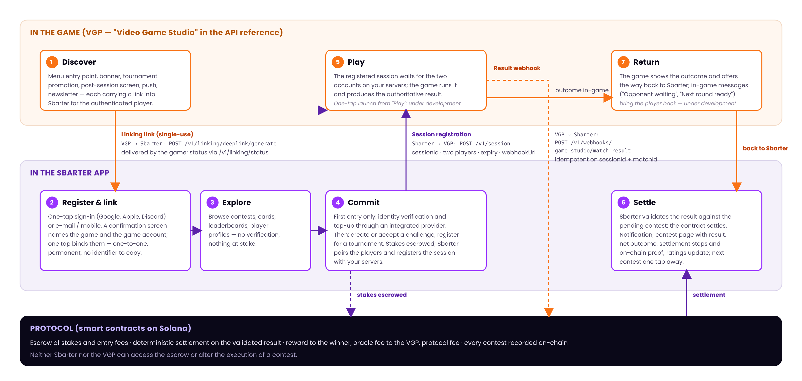
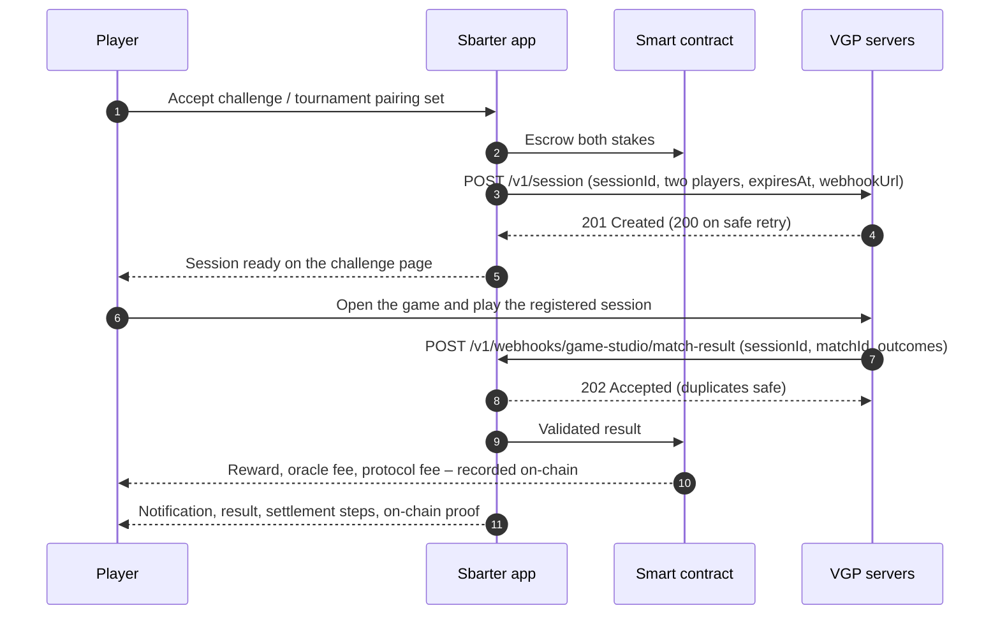

# 11 · How the game and the app work together

This chapter takes the cycle a player travels between the game and the Sbarter app and shows, for each handoff, what the player sees, what the VGP’s systems do and what the protocol does. The authoritative technical specification – request and response schemas, authentication, environments – is the Sbarter developer portal; this chapter follows its structure and uses its operation names, so that product, marketing and support teams can read the same story engineering implements.


**Sbarter API** – hosted by Sbarter at `partners.<env>.sbarter.com/<slug>`, called by the VGP’s backend: account-linking operations, the challenge-creation link, lookups of the VGP’s games and challenges, and the result webhook. Authenticated with OAuth 2.0 client credentials issued in the Sbarter Studio Web Portal.

**Game Studio API** – hosted by the VGP, called by Sbarter: in-game linking confirmation, game-session registration and challenge notifications. Authenticated with an API key issued by the VGP and entered in the Studio Web Portal. Until the VGP’s API is live, a Sbarter sandbox plays the VGP’s side.


## 11.1 The full loop

*Figure 30 – The full loop. Three interfaces close the circuit: the linking link into Sbarter, the session registration from Sbarter to the VGP’s servers, and the result webhook from the VGP’s servers to Sbarter. Everything between them is handled by the app and the smart contracts.*

Two properties of the loop deserve attention. First, friction is zero until the moment of competitive commitment: discovery, registration, linking and exploration ask nothing of the player; verification and funding sit at the first entry and nowhere else. Second, every message that decides an outcome runs server-to-server between the VGP’s backend and Sbarter: the result is produced by the game servers, never by the player, and neither Sbarter nor the VGP can alter it once accepted.

## 11.2 Account linking

Linking associates a player’s Sbarter account with their authenticated game account, so that Sbarter can identify the two participants of a session and attribute the VGP’s result to the right entries. The binding is one-to-one: a game account belongs to one Sbarter player at a time, and becomes free again only when that player removes the title from their Game Library. Two journeys exist.

### Journey A – the player starts in the game

1. The VGP’s backend calls `POST /v1/linking/deeplink/generate` with the player’s account identifier in its system (`providerUserId`) and receives a **single-use linking link**, which the game delivers through any surface – menu, banner, post-session screen, push, in-game message, e-mail.
2. The player taps it. If the app is installed it opens with the game context; otherwise a Sbarter page showing the title and its studio leads to the store, and the app picks the link up on its first start after installation. The link is valid for at most 15 minutes.
3. The player signs in, or registers ([2.2](./02-getting-started.md#22-creating-an-account)). Sbarter determines whether the account is new, registered but unbound, or already bound to the same game identity.
4. As soon as the player is signed in, the app redeems the link – there is no separate confirmation step. The player sees **Game connected** with the game account’s display name, the game name and its icon; Sbarter records the binding, and the title appears in the player’s Game Library ([2.7](./02-getting-started.md#27-the-game-library-and-linking-a-game-account)) with the game nickname shown next to the Sbarter ID.
5. The player lands on the challenge or tournament the link pointed to, if any, and continues into entry – eligibility, skill cap where configured, funds.

The VGP’s backend can check the outcome at any time with `POST /v1/linking/status`, naturally when the game regains focus. Redeeming the link does not by itself trigger a callback to the VGP. A refused link – expired, already used, or for a game account linked to someone else meanwhile – stays unused and nothing is linked.

### Journey B – the player starts in the Sbarter app

1. A registered player adds the title in the app – from the Game Library, or by tapping Join, Create or Accept on a title not yet linked – and types their game account identifier. If the account is already bound, nothing else happens; a game account bound to another player is refused before the game is asked.
2. Sbarter calls the VGP’s `POST /v1/sbarter/gamer/validate/in-app`: the game presents the confirmation to the authenticated player and returns the decision – accepted, rejected or expired – to the callback supplied with the request (`POST /v1/linking/in-app/{requestId}`). An acceptance carries the player’s profile snapshot. The request stays open for 15 minutes.
3. Sbarter tells the player the outcome with a push notification; on acceptance the title appears in the Game Library.
4. On success the player returns to the contest, passes the eligibility and funds checks and enters.

| Situation | Behaviour |
| --- | --- |
| Already linked to the same account | Continue; linking is not repeated. |
| Sbarter account linked to a different game account, or game account linked to a different Sbarter account | The new binding is rejected – one-to-one. The game account is free again once the other player removes the title from their Game Library. |
| Guest game account | The player authenticates or upgrades to a full account before linking. |
| Linking link expired or already used | No binding; the player restarts from the game. |
| In-game confirmation not answered within 15 minutes | Expired; the player starts again from the app. |
| Skill rating above the cap of an Entry contest | Shown as ineligible, with alternatives. The rating comes from the profile snapshot the VGP sends when the player confirms the link in the game ([11.4](#114-from-commitment-to-the-game-session)). |
| Insufficient funds | The app offers a top-up before entry ([7.2](./07-the-sbarter-wallet.md#72-topping-up)). |

## 11.3 Entry points into Sbarter

Every surface in the game that promotes competition – a persistent entry point in the main menu, rotating banners, a tournament promotion, the post-session moment on the results screen, push notifications, newsletters and community channels – carries a link into Sbarter. Beyond account linking, a link can carry a destination, so that the player lands where the surface pointed rather than on a generic home screen:

| Destination | What the player lands on |
| --- | --- |
| Browse filtered on the title | The Arena, showing only the challenges and tournaments of the title ([3.1](./03-the-arena-finding-and-following-contests.md#31-browse-and-lobby)). |
| A specific tournament | The tournament card with the join action visible ([5.2](./05-tournaments.md#52-registering)). |
| A specific challenge (private invitation) | The challenge page, ready to accept ([4.4](./04-1v1-challenges.md#44-accepting-a-challenge)). |
| The current season | The season leaderboard of the title ([3.4](./03-the-arena-finding-and-following-contests.md#34-season-leaderboards)), also available as an embeddable web module. |
| A new challenge | Challenge creation, prefilled with the format, the stake and the open duration the player chose in the game; the player confirms it in Sbarter ([4.2](./04-1v1-challenges.md#42-creating-a-challenge)). |

Today the linking link carries a challenge or tournament destination, and a separate link from the VGP’s backend (`POST /v1/challenges/deeplink/generate`) opens challenge creation; the other destinations are agreed per title.

A QR code is the same link on a different screen: printed, shown on a stream or displayed on a desktop version of the game. Links carry an attribution so that conversion can be measured per surface and campaign.

## 11.4 From commitment to the game session

When two linked players are committed – a challenge accepted and confirmed, or a tournament pairing set – and both stakes are in escrow, Sbarter registers the session with the VGP’s servers: `POST /v1/session` on the Game Studio API, carrying the game identifier, the challenge identifier, the canonical Sbarter `sessionId`, the two players, an expiry time, the `webhookUrl` to which the result must be reported, and optional rules. The call is idempotent on `sessionId`: a retry with the same payload must not create a second session.

What the player sees: the challenge page or the tournament pairing shows the session as ready, with both players’ readiness and the time window ([4.5](./04-1v1-challenges.md#45-playing-the-session), [5.4](./05-tournaments.md#54-when-the-tournament-starts)). “Play” in Sbarter lands the player directly in the provisioned session in the game, with the first player waiting for the second; how the game presents the session – a pending contest in a dedicated section, a lobby, an invitation – is the VGP’s design, and the launch mechanism is agreed at integration.

The **player profile snapshot** – display name, capture time and optional game statistics – reaches Sbarter with the VGP’s acceptance of an in-game link confirmation (Journey B); the separate `POST /v1/sbarter/gamer/profile` operation is published but not called in the current flow. The snapshot is what populates the game profile and “Sync Game Stats” ([9.2](./09-profile-and-statistics.md#92-game-profile-statistics-and-rankings)), and what supplies the rating used for Entry contests with a skill cap.

*From commitment to settlement: the three interfaces in sequence.*

## 11.5 Results: the webhook as the player sees it

When the session is over, the VGP’s servers post the authoritative result to the `webhookUrl` supplied at registration (`POST /v1/webhooks/game-studio/match-result` on the Sbarter API): the game identifier, the `sessionId`, the VGP’s own `matchId`, a status – win, draw, failed or voided – and the two players with their outcome, plus start and end timestamps where available. Requests carry an OAuth bearer token with the `webhook.write` grant; Sbarter answers 202, including for safe duplicate deliveries, and treats `sessionId` + `matchId` as the identity of a logical result, so that a retry never produces a second settlement. A result for an unknown session is answered 404, and a win reported without the player’s Sbarter identifier is refused.

On the player’s side the submission is invisible and its effect immediate: Sbarter validates that the identities, the session and the timing match the pending contest, the smart contract settles, the player is notified, the contest page shows the result, the transaction detail shows the net outcome, the settlement steps and the on-chain proof ([7.5](./07-the-sbarter-wallet.md#75-transactions-and-on-chain-proof)), and ratings and rankings update. In the ordinary path nothing is claimed, confirmed or disputed by the player.

## 11.6 When no result arrives

If no trusted result reaches Sbarter within the completion window, the contest is resolved by rule rather than by judgement, on the basis of the presence evidence supplied by the VGP’s servers – whether each player was logged in during the window:

| Evidence from the game servers | 1v1 challenge | Tournament pairing |
| --- | --- | --- |
| Exactly one player was present | The present player wins by forfeit. | The present player advances by forfeit. |
| Neither player was present | Void; both stakes returned. | Void; both eliminated; the next-round opponent may receive a bye. |
| Both players were present | Void; both stakes returned. No player reporting in 1v1. | Both players are asked, in the app, to report the outcome within a short window – “I won”, “I lost”, “My opponent didn’t show”. Consistent reports settle the pairing; conflicting or missing reports void it. |
| No trustworthy evidence | Handled under the operational policy agreed with the VGP – never a silent default. | Handled under the operational policy agreed with the VGP – never a silent default. |

## 11.7 What is specific to each format

| Format | Session registration | Result | Notes |
| --- | --- | --- | --- |
| 1v1 challenge | One two-player session per contest, after acceptance and confirmation. | One result for the session. | The ruleset – mode, completion window, what counts as a result – is configured in Sbarter; the game plays it. |
| Tournament | One two-player session per pairing, round by round; bracket and advancement live in Sbarter. | One result per pairing. | The session carries no tournament or round identifiers; Sbarter correlates each session with its bracket. Between rounds the player returns to the tournament page in the app. |
| Play & Compare | Score-based, all-vs-all: one instance, many players, a seed per instance; specified in its own contract. | One best result per player, in the result set at close; live updates of best results under Rebuy and Time Trial. | Seed provisioning, the single-result guarantee and result delivery at the end time are the three obligations specific to the format. |

## 11.8 Messages inside the game

Sbarter remains the system of record for eligibility, stakes, brackets and settlement; the game relays the moments that bring the player back, each with a link to the right screen. For challenges, Sbarter notifies the VGP’s servers of each moment – creation, invitation, acceptance, a player waiting for the opponent, completion – and the game decides how to show it. Tournament and reporting messages are agreed per title.

| Moment | Message | Destination |
| --- | --- | --- |
| Private invitation | “You have been challenged” | The challenge in Sbarter |
| Challenge accepted | “Opponent waiting” | The challenge page |
| Both stakes locked, session registered | “Play” | The session in the game |
| Bracket ready / next round ready | “Go to your pairing” | The assigned session |
| Missing tournament result, both present | “Report your result” | The reporting screen in Sbarter ([11.6](#116-when-no-result-arrives)) |
