# The Sbarter App – User Manual

**Draft v0.2 · 26 October 2026 · Confidential – for VGP partners.** Based on Sbarter app version 1.0.403 (iOS) and on the developer portal as published in October 2026.

This manual describes the Sbarter app as a player experiences it, screen by screen, and shows how the app and an integrated game work together across the life of a contest. It is written for Video Game Providers – management, product, marketing, support and engineering teams – who need to understand what their players will see and do once their title is live on Sbarter.

| Part | Chapters |
| --- | --- |
| Orientation | 0 · About this manual — 1 · Sbarter in brief — 2 · Getting started |
| The app | 3 · The Sbarter Wallet — 4 · Games and game accounts — 5 · The Arena |
| Competition formats | 6 · 1v1 challenges — 7 · Tournaments — 8 · Play & Compare |
| Around the contest | 9 · Community — 10 · Profile and statistics — 11 · Settings and player safety |
| For the VGP | 12 · How the game and the app work together |
| Appendices | A · Contest states — B · Glossary — C · Screens still to capture |

# 0 · About this manual

This manual describes the Sbarter app as a player experiences it, screen by screen, and shows how the app and an integrated game work together across the life of a contest. It is written for Video Game Providers (VGPs) – management, product, marketing, support and engineering teams – who need to understand what their players will see and do once their title is live on Sbarter, and what the integration does and does not touch.

It is not a technical reference. The integration itself – outbound and return deeplinks, account binding, the Oracle API and the additional query endpoints – is specified in the Sbarter Integration Documentation and in the API reference; this manual cross-references them and explains the same mechanisms from the player’s side of the screen.

## How to read this document

- **Chapters 1–2** position Sbarter and walk through installation, registration, eligibility and verification.
- **Chapters 3–5** cover the three permanent areas of the app: the Wallet, Games and game accounts, and the Arena where contests are listed and followed.
- **Chapters 6–8** describe the three competition formats – 1v1 challenges, tournaments and Play & Compare – from entry to settlement.
- **Chapters 9–11** cover community features, the player profile, settings and player-safety tools.
- **Chapter 12** is the chapter written specifically for VGPs: the full loop between the game and the app, what each handoff looks like to the player, and what the VGP receives and never receives.
- **The appendices** collect the contest states, the vocabulary and the screens still to be captured.

## Vocabulary

Sbarter uses a deliberate vocabulary, and this manual follows it. Where an in-app label differs from the term used here, the label is quoted in inverted commas so that the reader can find it on screen.

| Term | Meaning |
| --- | --- |
| Contest | The unit of competition settled by the protocol. A 1v1 challenge, each round of a tournament and each Play & Compare instance are contests. |
| Challenge | A 1v1 contest between two players. |
| Event | A tournament, a season or a creator-hosted competition. |
| Stake / entry fee | What a player commits to enter a contest. “Stake” is used for challenges, “entry fee” for tournaments and Play & Compare. Both are escrowed by the smart contract at entry. |
| Reward / reward pool | What the winner – or the ranked winners – receive at settlement. Shown in the app as “Prize Pool”. |
| Oracle fee | What the VGP earns on every result it verifies through the Oracle API. |
| Protocol fee | A fixed amount in SBT per contest, charged by the smart contract at settlement. |
| SBT | The protocol’s token, in which stakes, entry fees, rewards and oracle fees are denominated. The app also shows an indicative value in the player’s display currency. |
| Sbarter Wallet | The non-custodial wallet embedded in the app, created automatically with the account. Keys, tokens and funds remain under the player’s exclusive control. |
| Sbarter ID | The player’s public identifier in the app, used to find players, send SBT and link profiles. |
| VGP | Video Game Provider – the publisher or developer of an integrated title, and the only party that verifies results on that title. |
| Creator Partner Programme | The affiliation programme through which a VGP enrols creators who bring their communities to its title. Outside the perimeter of this manual. |


Draft v0.2, based on app version 1.0.403 (iOS) and on the developer portal as published in October 2026. Screens of Play & Compare, identity verification and the deeplink entry from a game are not yet captured and are described from the product specifications; they are listed in Appendix C. Tournament screens from the September preview still show the preview-period token label (“SBTB”); they will be refreshed on the next capture.


# 1 · Sbarter in brief

Sbarter enables players to run competitive gaming events with real stakes in the games they already play. It is a neutral competitive layer, not a game and not a destination: a player who competes on your title through Sbarter is still your player, playing your game on your servers. Sbarter provides the infrastructure around the session – identity, wallet, contest creation, escrow, settlement, rankings, notifications and support – and nothing else.

## 1.1 Three participants, one protocol

| Participant | What they do in Sbarter |
| --- | --- |
| Players | Challenge each other 1v1, register for tournaments and join Play & Compare contests, with a stake or an entry fee that makes the outcome matter. They prove their skill, back their ability and build a rating. |
| Video Game Providers | Open their title to competition without changing gameplay or economy. The VGP is the sole source of truth for what happens in the game: it verifies every result through the Oracle API and earns the oracle fee on each one. |
| Creators | Bring their communities to a title through the Creator Partner Programme, configured and rewarded by the VGP. Not covered in this manual. |

## 1.2 Principles the app embodies

Four principles shape every screen described in this manual. They are structural – enforced by the smart contracts and by the way the app is built – rather than promises.

- **Skill only.** Player performance inside the game decides every outcome. Sbarter never sets odds, never relies on chance and never profits from a player’s loss: its revenue is a fixed protocol fee per contest, identical whoever wins.
- **Non-custodial.** Stakes and entry fees are escrowed by a smart contract on Solana at entry and released at settlement. Neither Sbarter nor the VGP can access the escrow or intervene in the execution of a contest. Sbarter never holds player funds and never intermediates fiat: funding runs through authorised third-party providers integrated in the app.
- **Neutral.** Sbarter is never the organiser of an event and never the arbiter of a result. Events are organised by VGPs and creators; results come exclusively from the VGP’s servers. There is no manual intervention and no dispute process: what the game reports is what the contract settles.
- **Verified before the first stake.** Browsing is open to everyone; competing requires an identity-verified adult player in a supported country. Verification happens once, at the first entry, and is enforced on-chain through a privacy-preserving eligibility attestation.

## 1.3 The app at a glance

The app is organised around three permanent tabs in the bottom bar, plus a header that is present on every main screen.

| Area | Icon | What it contains |
| --- | --- | --- |
| Wallet | Sbarter mark (left) | Balance, top-up, send, receive, withdraw, transaction history with on-chain proof (chapter 3). |
| Arena | Controller (centre) | Browse open challenges and upcoming tournaments; Lobby for the contests the player has entered or created; filters; season leaderboards (chapters 5–8). |
| Community | People (right) | Chats – tournament lobbies and private channels with opponents – and friends (chapter 9). |
| Header | Avatar · bell · bubble | Avatar and nickname open the Profile (chapter 10); the bell opens Notifications; the bubble opens Chats. Settings are reached from the Profile (chapter 11). |

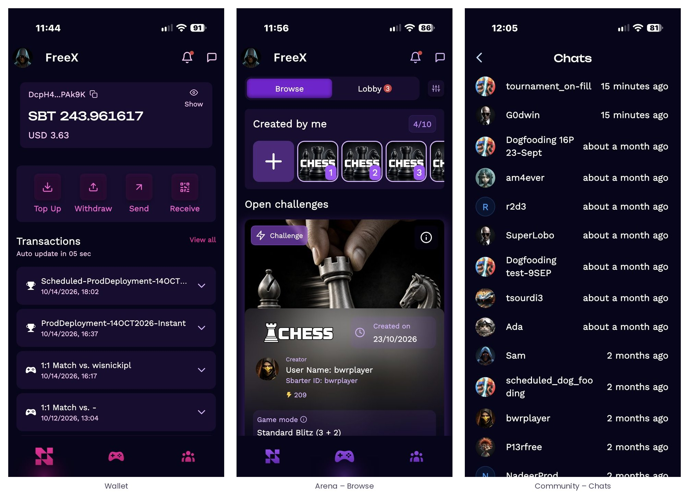

*Figure 1 – The three tabs of the bottom bar. The header (avatar, notifications, chats) is identical on each.*

# 2 · Getting started

## 2.1 Installing the app

The Sbarter app is distributed on the Apple App Store and on Google Play, and is listed country by country as legal availability is confirmed. For players who reach Sbarter from inside a game, the entry link opens the app directly when it is installed and otherwise lands on a landing page carrying the download options for the player’s platform – store listing or, where the stores are not yet open in that country, a direct download – with the original destination preserved, so that the first open lands exactly where the tap in the game pointed (see 12.2).

## 2.2 Creating an account

Registration is designed to take one tap. The player can sign in with a Google, Discord or Apple account, or register with an e-mail address or a mobile number and a password. The Terms of Service and the Privacy Policy are accepted at this point; the language selector sits in the top-right corner of the screen.

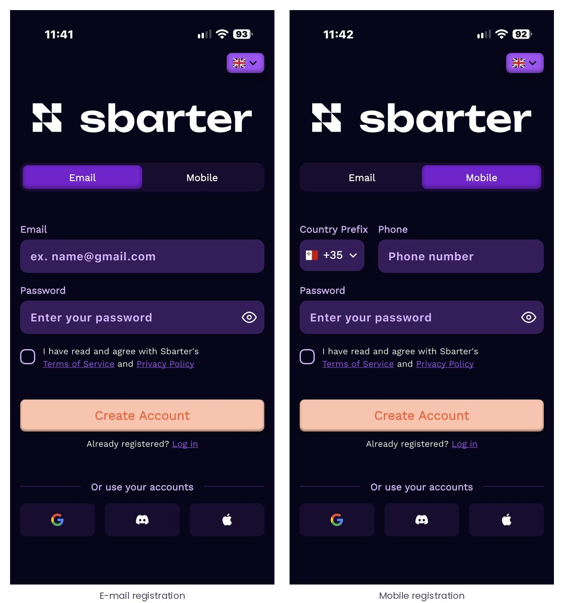

*Figure 2 – Registration. One-tap sign-in with Google, Discord or Apple, or e-mail / mobile and password. The Sbarter Wallet is created automatically with the account – no seed phrase and no crypto knowledge are required.*

When the player arrives from a game through a linking link generated by the VGP, registration flows straight into a confirmation screen naming the game and the game account; once confirmed, the two accounts are bound, the game nickname is shown next to the Sbarter ID, and results on that title are attributed from the very first contest without copying any identifier (see 4.2 and 12.2).

## 2.3 Country and eligibility

At registration the app determines the player’s location and assigns a country to the account. The country governs what the player can do:

- In a **supported country** – one for which the country-level legal check is complete – the player can top up the wallet, create and accept challenges, register for tournaments and join Play & Compare contests.
- In a **country not yet supported**, the player can install the app, register, browse contests, leaderboards and profiles, and chat, but cannot top up or enter any contest. These features are disabled, not hidden, so that the player understands why.
- Players must be **18 or older**. Age is confirmed at identity verification (2.4).

The list of supported countries is maintained by Sbarter and extended as legal checks are completed; for an integrated title, the launch markets are agreed with the VGP and the relevant store listings opened accordingly.

## 2.4 Identity verification – once, at the first entry

Verification is deliberately placed at the entry to real-stakes play and nowhere else: a curious player can explore the whole app before being asked for anything. The first time the player attempts to top up the wallet or to enter a contest, the app opens the verification flow of Sumsub, the integrated identity provider. The same single verification covers both funding and contest access. Once completed, the player’s wallet receives an on-chain eligibility attestation – a non-transferable credential that lets the smart contracts enforce “verified, adult, in a supported country” without any personal data being stored on-chain.


Nothing from this step. Identity documents, biometric data and verification outcomes at individual level never leave Sbarter and its identity provider. The VGP only ever sees statistical and informational data on game activity (12.7).


## 2.5 Sbarter ID, nickname and avatar

Every account has a nickname, chosen by the player and shown throughout the app, and a Sbarter ID – a short public identifier used to find players, send SBT and link profiles. Both are visible under Account Details, where the player can also change the avatar from a gallery, edit personal details, and read the Privacy Policy and the Terms & Conditions.

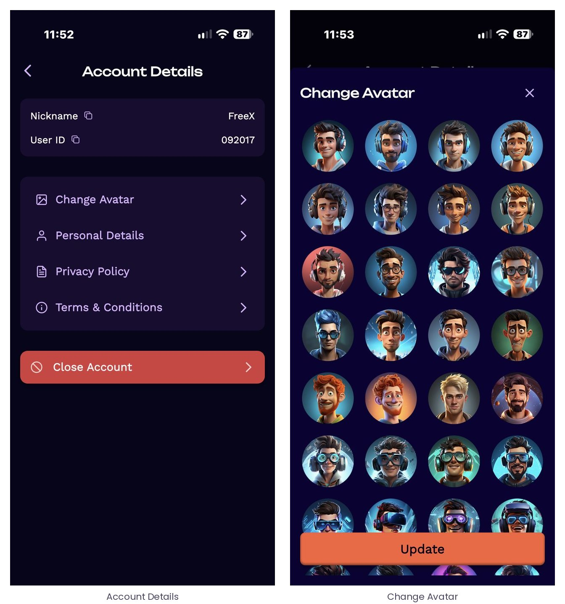

*Figure 3 – Account Details: nickname and Sbarter ID (both copyable), avatar gallery, personal details, legal documents and account closure.*

## 2.6 Sign-in security

Under Security & Privacy the player can change the password, set a PIN code for faster login and enable biometric sign-in. A persistent session with biometric re-authentication is what makes every later tap from the game land directly on target rather than on a login screen.

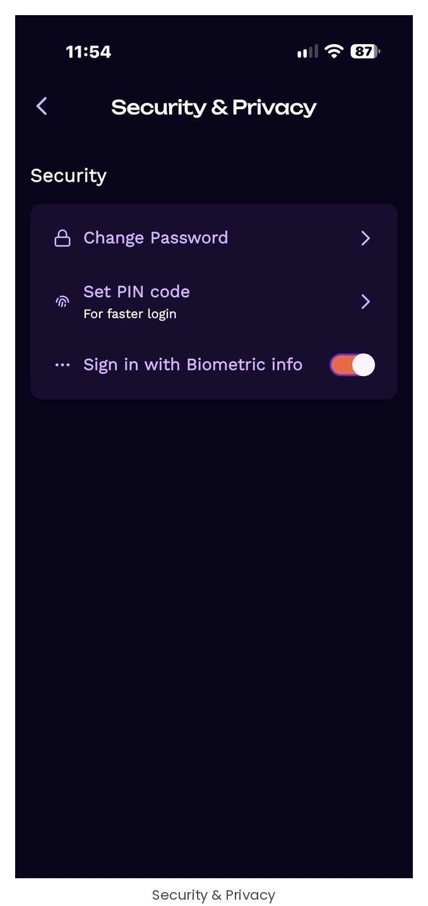

*Figure 4 – Security & Privacy: password, PIN code and biometric sign-in.*

# 3 · The Sbarter Wallet

The Wallet is the first tab of the app. It is a non-custodial wallet on Solana, created automatically with the account and secured through the embedded wallet infrastructure of Privy. It holds SBT – the token in which every stake, entry fee and reward is denominated – and shows, next to every amount, an indicative value in the display currency chosen in App Settings (USD in the screens of this manual).

## 3.1 Overview

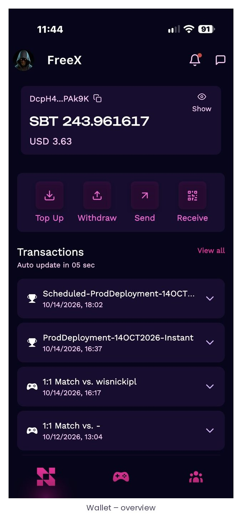

*Figure 5 – The Wallet tab: wallet address (copyable), SBT balance with its indicative fiat value, the four actions, and the transaction list that refreshes automatically every few seconds.*

| Element | Description |
| --- | --- |
| Wallet address | The player’s public Solana address, abbreviated with a copy button. “Show” reveals or hides the balance. |
| Balance | SBT balance, with the indicative fiat equivalent at the current rate. |
| Top Up | Fund the wallet in local currency through an integrated provider (3.2). |
| Withdraw | Convert SBT to USDC and withdraw through an integrated off-ramp provider (3.4). |
| Send / Receive | Transfer SBT to another Sbarter player by Sbarter ID or wallet address, or receive SBT by sharing an ID or a QR code (3.3). |
| Transactions | Every contest entry, settlement, transfer and top-up, each with its settlement steps and on-chain proof (3.5). |

## 3.2 Topping up

The player enters the amount to add in the display currency – quick amounts are offered – and the app shows how much SBT this represents at the current rate, to be credited once the payment is confirmed. The payment is processed by an integrated on-ramp provider: Swapped is the default and supports cards, Apple Pay, instant banking and local payment methods; under “Advanced configuration” the player can select Meld, an aggregator that compares several providers available in the player’s country. The providers offered depend on the player’s country.

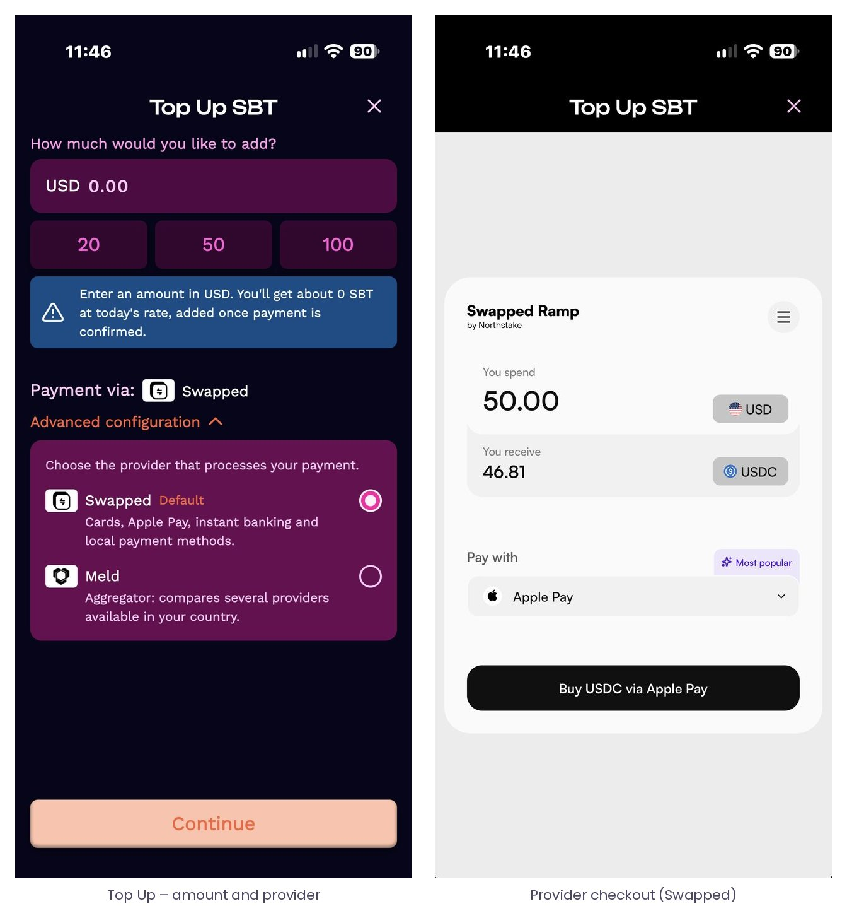

*Figure 6 – Top-up. The provider sells USDC for the amount paid; the USDC is then swapped automatically into SBT in the player’s wallet. The player only ever sees “add USD 50, receive about X SBT”.*


The purchase is a transaction between the player and the provider. Sbarter does not sell SBT, does not operate an exchange, does not take a share of the provider’s fees and never touches the fiat. The USDC bought by the provider is swapped into SBT within the player’s own wallet against a liquidity pool on a decentralised exchange.


## 3.3 Sending and receiving SBT

Players can transfer SBT between Sbarter wallets. “Send” takes a recipient – pasted, picked from contacts or scanned from a QR code – and an amount; “Receive” shows the player’s own Sbarter ID or wallet address as text and as a QR code.

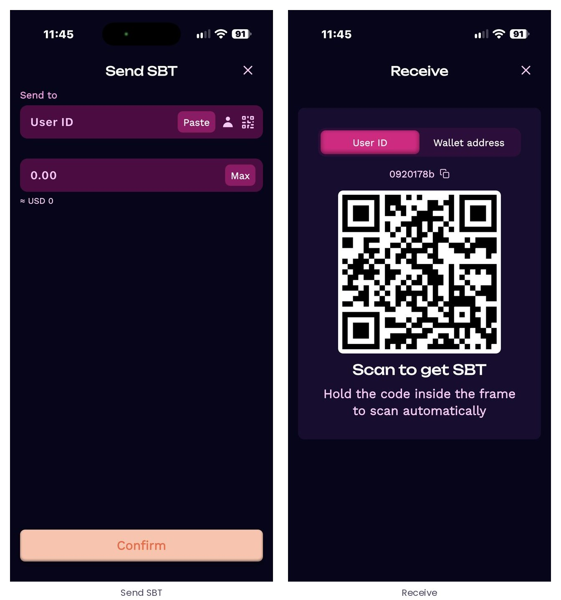

*Figure 7 – Send and Receive. Transfers are on-chain transactions between two non-custodial wallets.*

## 3.4 Withdrawing

Withdrawals are made in USDC: the player first converts the desired amount of SBT into USDC inside the wallet (“Convert to USDC”), then withdraws the USDC through the integrated off-ramp provider shown on the screen, which pays out to the player in fiat under its own terms. As for top-ups, Sbarter is not a party to the off-ramp transaction.

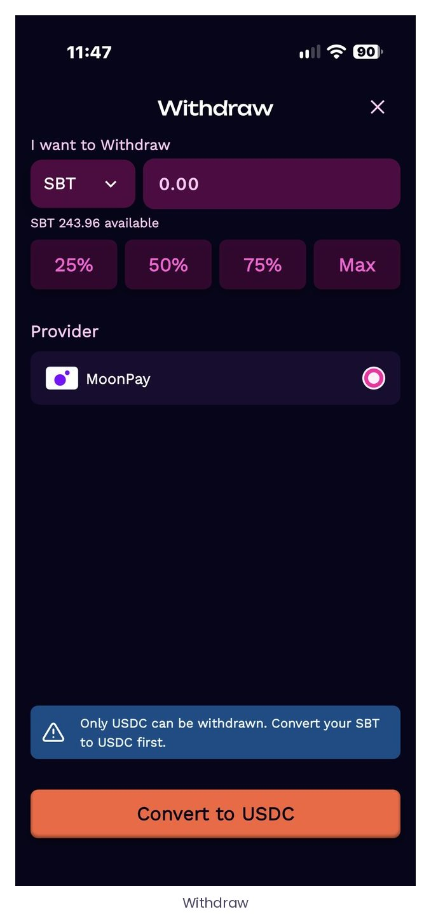

*Figure 8 – Withdraw: choose the amount of SBT (25 % / 50 % / 75 % / Max), convert to USDC, then withdraw through the selected provider.*

## 3.5 Transactions and on-chain proof

The transaction list shows every movement of the wallet: challenge stakes and settlements, tournament entry fees and rewards, Play & Compare entries, transfers and top-ups. Opening an entry shows the contest it relates to, the transaction identifier, the date and the status, the net result for the player, the stake or entry fee, the settlement steps executed by the smart contract, and the on-chain proof – the signature of the transaction on Solana mainnet, which anyone can verify on a public explorer.

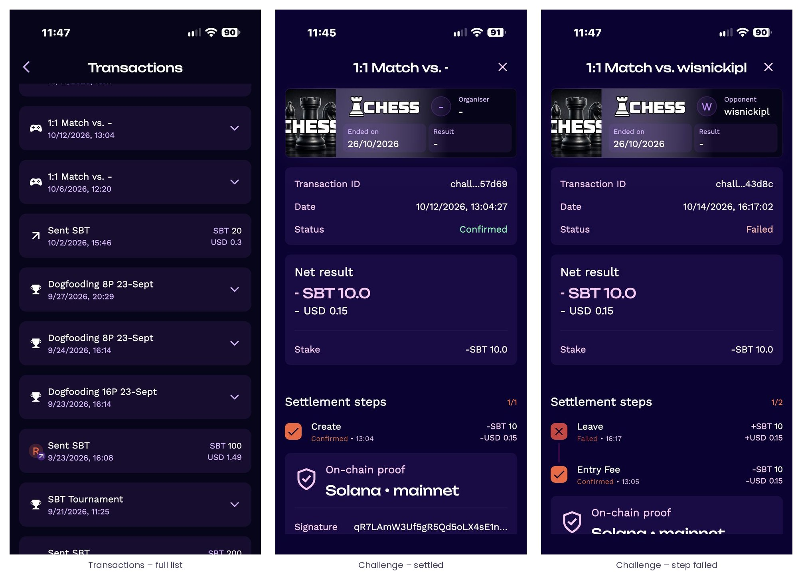

*Figure 9 – Transaction history and detail. Each settlement step (“Create”, “Entry Fee”, “Leave”…) is an on-chain instruction with its own status; a failed step is shown as such and the amount concerned stays where it was.*

Because every step is an on-chain instruction, the detail screen is also the player’s audit trail: it shows exactly when a stake was escrowed, when a reward was released, and – should a step not complete – which one, with the corresponding amount unaffected.

## 3.6 Wallet settings and export

Wallet Settings offers two options. “Standard mode” keeps the wallet in the simplified in-app experience. “Export wallet” opens the wallet management page, where the player can export the seed phrase of the wallet after re-authenticating. This is what makes the wallet non-custodial in practice: the player can take the keys and use the same wallet in any Solana wallet application, independently of Sbarter.

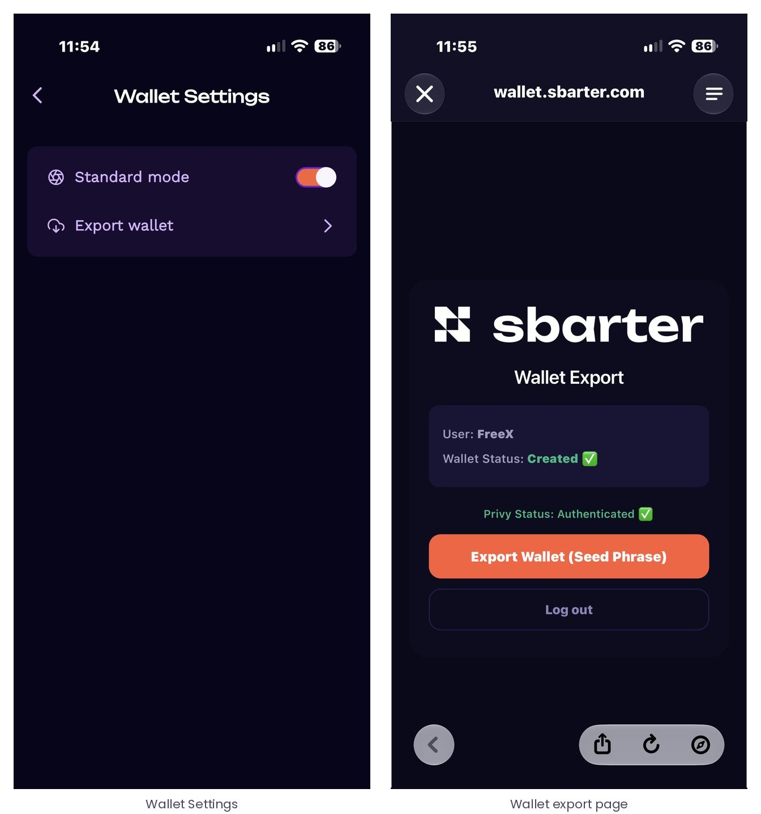

*Figure 10 – Wallet Settings and the export page: wallet status, authentication status and seed-phrase export.*


Sbarter cannot recover a seed phrase and cannot move funds on a player’s behalf. Support can help with the app, with providers and with the contest lifecycle; it cannot access the wallet.


# 4 · Games and game accounts

## 4.1 The Game Library

The Game Library lists every title available on Sbarter (“All Games”) and the titles the player has linked (“My Games”). A linked title carries a link badge on its tile. The library is reached from Settings, from the “Add Game” tile on the profile and from the first step of challenge creation.

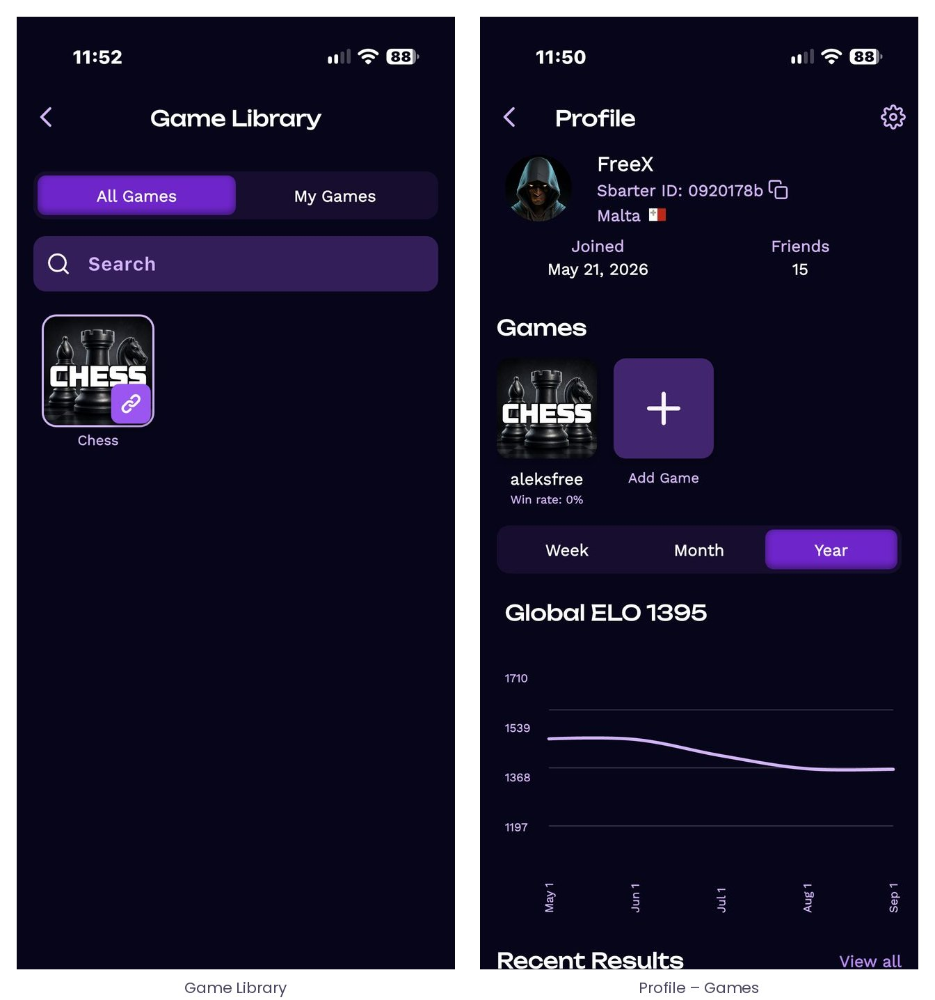

*Figure 11 – The Game Library and the Games section of the profile. A title must be linked before the player can compete on it.*

## 4.2 Linking a game account

To compete on a title, the player’s game account must be linked to the Sbarter account, so that the result transmitted by the game can be attributed to the right player. There are two ways for this to happen:

- **From the game.** The player taps a single-use linking link issued by the VGP for their authenticated game account; after signing in or registering, a confirmation screen names the game and the account, and one tap binds them. The game nickname then appears next to the Sbarter ID on the profile. This is the standard path for an integrated title (12.2, Journey A).
- **From the app.** A player already on Sbarter who taps Join, Create or Accept on a title not yet linked is asked to confirm the link inside the game: Sbarter requests the confirmation from the VGP, the game shows it to the authenticated player, and the decision comes back to Sbarter (12.2, Journey B). No identifier is typed by the player.

The binding is one-to-one and permanent: a game account already linked to another Sbarter account, or a Sbarter account already linked to another account on the same title, cannot be linked again. For titles connected through their public API during the preview period, the player links the account manually from “Add Game” by entering the game username; this path is not the reference experience for an integrated title.

## 4.3 Game profile, statistics and rankings

Each linked title has its own profile page: the game account and the Sbarter ID side by side, the player’s recent results against Sbarter opponents, the win rate, the ELO rating for that title with its evolution over the week, month or year, and the ranking among Sbarter players on that title, with the player’s own row highlighted. “Sync Game Stats” refreshes the statistics from the game; “Your Leaderboard” jumps to the player’s position in the ranking.

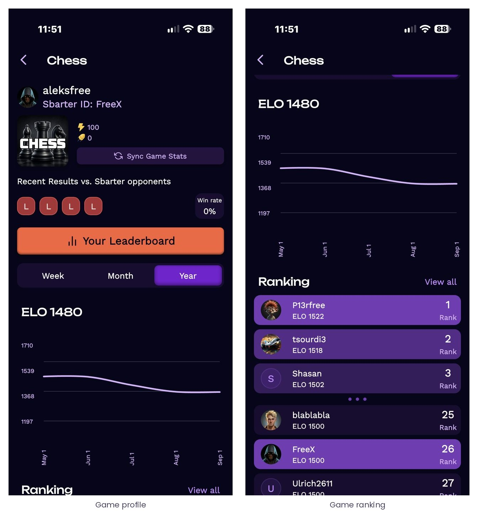

*Figure 12 – Game profile: linked account, recent results, title ELO and ranking.*

Rankings are per title and are driven only by contests settled on Sbarter. They allow the VGP to configure skill brackets – contests reserved to players within a rating band – so that newcomers are not systematically paired with the strongest players (see 7.1).

# 5 · The Arena: finding and following contests

The Arena is the central tab. It has two views – Browse and Lobby – and a filter panel. Browse is the public listing of everything the player can enter; Lobby is the player’s own space, holding the challenges they created and the contests they have entered.

## 5.1 Browse and Lobby

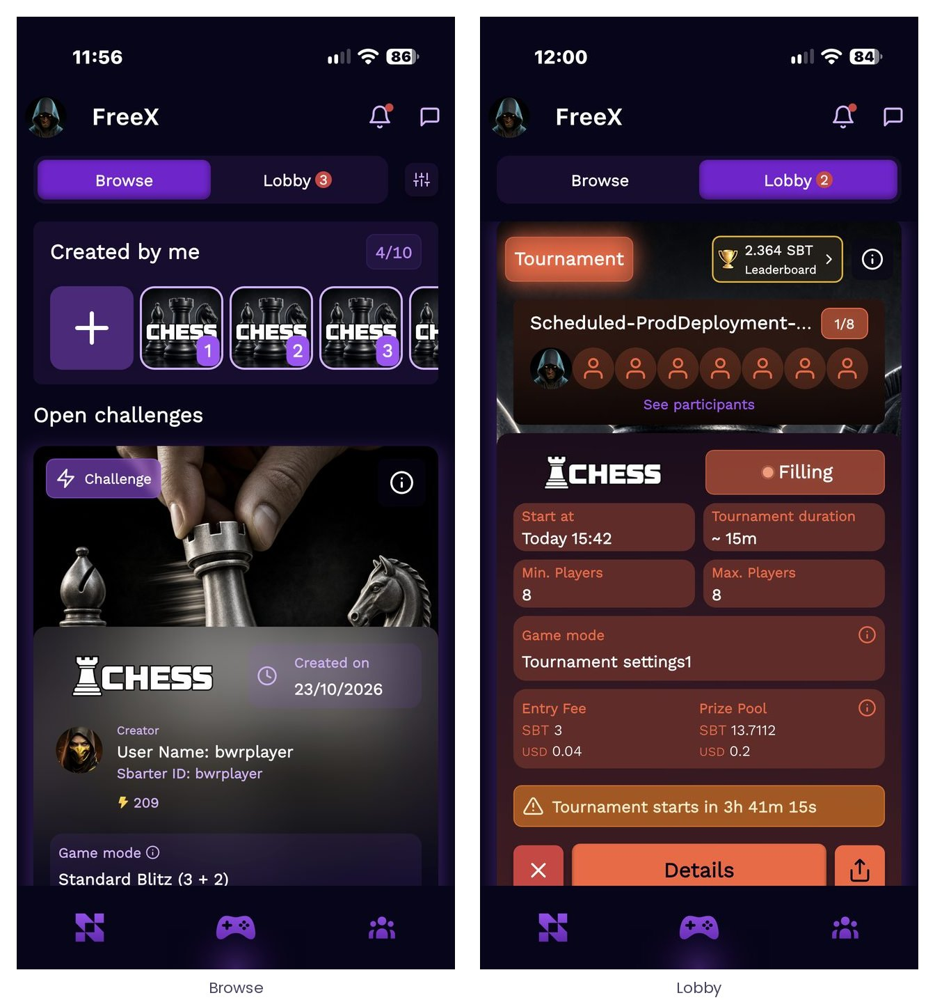

*Figure 13 – Browse lists the player’s own open challenges (“Created by me”) and the open challenges and tournaments of other players and organisers; Lobby holds the contests the player has entered, with a badge showing how many need attention.*

| View | What it shows |
| --- | --- |
| Browse | “Created by me”: the challenges the player has published and that are waiting for an opponent, with the count against the maximum number of simultaneous open challenges. “Open challenges”: challenges published by other players. Tournaments open for registration, with their status. |
| Lobby | Every contest the player is part of: accepted challenges awaiting the session, tournaments the player is registered for (with the countdown to the start), running tournaments. The Lobby badge counts the items that require the player’s attention. |
| Filter | Narrow Browse by format (challenges / tournaments), game, friends, stake range and reward-pool range (5.3). |

## 5.2 Anatomy of a contest card

Cards use one template across formats, so that a player who has read one card can read them all. The tournament card below is the richest example.

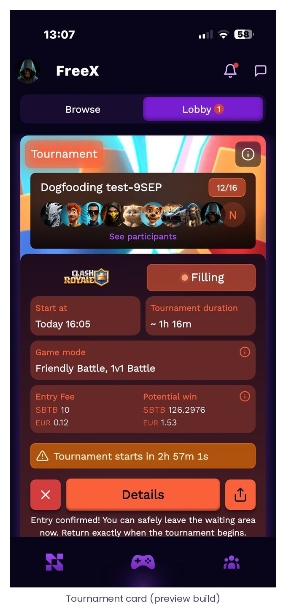

*Figure 14 – A tournament card in Browse. Top: format badge, name, registered participants and avatars, link to the participant list. Centre: game and status. Stat boxes: start time, expected duration, game mode, entry fee and reward pool – each with an information icon. Bottom: countdown and the action row.*

| Card element | Meaning |
| --- | --- |
| Format badge | “Challenge” for 1v1, “Tournament” for brackets, “Play & Compare” for score-based contests. |
| Participants | Registered players against the field size (e.g. 12/16) with their avatars; tap to open the list. |
| Status | “Filling” while registration is open; then “Preparing”, “In Play”, “Finished” (Appendix A). |
| Start at / duration | Scheduled start and expected duration of the whole event. |
| Game mode | The ruleset defined by the VGP for the contest – which mode is played, what counts as a result, timeouts. The information icon opens the rules. |
| Entry fee / stake | What the player commits at entry, in SBT with the indicative fiat value. |
| Reward pool (“Prize Pool” / “Potential win”) | What the winner – or the ranked winners – receive at settlement. |
| Action row | Join / Accept / Details / Share; once entered, a leave control appears on the left. |

## 5.3 Filters

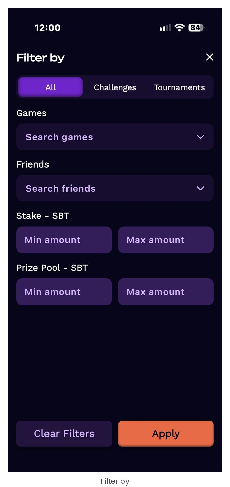

*Figure 15 – Filters: format, game, friends, stake range and reward-pool range.*

## 5.4 Season leaderboards

Titles with an active season carry a leaderboard button on their cards, showing the current season pool. The season leaderboard is a web module – also embeddable inside the game – that shows the season name and dates, the countdown, the season cup pool with its sponsored minimum and progress towards it, and the ranked list of players with contests won and season points. The player can switch between the current and past seasons and search for a player.

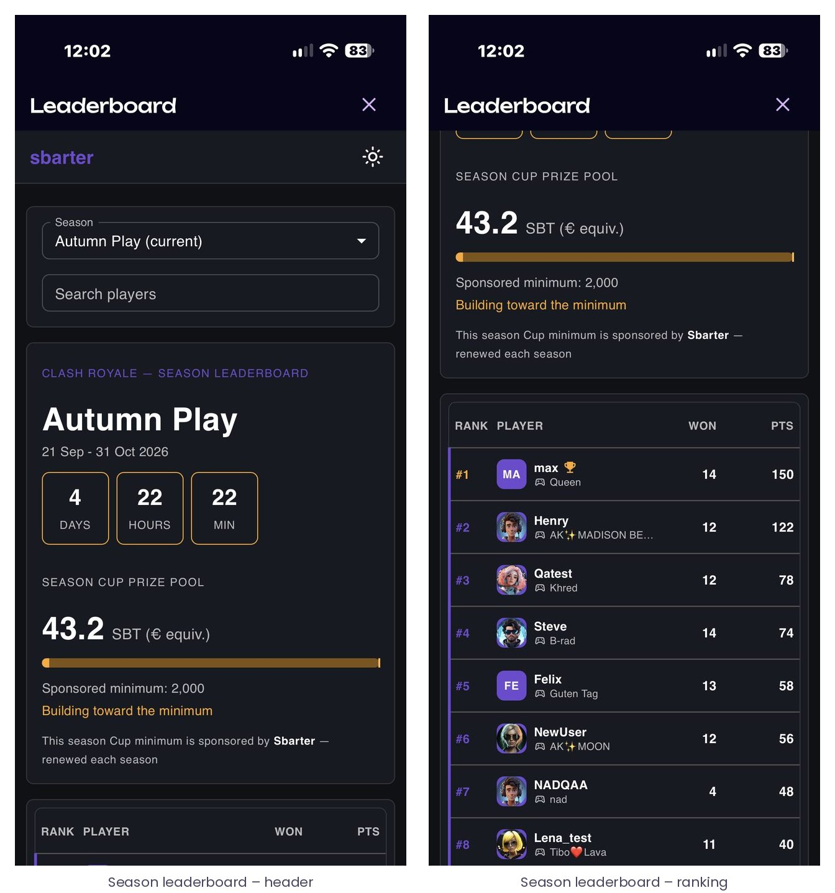

*Figure 16 – The season leaderboard. In production the season cup minimum is funded by the VGP (or by a creator) and renewed each season; the preview build shows a Sbarter-funded test season.*

# 6 · 1v1 challenges

A challenge is a contest between two players on a title and a game mode, each committing the same stake. The creator publishes the challenge; another player accepts it; both play the session in the game; the game reports the result; the smart contract pays the reward pool to the winner. Nobody at Sbarter touches any of these steps.

## 6.1 Lifecycle

| Step | What happens | Where |
| --- | --- | --- |
| Create | The creator picks the game, the game mode and the stake, and publishes. The stake is escrowed. The challenge appears in Browse under “Created by me” and, for other players, under “Open challenges”. | App |
| Accept | An eligible player accepts. Their stake is escrowed. Both players see the challenge in the Lobby with the readiness of each side and a private chat channel. | App |
| Prepare | Sbarter registers the two-player session with the game’s servers (12.4). Both players see the session as ready on the challenge page. | Sbarter → VGP |
| Play | The players open the game, where the registered session is waiting for them – with one tap from “Play” on an integrated title once direct launch is in place, or following the setup instructions on a public-API title. | Game |
| Report | The game’s servers post the authoritative result for the session to Sbarter’s webhook (12.5). | VGP → Sbarter |
| Settle | The smart contract releases the reward pool to the winner, the oracle fee to the VGP and the protocol fee; the result, the net outcome and the on-chain proof appear in both players’ transaction history and profiles. | Protocol |

## 6.2 Creating a challenge

Challenge creation is a four-step flow – Game, Settings, Stake, Publish – with a progress bar at the top.

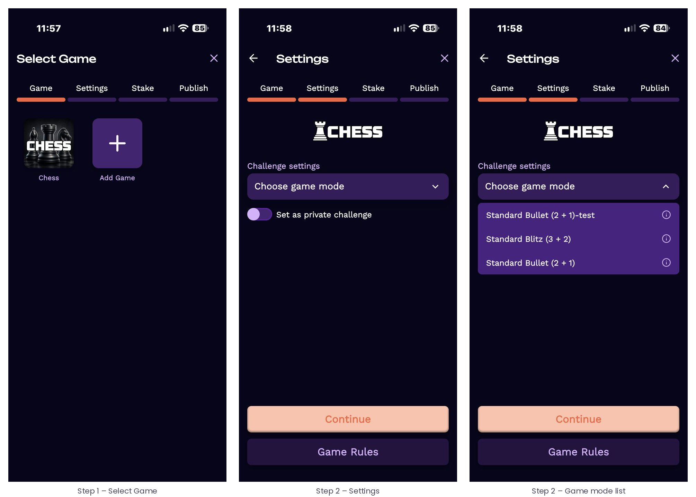

*Figure 17 – Steps 1 and 2. The player selects a linked title, then a game mode from the rulesets defined by the VGP (each with an information icon and “Game Rules”). “Set as private challenge” hides the challenge from Browse so that it can only be accepted through its link.*

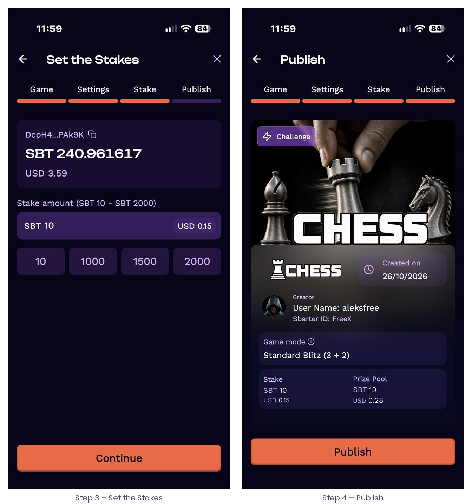

*Figure 18 – Steps 3 and 4. The stake is chosen within the range allowed for the title (quick amounts offered), with the wallet balance shown above. The Publish screen previews the card as other players will see it, including the reward pool.*

The reward pool shown on the card is what the winner receives: the two stakes combined, less the protocol fee – a fixed amount in SBT per contest – and, for a title integrated through the Oracle API, the oracle fee earned by the VGP. In the example above, two stakes of SBT 10 produce a reward pool of SBT 19.

When the creation flow is opened from a link inside the game (12.2), the game and the game mode are pre-filled and the player lands directly on the stake step.

## 6.3 Managing open challenges

From “Created by me” the creator can open a challenge and edit the game mode or the stake, duplicate it, delete it, or share its link – to a friend, a community channel or a creator’s audience. A challenge edited while open is republished with the new parameters; a deleted challenge returns the stake to the creator.

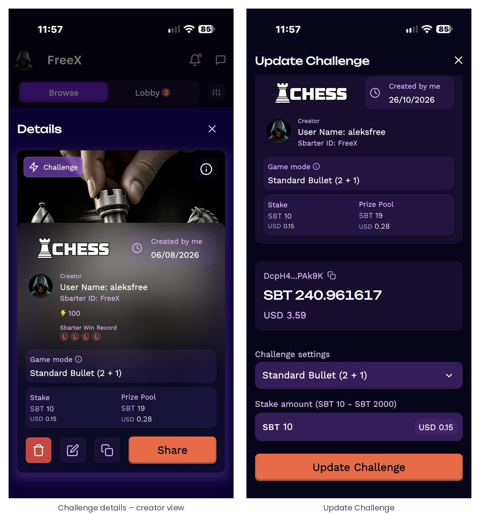

*Figure 19 – Managing an open challenge: delete, edit, duplicate, share. The creator’s win record on Sbarter is shown on the card.*

## 6.4 Accepting a challenge

In Browse, each open challenge shows the creator, their Sbarter win record, the game mode, the stake and the reward pool. Accepting escrows the acceptor’s stake and moves the challenge into both players’ Lobby. A player can only accept a challenge on a title they have linked, and only if their country and verification status allow it; otherwise the action is disabled with an explanation.

## 6.5 Playing the session

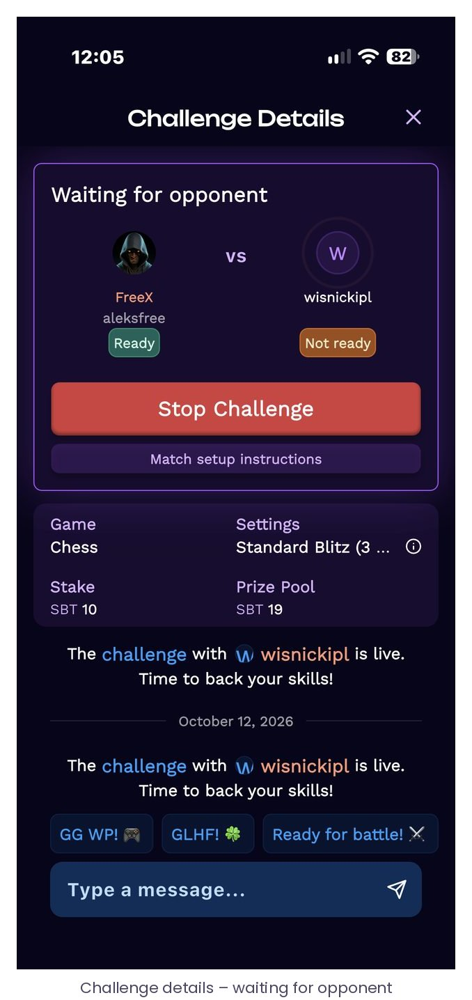

*Figure 20 – The challenge page once accepted: both players with their readiness, the “Stop Challenge” control, the setup instructions, the contest parameters, and the private chat channel with the opponent.*

The challenge page is the hub of the contest: both players with their game accounts and their readiness, the game mode, the stake and the reward pool, and a private chat channel in which the players coordinate; system messages mark the challenge going live and the session starting.

On an integrated title, once both stakes are locked Sbarter registers the session with the game’s servers and the page shows it as ready; the player opens the game and finds the session waiting – the target is a one-tap “Play” landing directly in it (12.4). On a title connected through its public API, the “Match setup instructions” explain how to find the opponent and start the right mode.

## 6.6 Result and settlement

When the game reports the result, the smart contract settles the contest immediately. Both players are notified; the result appears under Recent Results, the title ELO and the rankings update, and the transaction detail (3.5) shows the net result, the settlement steps and the on-chain proof. There is nothing to claim and nothing to confirm: the reward is in the winner’s wallet at settlement.

## 6.7 Stopping a challenge

Before the session starts, either player can leave – the creator with “Stop Challenge”, the acceptor by leaving the Lobby – and the stakes are returned. Once the session has started, the contest is settled on the result the game reports, according to the ruleset defined by the VGP, which covers timeouts and abandoned sessions. A settlement step that cannot be executed is shown as failed in the transaction detail, with the amount concerned left in escrow (Figure 9).

# 7 · Tournaments

A tournament is a scheduled single-elimination bracket on one title and one game mode: players register before the start by paying the entry fee, are paired round by round, and the reward pool is distributed to the finalists at settlement. Each pairing in the bracket is a contest in its own right, settled on the result the game reports for it; bracket progression is automatic.

## 7.1 Format and configuration

| Parameter | Description |
| --- | --- |
| Organiser | The VGP or a creator. The organiser’s name appears in the tournament details. Sbarter never organises tournaments. |
| Open to | Public, or restricted – for instance to a skill bracket, so that low-rated players compete among themselves. |
| Field | Minimum and maximum number of players (e.g. 8–8, 16). The tournament starts only if the minimum is reached; otherwise it is cancelled and entry fees are returned. |
| Start and duration | Scheduled start; expected duration derived from the number of rounds and the ruleset. |
| Game mode | The ruleset applied to every pairing. |
| Entry fee | Per player, escrowed at registration. Zero for VGP-funded free-entry tournaments. |
| Reward pool | Entry fees combined – or the amount funded by the organiser – less the oracle fee, the protocol fee on each pairing and, where a season is active, the season deduction; distributed per the reward table. |

## 7.2 Registering

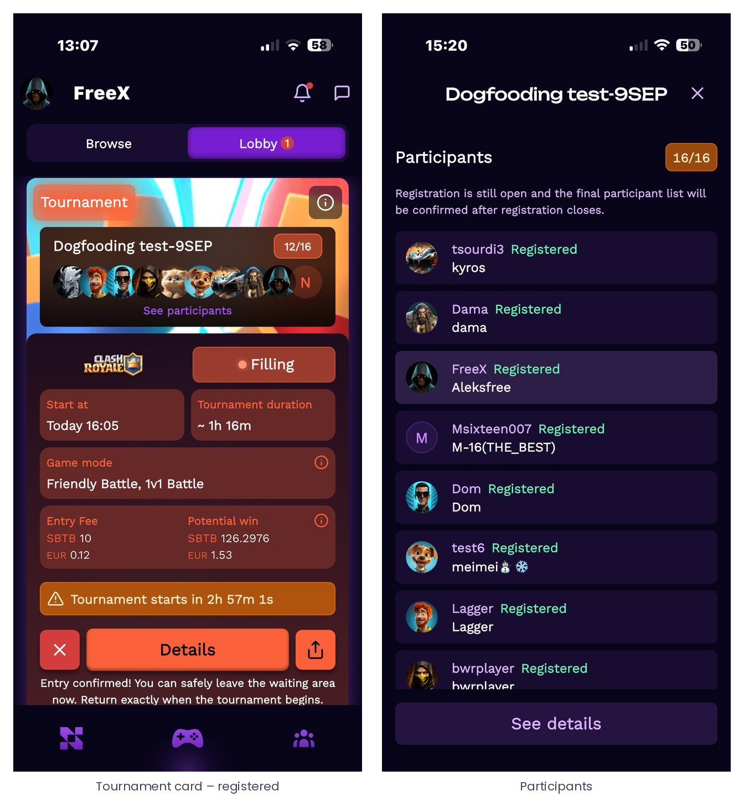

*Figure 21 – Registration. Once registered, the card confirms the entry and the player can leave the waiting area; the participant list shows each player with their game account.*

Registration is open while the status is “Filling”. Tapping the card registers the player and escrows the entry fee; the card then shows the countdown to the start, with a leave control on the left and share on the right. The player receives a notification confirming the registration and a reminder before the start. A registered player can withdraw with a full refund until the cutoff before the scheduled start set in the tournament configuration; the final participant list is confirmed when registration closes.

## 7.3 Tournament details

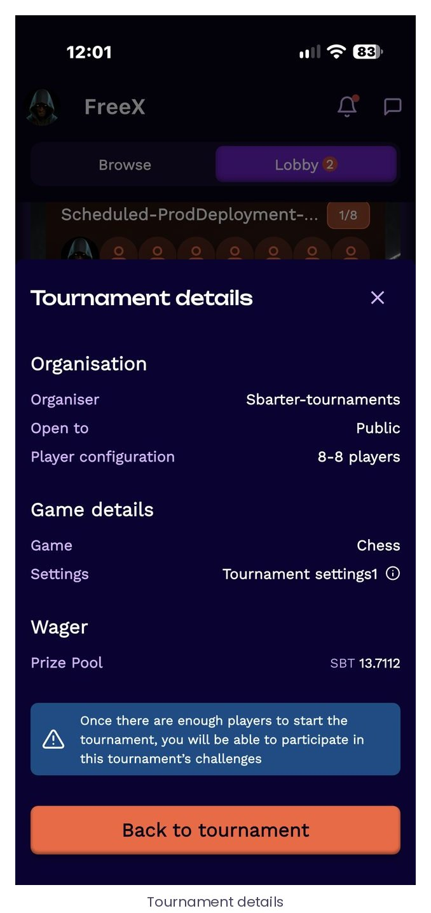

*Figure 22 – Tournament details: organiser, access, field size, game, ruleset and reward pool.*

## 7.4 When the tournament starts

At the scheduled start the tournament page switches to three tabs. **Matches** shows the player’s current pairing: the round, the opponent, both readiness states and the countdown to the session, above the tournament chat. **Brackets** shows the whole bracket with the state of every pairing – “Preparing”, “In Play”, “Finished” – and “TBD” for pairings whose players are not yet known. **Players** lists the field.

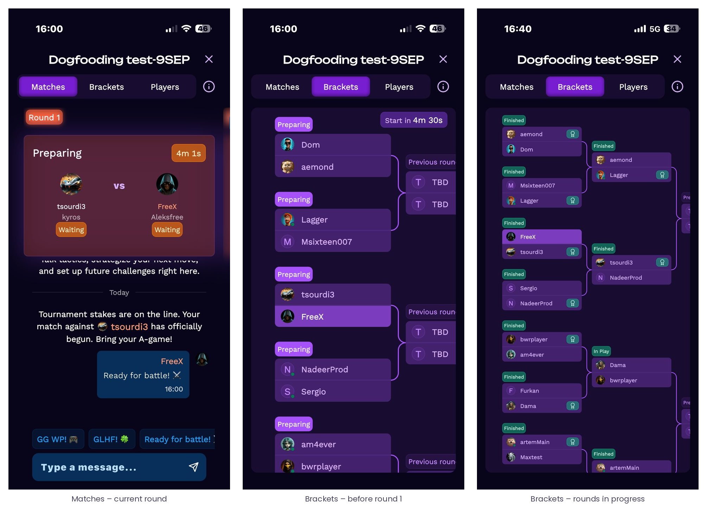

*Figure 23 – A running tournament: the current pairing with its countdown, and the bracket as rounds complete.*

## 7.5 Playing a round and progressing

Each round follows the same sequence as a challenge: Sbarter registers the pairing as a two-player session with the game’s servers, both players are notified, they play the session in the game, the game reports the result, and the pairing is settled. The winner is moved to the next round and notified when the next pairing is ready; the loser remains in the tournament page and can follow the bracket to the end. Between rounds the player returns to the tournament page in the app – it is the single place where the bracket, the next opponent and the timing live. A player who does not show up for a pairing within its completion window forfeits it; what happens when the game produces no result is set out in 12.6.

## 7.6 Settlement

When the final pairing is settled, the smart contract distributes the reward pool according to the reward table of the tournament, pays the oracle fee to the VGP and records the event on-chain. Every player sees their outcome in the transaction history and in Recent Results; finalists see the reward credited to their wallet at settlement.

## 7.7 Tournament chat

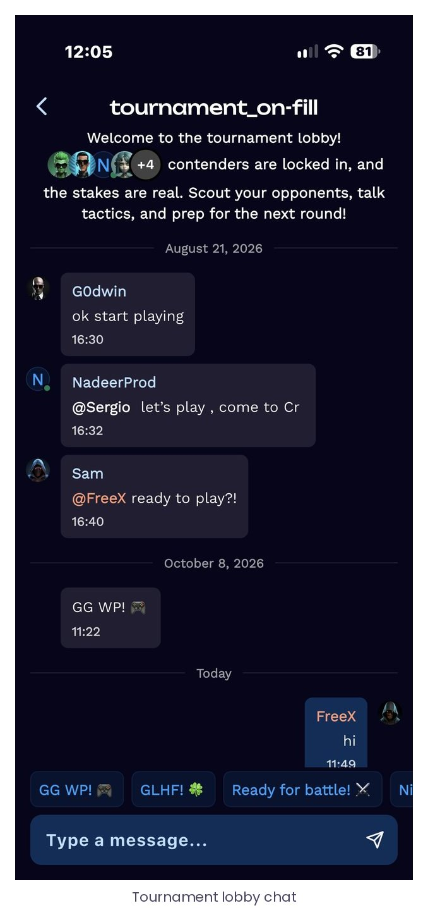

*Figure 24 – Each tournament has a group chat open to the registered players from registration to settlement.*

# 8 · Play & Compare


Play & Compare is fully developed and goes into production with the first integrated title. The screens are not yet captured; this chapter describes the player flow from the product specification and will be completed with figures on the next capture.


## 8.1 Format

Play & Compare is an all-vs-all, score-based contest for games in which players compete against the game itself rather than against a live opponent: a player joins, plays immediately and is ranked against everyone else at the close of the contest. There is no matchmaking and no waiting. It suits asynchronous and casual titles – cards, puzzles, racing, score chasers – and league-style formats on competitive titles.

Contests are instantiated by the system from a configuration defined by the VGP – game mode, entry fee, duration, minimum participants, reward table, attempt model – and renew automatically: when one instance closes for entries, the next one is already open, so that a joinable contest is always available. Three attempt models exist, chosen by the VGP among those the title supports:

| Model | Attempts | Counted result | Typical titles |
| --- | --- | --- | --- |
| Single Run | One session per entry, on a seed unique to the instance so that every player faces identical conditions. | The single session | Cards, randomised puzzles |
| Rebuy | Additional sessions, each paid at the entry fee, up to the configured maximum. | The player’s best result | Cards, match-3, score chasers |
| Time Trial | Unlimited sessions within the window on one entry fee; fixed content, no seed. | The player’s best result | Racing, speedruns, fixed courses |

## 8.2 Player flow

1. **Browse.** Play & Compare contests appear as cards with the format badge, the time to close, the game mode, the entry fee, the live reward pool with its guaranteed minimum, the minimum-players threshold and the live season pool. Parallel configurations of the same title (fee tiers, durations) appear as separate cards.
2. **Join.** Joining escrows the entry fee and moves the contest to the Lobby, where the card shows “Play” in place of “Join”. Entries close a configured number of minutes before the end time, so that every entrant has a playable window.
3. **Enter game.** The contest page shows the countdown, the completion deadline, the live leaderboard with every participant linked to their profile and the player’s own position pinned, and the “Enter game” button: a return link carrying the contest identifier, on which the game opens the session with the contest seed applied. Under Rebuy and Time Trial, “Play again” relaunches the session and the page shows the attempts counter.
4. **Live leaderboard.** Scores are public during the contest and move as the game transmits results; in the multi-attempt models each improvement of a player’s best result updates the leaderboard.
5. **Close and settlement.** At the end time the game transmits the final result set – one best result per player. The smart contract ranks the scores, applies the reward table to the effective pool and distributes the rewards. A player who joined but did not complete a session is ranked last. If the minimum number of participants is not reached, the instance is voided and every entry fee is refunded automatically.
6. **Results.** The settled instance appears in the results history with its final leaderboard, the player’s outcome and reward, the season points earned and the updated season rank; “Join the next contest” leads into the successor instance already open.

## 8.3 Seasons and the Season Final

The instances of a configuration are grouped into four-week seasons. A season deduction from each instance’s reward pool feeds a season pool, visible live on the cards and on the season leaderboard (5.4); each settled instance awards season points by placement, weighted by field size, with only each player’s best results per week counted so that the leaderboard measures quality rather than available time. At season end the top players qualify for the Season Final – a free-entry contest, reserved to the qualifiers and verifiable on-chain, whose reward pool is the accumulated season pool, optionally topped up by the VGP. The next season starts immediately.

# 9 · Community: chats, friends and notifications

## 9.1 Chats

The Community tab and the bubble icon in the header open the chat list: one group channel per tournament the player is registered for, and one private channel per opponent. Channels are created by the app when a contest brings two players together and remain available afterwards, so that rivals can set up the next challenge. Quick replies cover the usual exchanges; players can share their game username or an in-game friend invite to prepare the session.

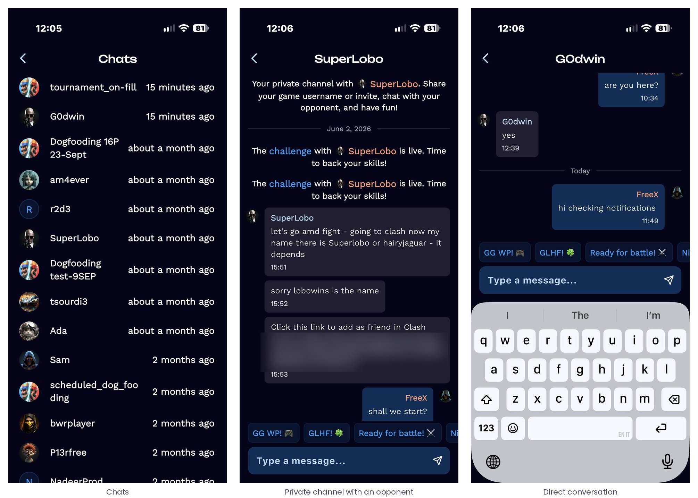

*Figure 25 – Chats: tournament lobbies and private channels. System messages mark the key moments of the contest.*

## 9.2 Friends

Players can add friends; the friend count appears on the profile and “Friends” is a filter in Browse, so that a player can see at a glance the challenges published by people they know. A shared challenge link is the simplest way to invite a friend to a specific contest.

## 9.3 Notifications

The bell in the header opens the notification centre, filtered by category – Gameplay, Messages, Rewards, Wallet. Notifications cover every moment that requires the player’s attention or confirms an outcome: registration confirmed, tournament starting soon, challenge accepted, session ready, result and reward settled, wallet credited. The centre keeps seven days; older records remain available in the transaction history.

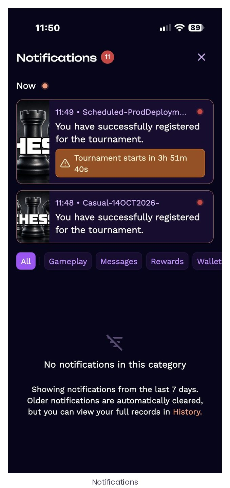

*Figure 26 – The notification centre, with categories and the live countdown to a tournament the player is registered for.*

# 10 · Profile and statistics

The profile is reached from the avatar in the header. It brings together the player’s identity on Sbarter – avatar, nickname, Sbarter ID, country, date joined, number of friends – the linked titles with their win rate, the global ELO with its evolution over the week, month or year, the recent results across titles with their state, and the global ranking among Sbarter players with the player’s own position.

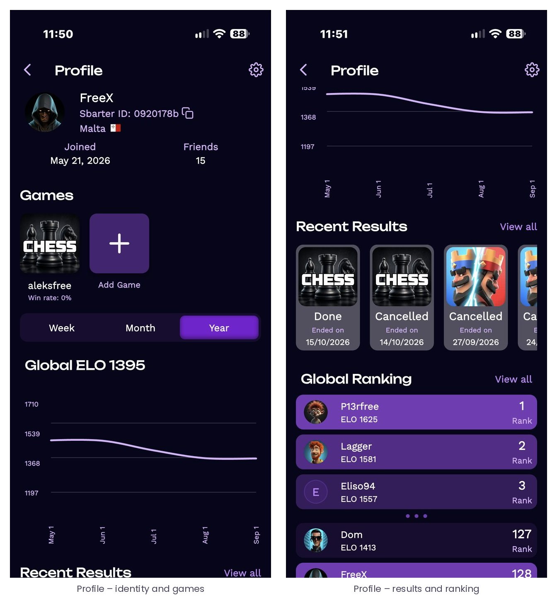

*Figure 27 – The player profile. Each title tile opens the game profile of chapter 4; “View all” opens the full results history and the full ranking.*

Other players’ profiles are reachable from every place a nickname appears – contest cards, participant lists, leaderboards, chats – and show the same public elements: nickname, Sbarter ID, linked titles, win record and ratings. Personal details are never public.

# 11 · Settings and player safety

## 11.1 The Settings menu

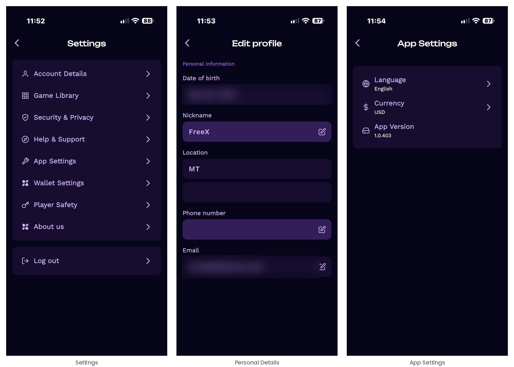

*Figure 28 – Settings. Personal details (date of birth, nickname, location, phone, e-mail) are editable by the player; App Settings hold the language, the display currency and the app version.*

| Entry | Content |
| --- | --- |
| Account Details | Nickname, User ID, avatar, personal details, Privacy Policy, Terms & Conditions, Close Account (2.5). |
| Game Library | Linked and available titles (4.1). |
| Security & Privacy | Password, PIN code, biometric sign-in (2.6). |
| Help & Support | Support Centre and the “How to Play” guide for challenges (11.3). |
| App Settings | Language, display currency (used for every indicative fiat value in the app), app version. |
| Wallet Settings | Standard mode and wallet export (3.6). |
| Player Safety | Spending limit and self-exclusion (11.4). |
| About us | Information on Sbarter. |

## 11.2 Help & Support

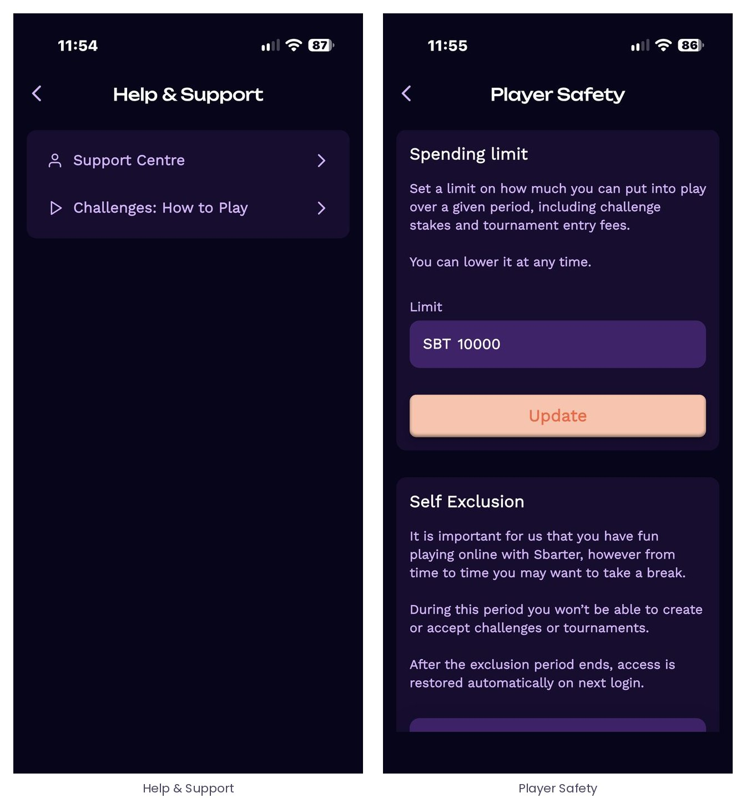

*Figure 29 – Help & Support and Player Safety.*

The Support Centre handles everything related to the Sbarter app – account, wallet, providers, contest lifecycle. Questions about the game itself – gameplay, game accounts, in-game issues – belong to the VGP’s own support; the split is described in 12.8.

## 11.3 Player Safety

Two tools let a player set their own boundaries, in line with Sbarter’s view that stakes should mean something and never become a problem.

- **Spending limit.** A cap on how much the player can put into play over a given period, including challenge stakes and tournament entry fees. The limit can be lowered at any time.
- **Self-exclusion.** The player can suspend their own access to competition for a chosen period. During the exclusion the player cannot create or accept challenges or register for tournaments; access is restored automatically at the first login after the period ends.

## 11.4 Closing an account

An account can be closed from Account Details. Before closing, the player should withdraw or transfer the SBT held in the wallet, or export the wallet (3.6): closing the Sbarter account does not transfer the keys to anyone, and Sbarter cannot recover them afterwards.

# 12 · How the game and the app work together

This chapter is for the VGP. It takes the cycle a player travels between your game and the Sbarter app and shows, for each handoff, what the player sees, what your systems do and what the protocol does. The authoritative technical specification – request and response schemas, authentication, environments – is the Sbarter developer portal (12.11); this chapter follows its structure and uses its operation names, so that product, marketing and support teams can read the same story engineering implements.


**Sbarter API** – hosted by Sbarter, called by your backend: account-linking operations and the result webhook. Authenticated with OAuth 2.0 client credentials issued in the Sbarter Studio Web Portal.

**Game Studio API** – hosted by you, called by Sbarter: in-game linking confirmation, player profile snapshot and game-session registration. Authenticated with an API key you issue.

Operations marked *under development* in the portal – one-tap launch into a provisioned session, in-game notifications, presence evidence and result reconciliation – are described here as the target experience and are agreed with each VGP before launch.


## 12.1 The full loop

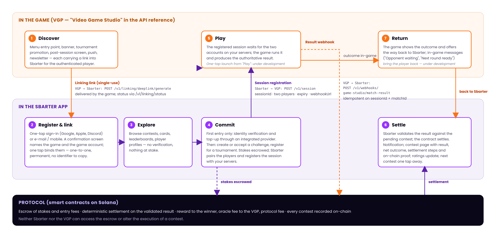

*Figure 30 – The full loop. Three published interfaces close the circuit: the linking link into Sbarter, the session registration from Sbarter to your servers, and the result webhook from your servers to Sbarter. Everything between them is handled by the app and the smart contracts.*

Two properties of the loop deserve attention. First, friction is zero until the moment of competitive commitment: discovery, registration, linking and exploration ask nothing of the player; verification and funding sit at the first entry and nowhere else. Second, every message that decides an outcome runs server-to-server between your backend and Sbarter: the result is produced by your game servers, never by the player, and neither Sbarter nor you can alter it once accepted.

## 12.2 Account linking

Linking associates a player’s Sbarter account with their authenticated game account, so that Sbarter can identify the two participants of a session and attribute your result to the right entries. The binding is one-to-one and permanent, and never asks the player to copy an identifier. Two journeys are published.

### Journey A – the player starts in your game

1. Your backend calls `POST /v1/linking/deeplink/generate` with the player’s account identifier in your system (`providerUserId`) and receives a **single-use linking link**, which you deliver through any surface – menu, banner, post-session screen, push, in-game message, e-mail.
2. The player taps it. If the app is installed it opens with the game context; otherwise a welcome page for your title leads to installation – store listing or direct download – and a deferred link preserves the context through the install.
3. The player signs in, or registers (2.2). Sbarter determines whether the account is new, registered but unbound, or already bound to the same game identity.
4. The player sees a **confirmation screen naming your game and the game account**, and confirms. Sbarter records the binding; your title appears in the player’s Game Library (4.1) with the game nickname shown next to the Sbarter ID.
5. The player lands on the referenced contest or on Browse filtered on your title, and continues into entry – eligibility, skill cap where configured, funds.

Your backend can check the outcome at any time with `POST /v1/linking/status`. Redeeming the link does not by itself trigger a callback to you.

### Journey B – the player starts in the Sbarter app

1. A registered player browses the contests of your title and taps Join, Create or Accept. If the account is already bound, nothing else happens.
2. If it is not, and Sbarter already knows the player’s game account identifier, Sbarter calls your `POST /v1/sbarter/gamer/validate/in-app`: you present the confirmation to the authenticated player inside your game and return the decision – accepted, rejected or expired – to the callback supplied with the request (`POST /v1/linking/in-app/{requestId}`).
3. On success the player returns to the contest, passes the eligibility and funds checks and enters.

Discovery of a game account that Sbarter does not yet know – the player is sent into your game with a one-time link code and your server returns the authenticated account – is the proposed completion of this journey and is under development.

| Situation | Behaviour |
| --- | --- |
| Already linked to the same account | Continue; linking is not repeated. |
| Sbarter account linked to a different game account, or game account linked to a different Sbarter account | The new binding is rejected – one-to-one, permanent. |
| Guest game account | The player authenticates or upgrades to a full account before linking. |
| Linking link expired or already used | No binding; the player restarts from your game. |
| Skill rating above the cap of an Entry contest | Shown as ineligible, with alternatives. The rating comes from your profile snapshot (12.4). |
| Insufficient funds | The app offers a top-up before entry (3.2). |

## 12.3 Entry points into Sbarter

Every surface in your game that promotes competition – a persistent entry point in the main menu, rotating banners, a tournament promotion, the post-session moment on the results screen, push notifications, newsletters and community channels – can carry a link into Sbarter. The published operation generates account-linking links; richer destinations are the proposed experience and are agreed per title:

| Destination | What the player lands on |
| --- | --- |
| Browse filtered on your title | The Arena, showing only the challenges and tournaments of your title (5.1). |
| A specific tournament | The tournament card with the join action visible (7.2). |
| A specific challenge (private invitation) | The challenge page, ready to accept (6.4). |
| The current season | The season leaderboard of your title (5.4), also available as an embeddable web module. |

A QR code is the same link on a different screen: printed, shown on a stream or displayed on a desktop version of the game. Links carry an attribution so that conversion can be measured per surface and campaign.

## 12.4 From commitment to the game session

When two linked players are committed – a challenge accepted and confirmed, or a tournament pairing set – and both stakes are in escrow, Sbarter registers the session with your servers: `POST /v1/session` on your Game Studio API, carrying your game identifier, the canonical Sbarter `sessionId`, the two players, an expiry time, the `webhookUrl` to which the result must be reported, and optional rules. The call is idempotent on `sessionId`: a retry with the same payload must not create a second session.

What the player sees: the challenge page or the tournament pairing shows the session as ready, with both players’ readiness and the time window (6.5, 7.4). The player opens your game, where the registered session is waiting for the two accounts; how your game presents it – a pending contest in a dedicated section, a lobby, an invitation – is your design. The target experience is a one-tap **“Play”** in Sbarter that lands directly in the provisioned session, with the first player waiting for the second; it requires a launch mechanism on your side and is under development with each VGP.

At any time Sbarter may request a **player profile snapshot** from `POST /v1/sbarter/gamer/profile` – display name, capture time and optional game statistics. This is what populates the game profile and “Sync Game Stats” (4.3), and what supplies the rating used for Entry contests with a skill cap.

## 12.5 Results: the webhook as the player sees it

When the session is over, your servers post the authoritative result to the `webhookUrl` supplied at registration (`POST /v1/webhooks/game-studio/match-result` on the Sbarter API): your game identifier, the `sessionId`, your own `matchId`, a status – win, draw, failed or voided – and the two players with their outcome, plus start and end timestamps where available. Requests carry an OAuth bearer token with the `webhook.write` grant; Sbarter answers 202, including for safe duplicate deliveries, and treats `sessionId` + `matchId` as the identity of a logical result, so that a retry never produces a second settlement.

On the player’s side the submission is invisible and its effect immediate: Sbarter validates that the identities, the session and the timing match the pending contest, the smart contract settles, the player is notified, the contest page shows the result, the transaction detail shows the net outcome, the settlement steps and the on-chain proof (3.5), and ratings and rankings update. In the ordinary path nothing is claimed, confirmed or disputed by the player.

## 12.6 When no result arrives

If no trusted result reaches Sbarter within the completion window, the contest is resolved by rule rather than by judgement. The published API does not yet include the evidence these rules need – whether each player was logged in during the window, or a way for Sbarter to retrieve a missed result – so the table below is the proposed policy, to be agreed and implemented with each VGP before real-stakes settlement depends on it.

| Evidence from your servers | 1v1 challenge | Tournament pairing |
| --- | --- | --- |
| Exactly one player was present | The present player wins by forfeit. | The present player advances by forfeit. |
| Neither player was present | Void; both stakes returned. | Void; both eliminated; the next-round opponent may receive a bye. |
| Both players were present | Void; both stakes returned. No player reporting in 1v1. | Both players are asked, in the app, to report the outcome within a short window – “I won”, “I lost”, “My opponent didn’t show”. Consistent reports settle the pairing; conflicting or missing reports void it. |
| No trustworthy evidence | Operational policy – never a silent default. | Operational policy – never a silent default. |


Player reporting exists only as a fallback for tournament pairings in which both players were present and the game produced no result; it is collected in the Sbarter app, never through a screen in your game, and is under development. A void final splits the combined first and second rewards equally between the finalists.


## 12.7 What is specific to each format

| Format | Session registration | Result | Notes |
| --- | --- | --- | --- |
| 1v1 challenge | One two-player session per contest, after acceptance and confirmation. | One result for the session. | The ruleset – mode, completion window, what counts as a result – is configured in Sbarter; your game plays it. |
| Tournament | One two-player session per pairing, round by round; bracket and advancement live in Sbarter. | One result per pairing. | The session carries no tournament or round identifiers; Sbarter correlates each session with its bracket. Between rounds the player returns to the tournament page in the app. |
| Play & Compare | Score-based, all-vs-all: the published contract registers two-player sessions only; the Play & Compare contract – seed per instance, one best result per player, live updates – is published separately. | The result set at close. | Goes live title by title. |

## 12.8 Messages inside your game

Sbarter remains the system of record for eligibility, stakes, brackets and settlement; your game can relay the moments that bring the player back, each with a link to the right screen. No generic notification endpoint is published yet: the events, delivery direction, identities, expiry and idempotency are agreed per title.

| Moment | Proposed message | Destination |
| --- | --- | --- |
| Private invitation | “You have been challenged” | The challenge in Sbarter |
| Challenge accepted | “Opponent waiting” | The challenge page |
| Both stakes locked, session registered | “Play” | The session in your game |
| Bracket ready / next round ready | “Go to your pairing” | The assigned session |
| Missing tournament result, both present | “Report your result” | The reporting screen in Sbarter (12.6) |

## 12.9 What reaches you, and what never does

| You receive | You never receive |
| --- | --- |
| Statistical and informational data on game activity on your title – how often, at which entry tiers and in which formats your players compete – under the Terms & Conditions accepted by every player, in accordance with the GDPR, for performance marketing inside your own app. | Identity documents, biometric data, verification outcomes at individual level, wallet keys, payment details. These never leave Sbarter and its providers, under any circumstance. |
| The Sbarter identity of a linked player only as an opaque identifier next to the game-account identifier you issued yourself. | Personal data of players beyond what your own game account already holds. |
| Oracle fees, paid by the smart contract to your wallet at every settlement. | Any access to escrowed stakes or entry fees, or to the execution of a contest. |

## 12.10 Player support: who handles what

| Topic | Handled by |
| --- | --- |
| Sbarter account, wallet, top-up and withdrawal providers, verification, contest lifecycle, settlement, app issues | Sbarter Support Centre (11.2) |
| Gameplay, game accounts, in-game issues, sessions that did not start or complete inside the game | The VGP’s own support |
| A result that the player believes is wrong | Sbarter settles the result your servers reported; there is no dispute process in the app. A player who questions a result is referred to the on-chain proof and, for anything concerning the session, to your support. Missing results follow 12.6. |

## 12.11 The developer portal

- **Getting Started** – Introduction, Integration Architecture (operations by caller and receiver), Quick Start, Authentication & Credentials (client credentials from the Studio Web Portal; your API key for the Game Studio API).
- **Integration Guides** – Account Linking, 1v1 Challenge Integration, Tournament Integration, Game Results & Reconciliation, Notifications & Deep Linking.
- **API Reference** – Sbarter API (hosted by Sbarter, called by you) and Game Studio API (hosted by you, called by Sbarter), with the authoritative schemas.
- **Security & Operations** and **Testing & Releases** – request handling, operational considerations, validation and rollout.

# Appendix A · Contest states and statuses

| Where | State | Meaning |
| --- | --- | --- |
| Tournament card | Filling | Registration open; the field is not yet complete or the start time has not been reached. |
| Tournament card | Preparing | Start reached; pairings are being set up and players notified. |
| Tournament pairing | Preparing / In Play / Finished / TBD | The pairing is being set up; the session is running; the result has been settled; the players of the pairing are not yet known. |
| Tournament | Cancelled | The minimum number of players was not reached; entry fees returned. |
| Challenge | Created by me / Open | Published and waiting for an opponent. |
| Challenge | Waiting for opponent · Ready / Not ready | Accepted; the page shows each player’s readiness before the session. |
| Challenge | Live | The session has started in the game. |
| Result | Done / Cancelled | Settled on the game’s result; or stopped before the session with stakes returned. |
| Transaction | Confirmed / Failed | The on-chain instruction completed; or did not complete, leaving the amount where it was. |
| Settlement step | Create / Entry Fee / Leave / Reward | The individual on-chain instructions of a contest: stake or entry-fee escrow, exit before the session, reward release. |
| Play & Compare | Open / Join closed / Settled / Voided | Entries accepted; last minutes play-only; ranked and rewarded; minimum not reached and refunded. |

# Appendix B · Glossary

| Term | Definition |
| --- | --- |
| Attestation | A non-transferable on-chain credential attached to a verified player’s wallet, through which the smart contracts enforce eligibility without storing personal data. |
| Binding | The link between a game account and a Sbarter account, through which results on a title are attributed to the right player. |
| Session (sessionId) | The two-player game session that Sbarter registers with the VGP for a contest; the canonical identifier that links the session, the result and the settlement. |
| Linking link | A single-use link generated by the VGP for an authenticated game account, which opens Sbarter on the confirmation screen that binds the two accounts. |
| Result webhook | The Sbarter endpoint to which the VGP’s servers post the authoritative result of a session, identified by sessionId and the VGP’s matchId. |
| ELO | The rating of a player, global and per title, driven only by contests settled on Sbarter. |
| Escrow | The holding of stakes and entry fees by the smart contract between entry and settlement. Not accessible to Sbarter or to the VGP. |
| Game mode / ruleset | The definition, by the VGP, of what a contest is on a title: the mode played, what counts as a result, timeouts. |
| Oracle | The role of the VGP: the only source of results for contests on its title. The API reference calls the VGP the “Video Game Studio”. |
| Partner Portal | The web interface through which the VGP configures and monitors its titles. |
| Season | A four-week cycle grouping the contests of a configuration, with a season pool, season points and a Season Final. |
| Settlement | The execution of a contest’s outcome by the smart contract: reward to the winner(s), oracle fee to the VGP, protocol fee, record on-chain. |
| Skill bracket | A rating band to which a contest or a tournament can be restricted. |

# Appendix C · Screens still to capture

The following screens are described in this draft from the product specifications and will be illustrated on the next capture:

- Landing page reached from a game link when the app is not installed, with store and direct-download options.
- Registration reached from a game link, showing the imported game nickname.
- Identity verification flow (Sumsub) at the first top-up or first entry; the message shown to a player in a country not yet supported.
- Challenge page on an integrated title with the session ready and the “Play” action, the linking confirmation screen (Journey A), and the return to the contest page after the session.
- Play & Compare: Browse card, Lobby, contest page with live leaderboard and “Enter game”, results history, season page.
- A settled challenge won by the player, with the reward credited.
- Friends list and adding a friend.
- Tournament screens on the current build (the September preview screens show the preview-period token label).

Open points to confirm before v1.0: the verification trigger and thresholds; the current supported-country list; the live on-ramp and off-ramp providers per country; the exact protocol-fee and oracle-fee presentation; the tournament bracket sizes and withdrawal cutoff offered at launch; the missing-result policy of 12.6, in particular whether player reporting in tournaments is retained; the cooling-off period on spending-limit increases.
