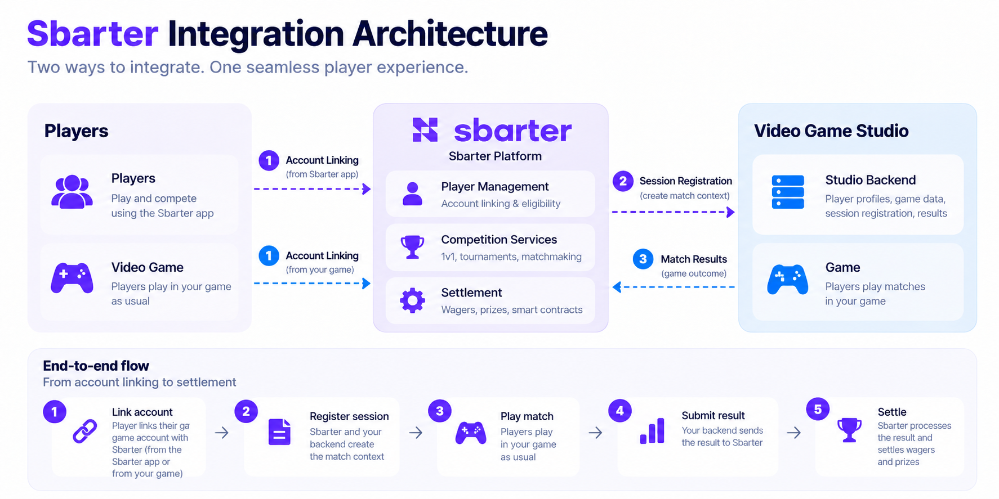

# Integration Model

Sbarter orchestrates the competition while the game studio operates the game and supplies its authoritative results. The published integration is built around HTTPS APIs and a Sbarter-hosted result callback.

## Interaction directions

| Interaction | Caller → receiver | Published operation |
| --- | --- | --- |
| Generate an account-linking deep link | Game studio → Sbarter | `POST /v1/linking/deeplink/generate` |
| Check game-account linking status | Game studio → Sbarter | `POST /v1/linking/status` |
| Request in-game linking confirmation | Sbarter → Game studio | `POST /v1/sbarter/gamer/validate/in-app` |
| Return a linking decision | Game studio → Sbarter | `POST /v1/linking/in-app/{requestId}` |
| Retrieve a player profile snapshot | Sbarter → Game studio | `POST /v1/sbarter/gamer/profile` |
| Register a game session | Sbarter → Game studio | `POST /v1/session` |
| Submit contest results | Game studio → Sbarter | `POST /v1/webhooks/game-studio/match-result` |

See **API Reference** in the left navigation for the authoritative request and response schemas.

## Linking patterns

**Game-studio initiated:** the studio generates a single-use deep link for its authenticated player. The player signs in to Sbarter and completes linking. The studio can subsequently query linking status. Redeeming the deep link does not itself trigger a studio callback.

**Sbarter initiated:** Sbarter requests in-game confirmation for an already-known `providerUserId`. The studio presents the confirmation to the player and calls the exact `webhookUrl` supplied by Sbarter to return the decision.

## Session and result flow

1. Sbarter identifies two linked participants.
2. Sbarter calls the studio's `POST /v1/session` with the canonical Sbarter `sessionId`, both player identifiers, expiry information and `webhookUrl`.
3. The studio registers the session. Retrying the same effective request using the same `sessionId` must not create a duplicate.
4. When the game ends, the studio submits its result to the supplied Sbarter callback. Duplicate logical results are safe when correlated by `sessionId + matchId`.
5. Sbarter processes the result under the applicable competition rules.

## Authentication by direction

- **Studio → Sbarter:** OAuth 2.0 client credentials with appropriate grants.
- **Sbarter → Studio:** the studio's `X-API-Key` as specified in the published Game Studio API.

