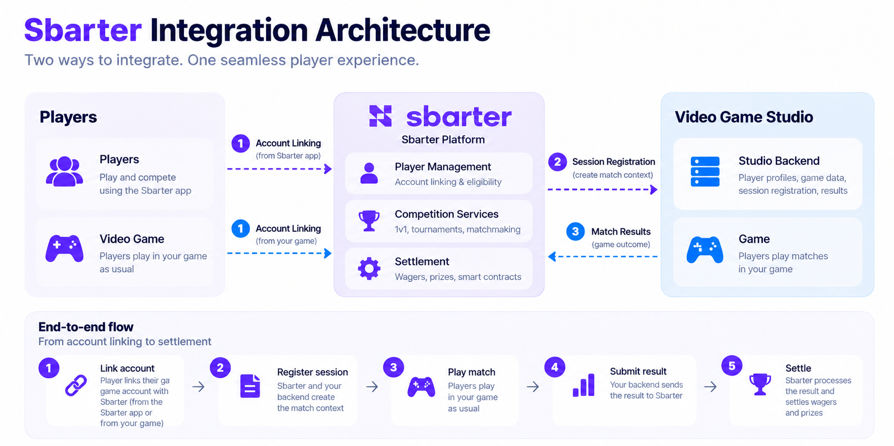

# Integration Model

Sbarter orchestrates the competition while the game studio operates the game and supplies its authoritative results. The published integration is built around HTTPS APIs and a Sbarter-hosted result callback.

## One host per studio

- **Your Sbarter API host.** Your backend calls `https://partners.<env>.sbarter.com/<slug>`; the slug is given by Sbarter at onboarding. See [Environments](./authentication.md#environments).
- **An adapter on Sbarter's side.** Behind that host, a studio adapter checks your token (it carries your studio id), calls your Game Studio API with the key you issued, and builds the callback URLs (`webhookUrl`) Sbarter sends you.
- **Your own API.** If your studio already has an API for these interactions, Sbarter can map to it in your adapter instead of you implementing the Game Studio API as published.
- **Sandbox first.** Until your API is live, Sbarter's simulator answers in its place, so the Sbarter API can be exercised end to end. See [Sandbox and live mode](./authentication.md#sandbox-and-live-mode).

## Interaction directions

| Interaction | Caller → receiver | Published operation |
| --- | --- | --- |
| Check credentials end to end | Game studio → Sbarter | `GET /v1/auth/check` |
| Generate an account-linking deep link | Game studio → Sbarter | `POST /v1/linking/deeplink/generate` |
| Check game-account linking status | Game studio → Sbarter | `POST /v1/linking/status` |
| Request in-game linking confirmation | Sbarter → Game studio | `POST /v1/sbarter/gamer/validate/in-app` |
| Return a linking decision | Game studio → Sbarter | `POST /v1/linking/in-app/{requestId}` |
| List your games and their challenge settings | Game studio → Sbarter | `GET /v1/games`, `GET /v1/games/{gameUUID}/settings` |
| List active challenges and challenge types | Game studio → Sbarter | `GET /v1/challenges`, `GET /v1/challenges/types` |
| Open challenge creation in Sbarter from the game | Game studio → Sbarter | `POST /v1/challenges/deeplink/generate` |
| Challenge notifications | Sbarter → Game studio | `POST /v1/challenge/creation`, `/invite`, `/acceptance`, `/await-opponent`, `/completion` |
| Retrieve a player profile snapshot | Sbarter → Game studio | `POST /v1/sbarter/gamer/profile` (published, not called in the current Level 3 flow) |
| Register a game session | Sbarter → Game studio | `POST /v1/session` |
| Submit contest results | Game studio → Sbarter | `POST /v1/webhooks/game-studio/match-result` |

See **API Reference** in the left navigation for the authoritative request and response schemas.

## Linking patterns

**Game-studio initiated:** the studio generates a single-use deep link (valid at most 15 minutes) for its authenticated player. The player opens it, signs in to Sbarter and the account is linked at once. The studio can subsequently query linking status. Redeeming the deep link does not itself trigger a studio callback.

**Sbarter initiated:** the player adds the game in the Sbarter app and types their game account id. Sbarter requests in-game confirmation for that `providerUserId`; the studio answers `202` at once, presents the confirmation to the player and calls the exact `webhookUrl` supplied by Sbarter to return the decision.

A game account can be linked to one Sbarter player at a time (`errorCode` `GI0023`). See [Account Linking](../guides/account-linking.md).

## Session and result flow

1. Sbarter identifies two linked participants.
2. Sbarter calls the studio's `POST /v1/session` with the canonical Sbarter `sessionId`, the `challengeId` the challenge notifications carried, both player identifiers, expiry information and `webhookUrl`.
3. The studio registers the session. Retrying the same effective request using the same `sessionId` must not create a duplicate.
4. When the game ends, the studio submits its result to the supplied Sbarter callback. Duplicate logical results are safe when correlated by `sessionId + matchId`.
5. Sbarter processes the result under the applicable competition rules.

## Authentication by direction

- **Studio → Sbarter:** OAuth 2.0 client credentials with appropriate grants.
- **Sbarter → Studio:** the studio's `X-API-Key` as specified in the published Game Studio API. Every call is a `POST` with a JSON body; Sbarter waits up to 10 seconds, any `2xx` counts as delivered, `4xx` as a refusal, and `5xx`, `429` or a timeout as the studio being unavailable. See [How Sbarter calls your API](./authentication.md#how-sbarter-calls-your-api).

Call `GET /v1/auth/check` after onboarding: `204` means the token, studio, slug and gateway are all in place.

