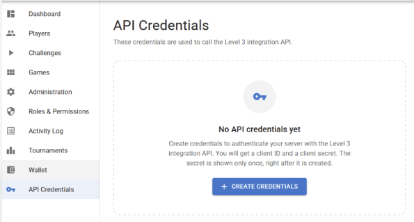
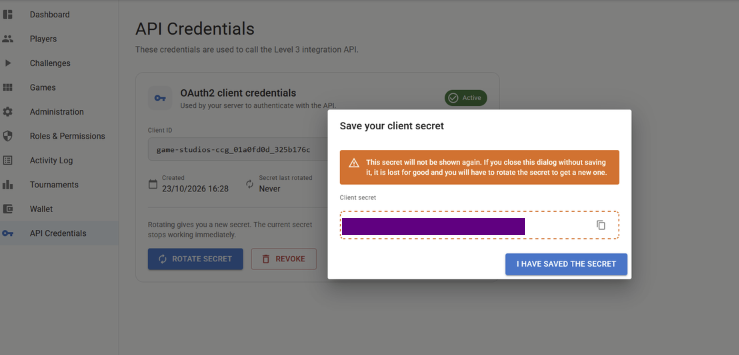
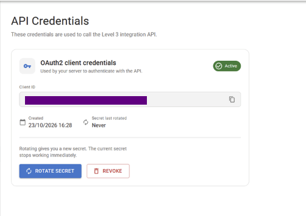

# Authentication & Credentials

The Sbarter integration uses different authentication schemes depending on which party initiates the call.

## Obtaining API Credentials

Video Game Studios obtain and manage their API credentials through the **Sbarter Studio Web Portal**.

Access to the portal must first be requested and approved by Sbarter. Once access is granted, an authorised studio representative can generate the OAuth 2.0 credentials required to connect the studio's backend to the Sbarter API.

### Step 1. Obtain Studio Web Portal access

Request access to the **Sbarter Studio Web Portal** through your Sbarter integration contact.

Once your studio has been approved and access provisioned, sign in using your assigned account.

### Step 2. Open API Credentials

From the Studio Web Portal's main navigation, click the **key icon**, labelled **API Credentials**.

If your studio has not generated credentials, the page displays a **Create Credentials** button.



### Step 3. Create credentials

Click **Create Credentials**.

The Studio Web Portal generates:

| Credential | Description |
|---|---|
| `client_id` | Unique identifier for your studio's API integration |
| `client_secret` | Confidential secret used to obtain OAuth 2.0 access tokens |

### Step 4. Save your client secret

**Important: The client secret is displayed only once.**

Copy the secret and store it securely before closing the confirmation dialog.



If the secret is lost, you must rotate it to generate a replacement.

Never commit client secrets to source control, embed them in mobile applications or expose them in browser-side JavaScript.

### Step 5. Obtain an access token

Use the generated `client_id` and `client_secret` with the OAuth 2.0 Client Credentials grant to request an access token.

See the **Obtain Access Token (Client Credentials)** operation in the [Sbarter API Reference](/server).

Use the returned bearer token when calling protected Sbarter API endpoints.

## Managing API Credentials

Once credentials exist, the Studio Web Portal displays their status and management controls.



### Rotate Secret

Click **Rotate Secret** to generate a replacement client secret.

**The previous secret stops working immediately.**

Store the replacement securely and update your backend configuration.

### Revoke Credentials

Click **Revoke** to invalidate the credentials.

Revocation prevents further access-token requests using those credentials. The treatment of previously issued access tokens depends on the token validation and revocation policy.

Only authorised studio administrators should perform credential rotation or revocation.

## Security Recommendations

- Use the credentials only in secure, server-side applications.
- Store client secrets in a secret manager.
- Never share credentials between studios.
- Restrict access to authorised technical personnel.
- Rotate credentials immediately if compromise is suspected.
- Use the appropriate credentials and endpoints for each environment.

## Game studio calling Sbarter

Authorised studio users generate `client_id` and `client_secret` in the Studio Web Portal. Obtain a bearer access token using the OAuth 2.0 client credentials grant and include it on protected Sbarter API calls:

```http
Authorization: Bearer <access_token>
```

The published token route is:

```http
POST /realms/studio_investor/protocol/openid-connect/token
Content-Type: application/x-www-form-urlencoded
User-Agent: <studio>-backend/1.0
```

Request body:

```text
grant_type=client_credentials&client_id=<client_id>&client_secret=<client_secret>
```

Example:

```bash
curl -X POST "https://<keycloak-host>/realms/studio_investor/protocol/openid-connect/token" \
  -H "Content-Type: application/x-www-form-urlencoded" \
  -H "User-Agent: <studio>-backend/1.0" \
  -d "grant_type=client_credentials&client_id=<client_id>&client_secret=<client_secret>"
```

Use the correct Keycloak host for the selected environment, as specified in the Sbarter API reference. Never include real client secrets in documentation, logs or source control.

### Required request headers

| Header | Required | Value |
| --- | --- | --- |
| `Content-Type` | Yes, on the token request | `application/x-www-form-urlencoded` |
| `User-Agent` | Yes, on every request to Sbarter | Any non-empty value identifying your client, e.g. `<studio>-backend/1.0` |
| `Authorization` | Yes, on protected API calls | `Bearer <access_token>`. Not sent on the token request |

Requests without a `User-Agent` header, or with an empty one, are rejected at the Sbarter network edge with `403 Forbidden` and an HTML body, before they reach the token endpoint or the API. Most HTTP clients (curl, Postman, Go, Python, Java, Node.js) send `User-Agent` by default; set it explicitly if your client strips default headers.

Other headers your HTTP client adds automatically (`Host`, `Content-Length`, `Accept`, `Accept-Encoding`, `Connection`) are not required by Sbarter.

Find the detailed documentation of this request here: 
[Obtain Access Token (Client Credentials)](../server/oauth-2.0-client-credentials/obtainclientcredentialstoken)


## OAuth scopes

| Scope | Purpose |
| --- | --- |
| `linking.deeplink.write` | Generate linking deep links |
| `linking.read` | Query linking status |
| `linking.write` | Submit in-app linking decisions |
| `webhook.write` | Submit contest results |

Scopes are assigned individually. Inspect the `scope` claim on the issued token instead of assuming every scope is present.

## Sbarter calling the game studio

The published Game Studio API uses the `X-API-Key` request header:

```http
X-API-Key: <studio-issued-api-key>
```

The studio issues this credential for Sbarter's server-to-server calls, including in-app linking confirmation, profile retrieval and session registration.

## Credential handling

- Use TLS for all API interactions.
- Keep credentials in a secret-management system rather than in application code or Markdown files.
- Cache the access token and request a new token before `expires_in` elapses. Client Credentials tokens do not use refresh tokens; avoid requesting a token for every API call.
- Limit credential access to the intended environment and integration.
- Avoid including tokens, secrets or raw personal data in logs.
- Use the sandbox/test environment before production.

## Common authentication errors

| HTTP status | Meaning / action |
| --- | --- |
| `400 invalid_request` on the token request | Body not sent as `application/x-www-form-urlencoded`, or a form parameter is missing |
| `401 invalid_client` on the token request | Unknown `client_id`, or credentials used against the wrong environment |
| `401 unauthorized_client` on the token request | Wrong, empty, rotated or revoked `client_secret` |
| `401 Unauthorized` | Missing, expired or invalid credential; obtain a valid token or verify API key |
| `403 Forbidden` with an HTML body | `User-Agent` header missing or empty; see [Required request headers](#required-request-headers) |
| Any other `403 Forbidden` | Token does not provide the required scope, or access is not permitted |
| `429 Too Many Requests` | Back off according to the receiving API's rate limits, where applicable |

See the individual operations in **API Reference** for the definitive supported response codes and security requirements.
