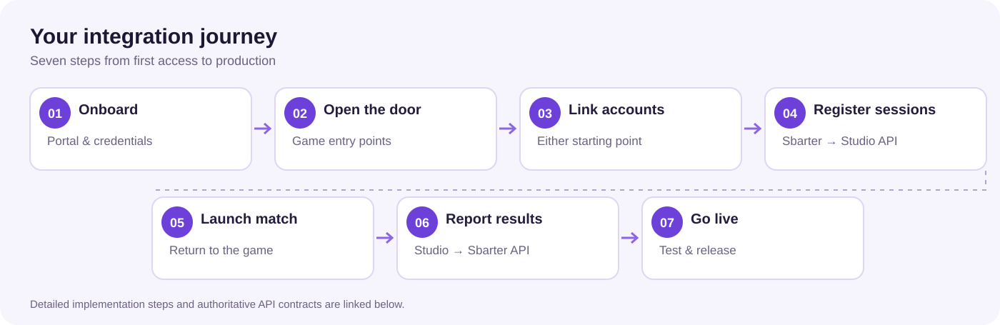

# Quick Start

Integrating your Video Game with Sbarter follows seven steps, from Studio Web Portal onboarding to production launch. Your studio continues to operate the game and its backend; Sbarter manages competition participation, orchestration and settlement.

## 1. Onboard

Complete the commercial and technical onboarding with Sbarter, obtain access to the **Studio Web Portal**, and register your studio and Video Game as instructed. Agree the supported game modes and rulesets. In the portal, open **API Credentials** (key icon) to create your OAuth `client_id` and one-time `client_secret`. Provide Sbarter with your Game Studio API base URL and the API key required for Sbarter-to-studio requests through an approved secure channel.

**Next:** [Authentication & Credentials](./authentication.md)

## 2. Open the door

Add Sbarter entry points to your Video Game, such as a menu link or competition invitation. For a game-initiated journey, generate a linking deep link and direct players to Sbarter. If the app is not installed, the proposed onboarding journey includes a studio-branded introduction and app-store links; confirm deferred-link behaviour as part of your integration.

**Next:** [Notifications & Deep Linking](../guides/notifications.md)

## 3. Link accounts

Support one-time linking between each player's Video Game account and Sbarter account. The journey can start inside the Video Game or the Sbarter app. Use the applicable published linking operations, and check linking status when your game needs to confirm completion, including when it regains focus.

**Next:** [Account Linking](../guides/account-linking.md)

## 4. Register sessions

When a 1v1 challenge or tournament match is ready, Sbarter calls the studio-hosted `POST /v1/session` operation with the session and player context. Implement idempotent registration using `sessionId`. Direct match-launch information, such as a launch URL, is an integration capability to agree and verify against the current API contract.

**Next:** [1v1 Challenge Integration](../guides/one-v-one.md)

## 5. Bring the player back

Enable players to move from Sbarter into the correct Video Game session with as few steps as possible. Where supported, handle the match launch link so both players reach the preconfigured match; coordinate app-link handling, opponent waiting and fallback behaviour with Sbarter.

**Next:** [Notifications & Deep Linking](../guides/notifications.md)

## 6. Report the result

Send the authoritative server-side match result to the result callback supplied during session registration, with the required authentication and session identifiers. Sbarter validates the result and manages competition settlement or tournament progression. Any studio revenue share or oracle fee is subject to the applicable commercial agreement and supported settlement arrangements.

**Next:** [Game Results & Reconciliation](../guides/game-results.md)

## 7. Test and go live

Complete agreed sandbox and conformance scenarios, including linking failures, duplicate session registration, result retries and missing-result handling. Coordinate sign-off and production environment access with Sbarter before launch. Rollout sequencing and supported jurisdictions are agreed separately.

**Next:** [Testing & Releases](../testing/index.md)

> **Implementation status:** This page combines currently published API operations with planned journey capabilities. Follow the linked guides and API Reference for the authoritative contracts, and do not assume proposed launch, notification, eligibility or reconciliation endpoints are already available.
