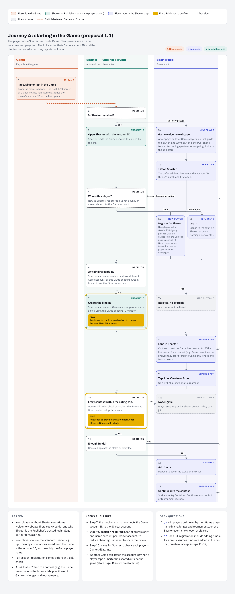
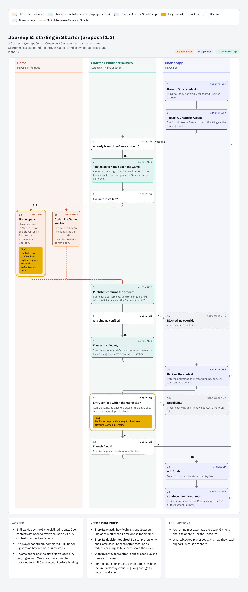

# Account Linking

Account linking associates a player's Sbarter account with their verified game account so Sbarter can identify the correct participants and associate game-server results with the correct competition entries. A binding is a **one-to-one association**: a game account can be linked to one Sbarter player at a time (`errorCode` `GI0023`). It lasts until the player removes the game from their Sbarter library, which frees the game account for linking again.

Two entry points are described: a player may arrive from **a Video Game (Journey A)** or begin inside **Sbarter (Journey B)**. Both ultimately return the player to a challenge or tournament and apply eligibility checks before an entry is accepted.

## Journey A: Start in the publisher's game

[View original PDF](./pdf/Game%20x%20Sbarter%20account%20binding.pdf)
### Player and platform sequence

1. The authenticated player in the Video Game selects a Sbarter link from the game's menu, banner, post-contest screen or another supported entry point. At that moment your backend mints a single-use link for the player's account (`providerUserId`) and hands it to the player.
2. If Sbarter is installed, the link opens the app. Without the app, it opens a Sbarter page showing your game and studio with the store links; after installation the app picks the link up on its first start. The 15-minute lifetime of the link still applies.
3. Sbarter determines whether the player is new, registered but unbound, or already bound to the same Video Game identity.
4. New players register; returning players sign in. The app keeps the link until the player is signed in, then redeems it.
5. Sbarter checks for a conflicting binding: a Video Game account already linked to another Sbarter player (`GI0023`), or the game already in the player's Sbarter library (`GI0006`), prevents linking.
6. If valid, Sbarter records the binding at once. There is no separate confirmation step: the player sees **Game connected** with your `providerDisplayName`, game name and icon. The player then lands on the link's destination (a challenge or tournament), or continues the normal journey if the link had none.
7. When entering an **Entry** contest, Sbarter evaluates the Video Game skill rating against the configured cap. **Open** contests do not use that skill-cap check.
8. Sbarter checks funds, offers funding where necessary and continues into the competition journey.

### API mapping

| Technical action | Published operation | Implementation note |
| --- | --- | --- |
| Generate a Video Game-linked entry point | [`POST /v1/linking/deeplink/generate`](/server/vgp-deeplink/generatelinkingdeeplink) | Your game calls this with the player's account id in your system and, strongly recommended, `providerDisplayName`. Sbarter returns a single-use link that you can deliver however you like; push, in-game message, email. When the player taps it on their mobile device, the Sbarter app opens (or the fallback page opens), they sign in, and the app shows **Game connected** with your `providerDisplayName`. Your game appears in their Sbarter library. There is no callback to your studio |
| Send the player to a contest after linking | Optional `destination` on the same call | `type` (`challenge` or `tournament`) and the Sbarter `resourceId`. See [Destinations](#destinations) |
| Check whether accounts are linked | [`POST /v1/linking/status`](/server/vgp-link-status) | Call it when your game regains focus. Answers `200` with `linked`, and `nickname`, `avatar`, `linkedAt` when linked. An unknown account, or another studio's, answers `linked: false`, never `404`. |
| Read game-side player metadata | [`POST /v1/sbarter/gamer/profile`](/client/provider-profile) | Published Sbarter-to-publisher contract, not called by Sbarter in the current Level 3 flow. The profile snapshot reaches Sbarter with an accepted in-app linking decision ([Journey B](#journey-b-start-in-the-sbarter-app)). |
| Register/sign in, eligibility and funds | Sbarter application responsibilities | Not publisher API operations in this guide. |

### Deep link rules

| Rule | Behaviour |
| --- | --- |
| Lifetime | Single use, at most **15 minutes**. A later `expiresAt` is stored at that cap and a missing one defaults to it; read `expiresAt` in the response rather than assuming the requested value was kept. Mint the link when the player asks for it, not in advance. |
| Form | An https link, `https://connect.sbarter.com/linking/confirm/dl_…` in production (`connect.test.sbarter.com` on staging). Hand it over whole; never rebuild it from `linkId`. |
| Several links | Allowed for an account that is not linked yet. Once one is redeemed, the others are refused with `GI0023` and stay unused. |
| Already linked account | No link is minted: `467` with `errorCode` `GI0023` (except with a `challenge` destination, which needs a linked account). Check `POST /v1/linking/status` first. |
| Studio feedback | None. Redeeming the link sends nothing to your studio; call `POST /v1/linking/status` when the game regains focus. |

### When the link does not link

Redemption is all-or-nothing: a refused link stays unused and nothing is linked. These codes are shown to the player who taps the link, never returned to your studio, which sees only `linked: false` on the status call.

| Reason | `errorCode` | What to do |
| --- | --- | --- |
| Link expired (or from another environment) | `GI0022` | Mint a new link |
| Link already used | `GI0021` | Mint a new link |
| Game account linked to another Sbarter player meanwhile | `GI0023` | The player removes the game from the other Sbarter account first |
| Player already has this game in their Sbarter library | `GI0006` | Remove it in Sbarter, then link again |
| Player not verified, banned, or excluded by country or age rules | `GI0012`, `GI0007`, `GI0008`–`GI0010` | Player action in Sbarter |

### Destinations

`destination` is optional. Sbarter checks that the target exists, belongs to the same game and is open for participation: a challenge waiting for an opponent and not expired, or a tournament still open for registration. A target that fails these checks is a `404` and no link is minted.

- A `challenge` destination is for a player who is **already linked**; otherwise `403`. A private challenge can only be opened for a player invited to it; otherwise `403`. Take the challenge id from `GET /v1/challenges`.
- A `tournament` destination also works for a player who is not linked yet. Take the tournament id from the Studio Web Portal or ask Sbarter.

## Journey B: Start in the Sbarter app

[View original PDF](./pdf/Game%201v1%20&%20tournament%20player%20journey.pdf)

### Player and platform sequence

1. A registered Sbarter player adds the Video Game in the Sbarter App, from the game library or by tapping **Join**, **Create** or **Accept** on one of its contests before linking, and types their Video Game account id.
2. Sbarter checks whether that account is already bound. A game account already linked to another Sbarter player is rejected before your studio is asked (`GI0023`), and a player can have only one pending attempt per game.
3. Sbarter calls your `POST /v1/sbarter/gamer/validate/in-app` with `providerGameId`, `providerUserId`, its own `internalId`, `expiresAt` and `webhookUrl`. Your API answers `202` at once. The attempt expires **15 minutes** after it starts.
4. The Video Game asks the authenticated player to confirm the link. The player authenticates to the Video Game if required; guest accounts must be upgraded before binding under the proposal.
5. The Video Game Studio's server posts the decision, `accepted`, `rejected` or `expired` with `confirmedAt`, to the exact `webhookUrl`. An `accepted` decision also carries `providerDisplayName`, `profileCapturedAt` and `profileStats`.
6. Sbarter checks binding conflicts again and records the binding; the one-to-one rule blocks conflicts rather than overriding existing bindings. Sbarter notifies the player of the result itself, by push.
7. On success, the player returns to the contest, undergoes the Entry skill-cap check if applicable, and completes the funds check before entering.

### API mapping

The published in-game-confirmation integration includes these operations:

| Operation | Direction | Published behavior |
| --- | --- | --- |
| [`POST /v1/sbarter/gamer/validate/in-app`](/client/vgp-in-app-confirmation) | Sbarter → Publisher | Ask the publisher to validate, in game, the `providerUserId` the player typed in Sbarter. Answer `202` right away; the decision follows on `webhookUrl`. |
| [`POST /v1/linking/in-app/{requestId}`](/server/vgp-in-app-confirmation/postinapplinkingresult) | Publisher → Sbarter | Return the linking decision to the exact `webhookUrl`; the `requestId` is already in it. Requires the `linking.write` scope. |

### Decision rules

| Situation | Sbarter's answer |
| --- | --- |
| First decision before `expiresAt` | `202`; the decision is final for that `requestId` |
| The same `requestId` decided again | `409`; nothing changes, so a retry is safe |
| Unknown `requestId`, or another studio's | `404` |
| `accepted` for a game account linked to another player meanwhile | `467` with `errorCode` `GI0023`; stored as `rejected` and the player's pending link is cleared |
| Decision after `expiresAt` | Stored as `expired` |
| Player linked the game through a deep link while the attempt was pending | The attempt is closed; a late decision gets `409` |

Sbarter may send the same request again, with the same `requestId` and `expiresAt`, if it did not get your `202`. Treat a repeat as the same attempt, not a new one.

## Binding rules and error handling

| Scenario | Behavior | Notes |
| --- | --- | --- |
| Already linked to same account | Continue without repeating binding | A deep link is not minted for an already linked account (`GI0023`); check `POST /v1/linking/status` first |
| Sbarter account already has the Video Game in its library, with a different Video Game account | Reject new binding (`GI0006`) | The player removes the game in Sbarter, then links again |
| Video Game account linked to a different Sbarter account | Reject new binding (`GI0023`) | Decided: one Sbarter player per game account at a time. The account is free again once that player removes the game from their Sbarter library |
| Player is on a Video Game guest account | Authenticate or upgrade to a full account before binding | Video Game Studio to confirm guest-account procedure |
| Deep link expired or already used | Do not bind; mint a new link (`GI0022`, `GI0021`) | Links live at most 15 minutes and are single use |
| In-app attempt expired | Do not bind; the player starts again in Sbarter | Attempts expire 15 minutes after they start |
| Video Game skill rating exceeds Entry cap | Show ineligible and relevant alternatives | Publisher rating retrieval mechanism to be confirmed |
| Player lacks required entry funds | Offer funding before competition entry | Sbarter application behavior |

## Related documentation

- [Integration Overview](./)
- **API Reference → Sbarter API**: linking-generation, linking-status and in-app confirmation callback.
- **API Reference → Game Studio API**: in-app validation and player profile.
- **Getting Started → Integration Architecture**: endpoints by caller and receiver.
