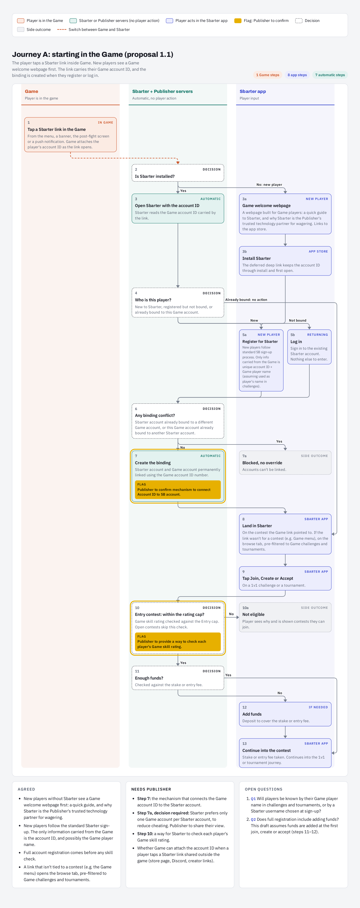
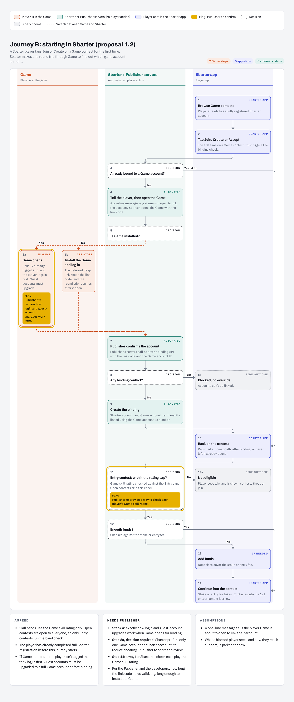

# Account Linking

Account linking associates a player's Sbarter account with their verified game account so Sbarter can identify the correct participants and associate game-server results with the correct competition entries. In the onboarding design, the proposed binding is intended to be a **permanent one-to-one association** and to require no manual copying of identifiers by the player.

Two entry points are described: a player may arrive from **a Video Game (Journey A)** or begin inside **Sbarter (Journey B)**. Both ultimately return the player to a challenge or tournament and apply eligibility checks before an entry is accepted.

## Journey A: Start in the publisher's game

[View original PDF](./pdf/Game%20x%20Sbarter%20account%20binding.pdf)
### Player and platform sequence

1. The authenticated player in the Video Game selects a Sbarter link from the game's menu, banner, post-match screen or another supported entry point. The link carries the Video Game account identifier.
2. If Sbarter is installed, it opens with that context. For a new player without the app, the proposal shows a Video Game welcome page followed by installation; a deferred deep link preserves the account context.
3. Sbarter determines whether the player is new, registered but unbound, or already bound to the same Video Game identity.
4. New players register; returning players sign in. An existing matching binding needs no new action.
5. Sbarter checks for a conflicting binding. Under the proposed one-to-one policy, either a Video Game account already associated with another Sbarter account, or a Sbarter account linked to another Video Game account, prevents linking.
6. If valid, Sbarter records the binding. The player lands on the referenced contest, or on a Video Game-filtered browsing view if the link was generic.
7. When entering an **Entry** contest, Sbarter evaluates the Video Game skill rating against the configured cap. **Open** contests do not use that skill-cap check.
8. Sbarter checks funds, offers funding where necessary and continues into the competition journey.

### API mapping

| Technical action | Published operation | Implementation note |
| --- | --- | --- |
| Generate a Video Game-linked entry point | [`POST /v1/linking/deeplink/generate`](/server/vgp-deeplink/generatelinkingdeeplink) | Your game calls this with the player's account id in your system. Sbarter returns a single-use link that you can deliver however you like — push, in-game message, email. When player taps it while on their Mobile Device, the Sbarter app opens (or fallback page opens), they sign in, and they see a confirmation screen naming your game and the account. After they confirm it, your game appears in their Sbarter library |
| Check whether accounts are linked | [`POST /v1/linking/status`](/server/vgp-link-status) | Publisher can check the account-link status. |
| Read game-side player metadata | [`POST /v1/sbarter/gamer/profile`](/client/provider-profile) | Sbarter-to-publisher contract. Do not assume that the specific Video Game skill-rating attribute is already exposed without checking the schema. |
| Register/sign in, eligibility and funds | Sbarter application responsibilities | Not publisher API operations in this guide. |

## Journey B: Start in the Sbarter app

[View original PDF](./pdf/Game%201v1%20&%20tournament%20player%20journey.pdf)

### Player and platform sequence

1. A registered Sbarter player browses contests for the Video Game in the Sbarter App and taps **Join**, **Create** or **Accept**.
2. Sbarter checks whether that account is already bound to your Video Game account. A matching existing binding skips the round trip.
3. If unbound, Sbarter informs the player that the Video Game will open and passes a one-time link code that is requested from you (Under Development).
4. The Video Game opens (or is first installed and then opened via a deferred link). The player authenticates to the Video Game if required; guest accounts must be upgraded before binding under the proposal.
5. The Video Game Studio's server associates the authenticated Video Game account ID with the link code and returns the evidence to Sbarter.
6. Sbarter checks binding conflicts; the one-to-one proposal blocks conflicts rather than overriding existing bindings.
7. On success, the player returns to the contest, undergoes the Entry skill-cap check if applicable, and completes the funds check before entering.

### API mapping and current gap

The published in-game-confirmation integration includes these operations:

| Operation | Direction | Published behavior |
| --- | --- | --- |
| [`POST /v1/sbarter/gamer/validate/in-app`](/client/vgp-in-app-confirmation) | Sbarter → Publisher | Ask the publisher to validate an already identified `providerUserId` in game. |
| [`POST /v1/linking/in-app/{requestId}`](/server/vgp-in-app-confirmation/postinapplinkingresult) | Publisher → Sbarter | Return the linking decision using the request identifier / callback provided for that operation. |

## Binding rules and error handling

| Scenario | Proposed behavior | Confirmation needed |
| --- | --- | --- |
| Already linked to same account | Continue without repeating binding | Confirm idempotent treatment in deployed integration |
| Sbarter account linked to a different Video Game account | Reject new binding | Confirm permanent one-to-one policy with the Video Game Studio |
| Video Game account linked to a different Sbarter account | Reject new binding | Confirm permanent one-to-one policy with the Video Game Studio |
| Player is on a Video Game guest account | Authenticate or upgrade to a full account before binding | Video Game Studio to confirm guest-account procedure |
| One-time link code has expired | Do not bind; restart safely | Code expiry, replay semantics and errors to be agreed |
| Video Game skill rating exceeds Entry cap | Show ineligible and relevant alternatives | Publisher rating retrieval mechanism to be confirmed |
| Player lacks required entry funds | Offer funding before competition entry | Sbarter application behavior |

## Related documentation

- [Integration Overview](./)
- **API Reference → Sbarter API**: linking-generation, linking-status and in-app confirmation callback.
- **API Reference → Game Studio API**: in-app validation and player profile.
- **Getting Started → Integration Architecture**: endpoints by caller and receiver.
