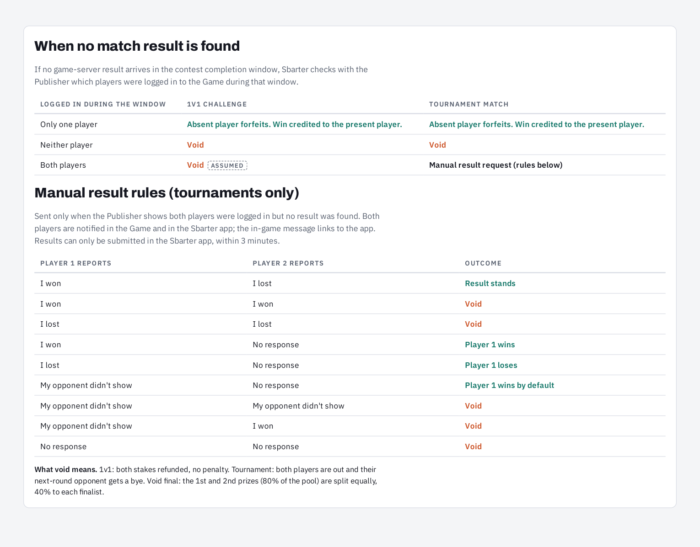

# Game Results & Reconciliation

This guide explains how a **Video Game Studio** reports authoritative contest results to Sbarter and how the proposed competition journeys resolve contests when no reliable game-server result is received. It applies to both standalone **1v1 challenges** and individual two-player **tournament contests**.

> **Integration status:** The contest-result webhook is defined in the published Sbarter API. Studio-side result lookup, login/presence evidence, finality reconciliation and manual tournament result workflows are **not specified by the current published OpenAPI contracts**. The exception rules below come from the supplied player journey v8 and remain subject to product and Studio implementation agreement.

## Responsibility boundary

- **Video Game Studio:** Hosts gameplay, produces a trusted server-side contest result and delivers it to the Sbarter callback. If subsequently agreed, supplies trusted evidence about whether each player was logged in during the completion window.
- **Sbarter:** Correlates the result with a registered session, applies competition-specific rules, determines the contest outcome, advances tournament brackets where applicable and settles funds.
- **Player:** Plays inside the Video Game. In the proposed **tournament-only** missing-result scenario, may submit a manual result report **in the Sbarter app**, never through a required publisher reporting screen.

## Result lifecycle



## Published API operations

| Action | Direction | API reference | Status |
| --- | --- | --- | --- |
| Register a two-player game session | Sbarter → Video Game Studio | [`POST /v1/session`](/client/session/paths/~1v1~1session/post) | **Published**. |
| Submit the authoritative result | Video Game Studio → Sbarter | [`POST /v1/webhooks/game-studio/match-result`](/server/webhook/postmatchresultwebhook) | **Published**. |
| Retrieve a result from the Studio after a missed callback | Sbarter → Video Game Studio | No published operation | **Under Development**. |
| Request login/presence evidence during a contest window | Sbarter → Video Game Studio | No published operation | **Under Development**. |
| Request manual tournament results from players | Sbarter app / proposed in-game notification | No published Studio API operation | **Under Development**; any Studio notification contract is separate. |

### Authoritative result submission

During `POST /v1/session`, Sbarter supplies the `webhookUrl` that the Studio **must use** for the result callback. The published webhook accepts `application/json` with the following structure:

| Field | Published requirement | Meaning |
| --- | --- | --- |
| `providerGameId` | Required | Video Game identifier |
| `sessionId` | Required, UUID | Canonical Sbarter session identity |
| `matchId` | Required | Studio-side identifier of the contest |
| `status` | Required | One of `win`, `draw`, `failed`, `voided` |
| `players` | Required, exactly two entries | Each entry requires `providerUserId`, `internalId`, `outcome`; `outcome` is `win`, `loss` or `draw` |
| `startedAt`, `finishedAt` | Optional timestamps | Contest activity times when available |

The `internalId` property is marked **required but nullable** in the published `PlayerGameResult` schema. Consult the OpenAPI reference for exact serialization requirements. Do not infer a winner solely from `status` without evaluating the two player outcomes and the competition rules.

**Authentication:** OAuth 2.0 Client Credentials bearer token with `webhook.write` scope. The documented responses are `202` (accepted, including duplicate retries), `400`, `401`, `403` and `500`.

**Idempotency:** The published contract uses `sessionId + matchId` as the logical result idempotency key. The Studio may retry delivery without creating multiple settlements. Whether an existing logical result can later be corrected or superseded is **not defined** by the provided OpenAPI operation; any correction procedure must be agreed separately.

### Example payload

The following is a **synthetic illustration** of the published schema, not live account or contest data:

```json
{
  "providerGameId": "sample-game",
  "sessionId": "123e4567-e89b-12d3-a456-426614174000",
  "matchId": "match-001",
  "status": "win",
  "players": [
    {
      "providerUserId": "studio-user-a",
      "internalId": "sbarter-user-a",
      "outcome": "win"
    },
    {
      "providerUserId": "studio-user-b",
      "internalId": "sbarter-user-b",
      "outcome": "loss"
    }
  ]
}
```

## Missing result: proposed decision table

Where no trusted game-server outcome arrives within the configured competition window, the source journey proposes using Studio-supplied evidence of which players were logged in **during that window**.

| Studio evidence | Standalone 1v1 challenge | Tournament contest |
| --- | --- | --- |
| Exactly one player logged in | Present player wins by forfeit; absent player loses | Present player advances by forfeit |
| Neither player logged in | Void; refund both stakes | Void; eliminate both; downstream bracket may award a bye |
| Both players logged in | **Void and refund**; no manual 1v1 reporting | Trigger a **3-minute** manual result request in the Sbarter app |
| No trustworthy evidence available | **Unspecified**: requires operational policy; do not silently apply the above outcomes | **Unspecified**: requires operational policy |

The source's 1v1 flow also groups **both players logged in** with neither present for a void outcome; the tournament flow specifically treats both-present as eligible for manual reporting. These are intentional differences in the source design.

## Tournament-only manual result rules

The supplied journey v8 proposes a **3-minute** response window. Players choose **I won**, **I lost**, or **My opponent didn't show** in the Sbarter app. A Video Game notification may link to that screen, but the Studio does not collect the result itself.

| Player 1 reports | Player 2 reports | Proposed resolution |
| --- | --- | --- |
| I won | I lost | Player 1 wins |
| I lost | I won | Player 2 wins |
| I won | I won | Void |
| I lost | I lost | Void |
| I won | No response | Player 1 wins |
| I lost | No response | Player 1 loses |
| My opponent didn't show | No response | Player 1 wins by default |
| My opponent didn't show | My opponent didn't show | Void |
| My opponent didn't show | I won | Void |
| No response | No response | Void |

The source table lists representative report combinations; reverse-player cases should be handled symmetrically where the rule permits. **Do not implement a broader conflict-resolution matrix without an approved product specification.**

### What happens when a tournament contest is void

The source journey removes both participants from the tournament and gives the next-round opponent a bye, when applicable. If the **final** is void, the example allocates the combined first and second rewards equally, **40% of the rewards pool to each finalist** under the source's 55% / 25% reward structure. This outcome is an **example tournament rule**, not a universal platform percentage.

## Reconciliation and operational requirements

The following are recommended implementation requirements, **not existing published endpoints**:

1. Correlate every callback with an issued `sessionId`, the expected two linked player accounts and the relevant Video Game.
2. Reject or quarantine results for unknown sessions, mismatched players or invalid status/outcome combinations.
3. Define the completion window and late-result cutoff separately from the `expiresAt` session-registration field; their equivalence is not established by the current schema.
4. Define an explicit reconciliation mechanism (for example, Studio-hosted result lookup) for missed or delayed callbacks.
5. Agree whether a final result can be revised while unsettled, and ensure duplicate delivery never generates duplicate financial settlement.
6. Specify authoritative presence evidence, its time granularity and privacy/security controls before enabling forfeiture decisions.
7. Record an auditable decision for every win, forfeit, void, manual report and settlement.

## Video Game Studio implementation checklist

- [ ] Submit game-server-authoritative outcomes to the exact `webhookUrl` supplied in session registration.
- [ ] Use authenticated requests with `webhook.write` scope.
- [ ] Implement safe retries for transient failures, with deduplication based on `sessionId + matchId`.
- [ ] Provide stable identifiers for the game, contest and two participating accounts.
- [ ] Agree recovery, presence-evidence and result-finality rules with Sbarter before enabling exception-based settlement.
- [ ] Test duplicate, delayed, missing, conflicting and voided results for both 1v1 and tournament contests.

## Related documentation

- [Integration Overview](./)
- [1v1 Challenge Integration](./one-v-one/)
- [Tournament Integration](./tournaments/)
- [Notifications & Deep Linking](./notifications/)
- [Sbarter API](/server/webhook/postmatchresultwebhook)
- [Game Studio API](/client/session/paths/~1v1~1session/post)

> **Source:** *1v1 and tournament player journey v8*, especially page 3; current published `server.yaml` and `client.yaml`. All source-derived exception rules above are labelled as proposed until implementation is confirmed.
