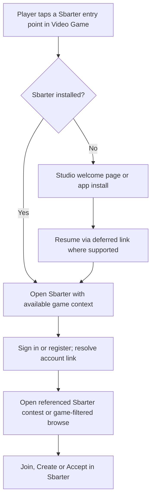
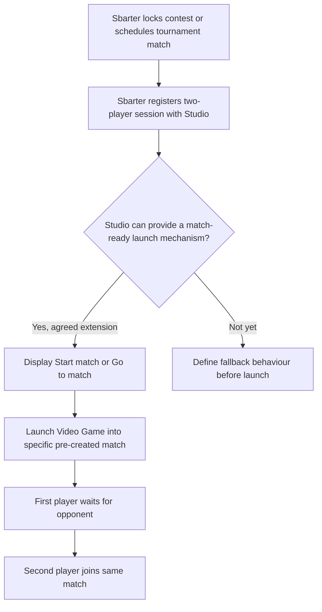

# Notifications & Deep Linking

This guide explains how a **Video Game Studio** can direct players into Sbarter and, subject to an agreed integration, surface competition messages and one-tap actions that return players to their assigned match in the **Video Game**.

The guiding principle is simple: **Sbarter manages challenges, tournaments, wagers and competition decisions; the Video Game Studio provides game identity, gameplay and optional surfaces for links and messages.** A Studio should not need to reproduce Sbarter's contest-management screens.

> **Integration status:** Sbarter publishes a deep-link generation operation for account linking and an in-game linking validation flow. Generic Studio notification delivery, match-ready events, match launch/readiness and targeted opponent discovery are **not present in the current published OpenAPI contracts**. These are proposed journey capabilities and require separate agreement.

## Integration patterns

| Pattern | Player action | Ownership | Status |
| --- | --- | --- | --- |
| Game → Sbarter account linking | Player taps a Sbarter link shown inside the Video Game | Studio presents the link; Sbarter handles login, confirmation and binding | **Published linking-generation API**, subject to the Studio implementation |
| Game → Sbarter browse or contest | Player taps game menu item, private invitation or tournament promotion | Sbarter owns destination page and entry decision | **Proposed destination / presentation experience**; do not assume every URL contract exists |
| Sbarter → Video Game account confirmation | Player confirms an existing known game account inside the Video Game | Sbarter requests verification; Studio handles in-game confirmation | **Published validation + callback APIs** |
| Sbarter → Video Game match launch | Player selects **Start match** / **Go to match** in Sbarter | Studio owns match entry and waiting-room behaviour | **Under Development** |
| Sbarter → Studio in-game notices | Player sees private invite, opponent ready or next round available inside the Video Game | Sbarter generates event; Studio decides in-game display | **Under Development** |

## Journey A: Player enters Sbarter from a Video Game

The onboarding source proposes a welcome page for first-time players, a deferred deep link preserving context through installation and a landing destination either on a specific contest or on a game-filtered browse view. **These are proposed product behaviours** and should be validated for the selected mobile platform and integration provider before launch.

### Published linking operation

| Operation | Direction | Purpose |
| --- | --- | --- |
| [`POST /v1/linking/deeplink/generate`](/server/vgp-deeplink/generatelinkingdeeplink) | Video Game Studio → Sbarter | Generates an account-linking deep link for a game account. The Studio can present or distribute it through an agreed channel. |
| [`POST /v1/linking/status`](/server/vgp-link-status) | Video Game Studio → Sbarter | Checks the account-link status for a publisher-side identity. |

These operations are **linking-related**. Do not assume the generation endpoint also produces a universal deep link for arbitrary challenges, tournaments or provisioned matches unless the schema and routing contract are extended to support those destinations.

## Journey B: Sbarter requests verification inside the Video Game

When Sbarter already knows the publisher account identifier, it can invoke the existing in-game validation mechanism:

| Operation | Direction | Purpose |
| --- | --- | --- |
| [`POST /v1/sbarter/gamer/validate/in-app`](/client/vgp-in-app-confirmation) | Sbarter → Video Game Studio | Ask the Studio to present confirmation to the identified authenticated game player. |
| [`POST /v1/linking/in-app/{requestId}`](/server/vgp-in-app-confirmation/postinapplinkingresult) | Video Game Studio → Sbarter | Return `accepted`, `rejected` or `expired` to the exact callback supplied by Sbarter. |

**Distinguish verification from discovery:** This published flow targets a known `providerUserId`. The proposed Sbarter-first **unknown-account discovery via a one-time link code** is a separate capability and is **Under Development**. See [Account Linking](./account-linking/).

## Competition messages proposed in player journey v8

| Trigger | Proposed message / action | Player destination | Studio implementation status |
| --- | --- | --- | --- |
| Private 1v1 invitation | “You have been challenged” | Specific challenge in Sbarter | **Under Development**: generic Studio notification API |
| Challenge accepted | “Opponent waiting” | Challenge details in Sbarter | **Under Development**: Studio message and direct-link support |
| Both stakes locked and match prepared | “Start match” | Existing match in Video Game | **Under Development**: match provisioning and launch contract |
| Tournament bracket ready | “Go to match” | Assigned first-round match | **Under Development** |
| Next tournament round ready | “Next round ready” / “Go to match” | Next assigned match | **Under Development** |
| Missing tournament result with both players present | “Report your result” | Manual reporting screen in Sbarter | **Under Development**; reports remain Sbarter-owned |

In all cases, **Sbarter remains the system of record for competition eligibility, fees, bracket decisions and settlement**. A Studio displays agreed messages and routes the player; it does not decide payouts or accept wagers on Sbarter's behalf.

## Proposed one-tap match launch

The current [`POST /v1/session`](/client) contract registers a session with `providerGameId`, `sessionId`, exactly two `players`, `expiresAt`, `webhookUrl` and optional `rules`. **It does not define a launch URL, a ready state, a waiting-room identifier or a Studio-to-Sbarter readiness notification.** One-tap joining in the source journeys therefore requires an extension or separately documented agreement.

## Proposed notification delivery contract

No generic Studio notification endpoint is currently published. Before a Studio implements in-game messaging, Sbarter and the Studio should agree on:

| Concern | Contract decision required |
| --- | --- |
| Delivery direction | Whether Sbarter calls a Studio-hosted endpoint or publishes another authenticated event channel |
| Event types | Standard event identifiers for invites, match-ready, next round and manual-report requests |
| Target identity | Stable game-account ID and game identifier; no reliance on display name as a key |
| Destination | Validated link / intent into Sbarter or a specific game session |
| Expiry | Notification validity and handling of expired contest or match windows |
| Idempotency | Stable event ID, duplicate delivery, retry policy and ordering |
| Visibility | Delivery acknowledgement versus actual in-game display, offline players, push availability |
| Security | Authentication, signature/token validation, minimal personally identifying data and allowed destinations |
| Capability negotiation | Which notifications and deep-link actions the Video Game actually supports |

These are **proposed contract considerations**, not fields of any currently published endpoint.

## Mobile and failure cases to validate

- Video Game or Sbarter not installed; routing after app installation; deferred-link support on each OS.
- Player not authenticated, or authenticated as a different game account than the one targeted.
- Expired or reused linking context, private invite or contest completion window.
- Challenge cancelled, declined or filled between notification delivery and click.
- Notification delivered twice, delayed, out of order or when the user is offline.
- Match not provisioned, provisioned but not ready, or first player waiting when the second cannot join.
- Opening a link from a mobile browser rather than the game or Sbarter app.
- Fallback when the Studio cannot support in-game notification or one-tap match launch.

## Video Game Studio implementation checklist

- [ ] Confirm which Sbarter entry points can be shown inside the Video Game and how the authenticated `providerUserId` is carried securely.
- [ ] Implement published account-linking operations where applicable, including status and in-game confirmation.
- [ ] Confirm the cross-app linking and deferred-install experience on supported mobile platforms.
- [ ] Agree a notification delivery and deep-link destination contract before showing Studio-side private invites or match-ready prompts.
- [ ] Agree a match provisioning/readiness/launch capability before promising one-tap entry into an assigned match.
- [ ] Verify that every displayed message can handle cancellation, expiration, re-entry and duplicate delivery safely.

## Related documentation

- [Integration Overview](./)
- [Account Linking](./account-linking/)
- [1v1 Challenge Integration](./one-v-one/)
- [Tournament Integration](./tournaments/)
- [Game Results & Reconciliation](./game-results/)
- [Sbarter API](/server)
- [Game Studio API](/client)

> **Sources:** *RB3 x Sbarter onboarding v5* (two entry journeys), *1v1 and tournament player journey v8* (pages 1–3), and the current published `server.yaml` / `client.yaml`. Partner-specific names have been generalized intentionally.
