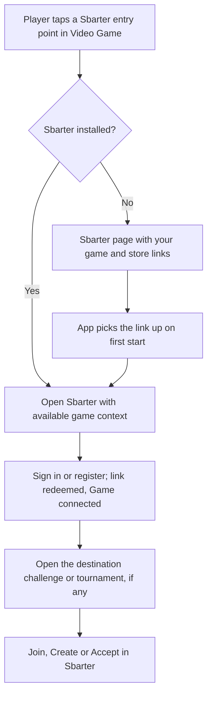
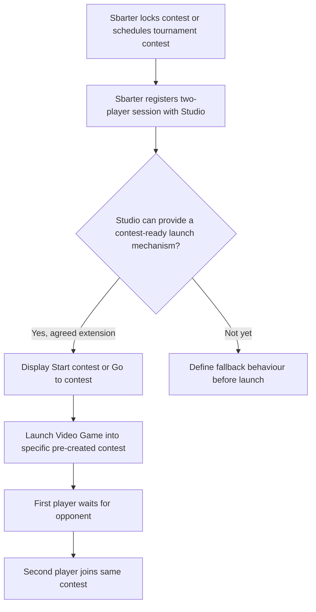

# Notifications & Deep Linking

This guide explains how a **Video Game Studio** can direct players into Sbarter and, subject to an agreed integration, surface competition messages and one-tap actions that return players to their assigned contest in the **Video Game**.

The guiding principle is simple: **Sbarter manages challenges, tournaments, stakes and competition decisions; the Video Game Studio provides game identity, gameplay and optional surfaces for links and messages.** A Studio should not need to reproduce Sbarter's contest-management screens.

> **Integration status:** Sbarter publishes a deep-link generation operation for account linking (with an optional challenge or tournament destination), a deep link that opens challenge creation prefilled from the game, an in-game linking validation flow and the challenge notifications `POST /v1/challenge/creation`, `/invite`, `/acceptance`, `/await-opponent` and `/completion`. Tournament round notices, contest-ready launch/readiness and manual-report requests are **not present in the current published OpenAPI contracts**. These are proposed journey capabilities and require separate agreement.

## Integration patterns

| Pattern | Player action | Ownership | Status |
| --- | --- | --- | --- |
| Game → Sbarter account linking | Player taps a Sbarter link shown inside the Video Game | Studio presents the link; Sbarter handles login and binding | **Published linking-generation API**, subject to the Studio implementation |
| Game → Sbarter contest | Player taps a private invitation or tournament promotion | Sbarter owns destination page and entry decision | **Published**: optional `destination` (`challenge` or `tournament`) on the linking deep link. A game-filtered browse destination is proposed |
| Game → Sbarter challenge creation | Player picks a format, pledge and duration in the Video Game | Studio mints the link; the player confirms the challenge in Sbarter | **Published**: `POST /v1/challenges/deeplink/generate` |
| Sbarter → Video Game account confirmation | Player types their game account id in Sbarter and confirms it inside the Video Game | Sbarter requests verification; Studio handles in-game confirmation | **Published validation + callback APIs** |
| Sbarter → Video Game contest launch | Player selects **Start contest** / **Go to contest** in Sbarter | Studio owns contest entry and waiting-room behaviour | **Under Development** |
| Sbarter → Studio challenge notices | Player sees a new challenge, private invite, acceptance or opponent waiting inside the Video Game | Sbarter sends the event; Studio decides in-game display | **Published**: [challenge notifications](#published-challenge-notifications) |
| Sbarter → Studio tournament notices | Player sees next round available inside the Video Game | Sbarter generates event; Studio decides in-game display | **Under Development** |

## Journey A: Player enters Sbarter from a Video Game

A first-time player without the app lands on a Sbarter page showing your game and studio with the store links; after installation the app picks the pending link up on its first start (Android through the install referrer; iOS asks once for permission to read it). The app keeps the link until the player is signed in, then redeems it. There is **no confirmation screen**: the player sees **Game connected** with your `providerDisplayName`, so always send it; it is how the player recognises their account. With a `destination`, the app then opens that challenge or tournament. A landing on a game-filtered browse view remains a proposed behaviour.

The link is single use and lives at most **15 minutes**; read `expiresAt` from the response. Nothing is sent back to your studio when the link is redeemed: call `POST /v1/linking/status` when your game regains focus. Refusal codes and destination checks are listed in [Account Linking](./account-linking/#when-the-link-does-not-link).

### Published linking operation

| Operation | Direction | Purpose |
| --- | --- | --- |
| [`POST /v1/linking/deeplink/generate`](/server/vgp-deeplink/generatelinkingdeeplink) | Video Game Studio → Sbarter | Generates an account-linking deep link for a game account. The Studio can present or distribute it through an agreed channel. |
| [`POST /v1/linking/status`](/server/vgp-link-status) | Video Game Studio → Sbarter | Checks the account-link status for a publisher-side identity. |
| [`POST /v1/challenges/deeplink/generate`](/server/vgp-deeplink/generatechallengedeeplink) | Video Game Studio → Sbarter | Generates a link that opens challenge creation in Sbarter, prefilled with the player's choices. |

The linking deep link takes an optional `destination`: an open challenge or tournament of the same game. A `challenge` destination needs an already-linked player (`403` otherwise), and a private challenge needs an invitation (`403` otherwise); a destination that fails the checks is a `404` and no link is minted. Do not assume the generation endpoint produces links into provisioned game sessions; that requires an extension of the contract.

### Challenge created from the game

1. Once, and when your game's configuration changes: `GET /v1/games` for Sbarter's `gameUUID`, then `GET /v1/games/{gameUUID}/settings` for the challenge formats, with their pledge limits (`pledge.min`..`pledge.max`) and availability periods (`challengeAvailableFor`). These reads need any valid token of your studio, no extra scope.
2. The player picks a format, public or private, a pledge and how long the challenge stays open. Your backend calls `POST /v1/challenges/deeplink/generate` with `providerGameId`, `providerUserId`, `providerDisplayName`, `gameSettingsId`, `type` (`public` or `private`), `pledge` (a decimal string with at most six fractional digits) and `availability` (minutes, as an integer string). It needs the `linking.deeplink.write` scope.
3. The player opens the returned `deepLink`; the Sbarter app shows challenge creation with those values, links the account if needed, and the player confirms there. From then on it is the normal [1v1 challenge flow](./one-v-one/).

The link follows the same rules as the linking deep link: single use, at most 15 minutes, no callback, and `GI0023` when the account is already linked to another player. `GET /v1/challenges` lists the active challenges in your games with their participants, paged with the `nextScrollID` / `prevScrollID` cursors; `GET /v1/challenges/types` lists the challenge types. The games, settings and challenge endpoints are being enabled studio by studio; ask Sbarter whether they are live for your slug.

## Journey B: Sbarter requests verification inside the Video Game

When the player adds your game in the Sbarter app and types their game account id, Sbarter invokes the in-game validation mechanism:

| Operation | Direction | Purpose |
| --- | --- | --- |
| [`POST /v1/sbarter/gamer/validate/in-app`](/client/vgp-in-app-confirmation) | Sbarter → Video Game Studio | Ask the Studio to present confirmation to the identified authenticated game player. |
| [`POST /v1/linking/in-app/{requestId}`](/server/vgp-in-app-confirmation/postinapplinkingresult) | Video Game Studio → Sbarter | Return `accepted`, `rejected` or `expired` to the exact callback supplied by Sbarter. |

Answer the validation request with `202` at once; the attempt expires 15 minutes after it starts. Sbarter notifies the player of the outcome itself, by push. See [Account Linking](./account-linking/#journey-b-start-in-the-sbarter-app) for the decision rules.

## Published challenge notifications

Sbarter tells your studio about each challenge in your game. Every notification is a `POST` with `X-API-Key`; any `2xx` is enough, nothing is read from the response, and your game decides how to surface it.

| Operation | When | `players` |
| --- | --- | --- |
| [`POST /v1/challenge/creation`](/client) | A challenge was created in your game | The creator |
| [`POST /v1/challenge/invite`](/client) | Linked players were invited to a challenge | The invited players |
| [`POST /v1/challenge/acceptance`](/client) | The challenge was accepted | Creator first, opponent second |
| [`POST /v1/challenge/await-opponent`](/client) | A player is ready and waiting for the other | Waiting player first, opponent second |
| [`POST /v1/challenge/completion`](/client) | The challenge has finished | Not included |

Each body carries `challengeId` and `providerGameId`; `players` entries carry the Sbarter `internalId` and your `providerUserId`. The same `challengeId` arrives later in `POST /v1/session`, so a session can be tied to the invitation the players saw.

## Competition messages proposed in player journey v8

| Trigger | Proposed message / action | Player destination | Studio implementation status |
| --- | --- | --- | --- |
| Private 1v1 invitation | “You have been challenged” | Specific challenge in Sbarter | **Published**: `POST /v1/challenge/invite` |
| Challenge accepted | “Opponent waiting” | Challenge details in Sbarter | **Published**: `POST /v1/challenge/acceptance` and `POST /v1/challenge/await-opponent` |
| Both stakes locked and contest prepared | “Start contest” | Existing contest in Video Game | **Under Development**: contest provisioning and launch contract |
| Tournament bracket ready | “Go to contest” | Assigned first-round contest | **Under Development** |
| Next tournament round ready | “Next round ready” / “Go to contest” | Next assigned contest | **Under Development** |
| Missing tournament result with both players present | “Report your result” | Manual reporting screen in Sbarter | **Under Development**; reports remain Sbarter-owned |

In all cases, **Sbarter remains the system of record for competition eligibility, protocol fees, bracket decisions and settlement**. A Studio displays agreed messages and routes the player; it does not decide rewards or accept stakes on Sbarter's behalf.

## Proposed one-tap contest launch

The current [`POST /v1/session`](/client) contract registers a session with `providerGameId`, `sessionId`, `challengeId`, exactly two `players`, `expiresAt`, `webhookUrl` and optional `rules`. **It does not define a launch URL, a ready state, a waiting-room identifier or a Studio-to-Sbarter readiness notification.** One-tap joining in the source journeys therefore requires an extension or separately documented agreement.

## Proposed notification delivery contract

The [challenge notifications](#published-challenge-notifications) are published. For the other events (tournament rounds, contest-ready launch, manual-report requests), Sbarter and the Studio should agree on:

| Concern | Contract decision required |
| --- | --- |
| Delivery direction | Whether Sbarter calls a Studio-hosted endpoint or publishes another authenticated event channel |
| Event types | Standard event identifiers for invites, contest-ready, next round and manual-report requests |
| Target identity | Stable game-account ID and game identifier; no reliance on display name as a key |
| Destination | Validated link / intent into Sbarter or a specific game session |
| Expiry | Notification validity and handling of expired contest or contest windows |
| Idempotency | Stable event ID, duplicate delivery, retry policy and ordering |
| Visibility | Delivery acknowledgement versus actual in-game display, offline players, push availability |
| Security | Authentication, signature/token validation, minimal personally identifying data and allowed destinations |
| Capability negotiation | Which notifications and deep-link actions the Video Game actually supports |

These are **proposed contract considerations**, not fields of any currently published endpoint.

## Mobile and failure cases to validate

- Video Game or Sbarter not installed; routing after app installation; deferred-link support on each OS.
- Player not authenticated, or authenticated as a different game account than the one targeted.
- Expired or reused linking context, private invite or contest completion window.
- Challenge cancelled, declined or filled between notification delivery and click.
- Notification delivered twice, delayed, out of order or when the user is offline.
- Contest not provisioned, provisioned but not ready, or first player waiting when the second cannot join.
- Opening a link from a mobile browser rather than the game or Sbarter app.
- Fallback when the Studio cannot support in-game notification or one-tap contest launch.

## Video Game Studio implementation checklist

- [ ] Confirm which Sbarter entry points can be shown inside the Video Game and how the authenticated `providerUserId` is carried securely.
- [ ] Implement published account-linking operations where applicable, including status and in-game confirmation.
- [ ] Confirm the cross-app linking and deferred-install experience on supported mobile platforms.
- [ ] Implement the published challenge notifications, answering any `2xx`, and agree a contract for tournament and contest-ready prompts before showing them.
- [ ] Send `providerDisplayName` on every deep link and call `POST /v1/linking/status` when the game regains focus.
- [ ] Agree a contest provisioning/readiness/launch capability before promising one-tap entry into an assigned contest.
- [ ] Verify that every displayed message can handle cancellation, expiration, re-entry and duplicate delivery safely.

## Related documentation

- [Integration Overview](./)
- [Account Linking](./account-linking/)
- [1v1 Challenge Integration](./one-v-one/)
- [Tournament Integration](./tournaments/)
- [Game Results & Reconciliation](./game-results/)
- [Sbarter API](/server)
- [Game Studio API](/client)

