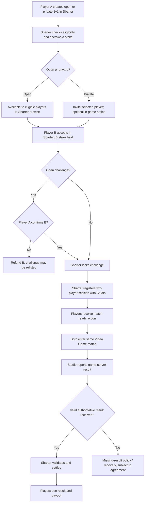

# 1v1 Challenge Integration

This guide describes the player and system journey for a **1v1 skill-based challenge** between two players whose Video Game accounts are already linked to Sbarter. It is based on the supplied *1v1 and tournament player journey v8* design. **Product decisions in that journey are not necessarily capabilities of every integrated Video Game.**

> **Integration status:** Sbarter's published API contracts cover registration of a two-player game session and receipt of a game-server result. Direct in-game invitations, match-ready notifications, one-tap launch, presence lookup and some exception rules are **proposed / under development** and require an agreed implementation with the Video Game Studio.

## Responsibilities at a glance

- **Sbarter:** Presents challenge discovery, creation and acceptance; verifies eligibility; holds stakes in escrow; determines the official contest outcome; settles and displays payouts.
- **Video Game Studio:** Maintains the Video Game accounts; registers/provisions the session requested by Sbarter; hosts gameplay; produces the authoritative game-server match result; optionally displays Sbarter-related notifications and deep links.
- **Player:** Creates or accepts challenges in the **Sbarter app**, then plays the match in the **Video Game**. The Video Game does not implement Sbarter's wager-management screens.

## End-to-end journey

*Generic adaptation of the 1v1 journey v8, page 1. It intentionally removes the original partner names and does not imply all proposed integration actions have published APIs.*

## Player journey and API mapping

| Stage | What happens | Responsible system | Published API / status |
| --- | --- | --- | --- |
| Create challenge | Player A selects mode, stake, how long the challenge remains open and match completion window. | Sbarter | Sbarter application flow; no publisher API call required for challenge creation. |
| Hold stake | Sbarter checks eligibility and balance and places Player A's stake in escrow. | Sbarter | Internal platform workflow. |
| Discover or invite | Open challenges appear in Sbarter. Private invites target a selected Video Game player; optional studio-side messages can point to Sbarter. | Sbarter; optionally Studio | Studio notification delivery: **Under Development**. |
| Accept challenge | Player B accepts in Sbarter and the matching stake is held. For an open challenge, Player A confirms or rejects B; private invited opponents do not require another confirmation in the source flow. | Sbarter | Internal platform workflow. |
| Lock and provision | After confirmation, Sbarter identifies two linked Video Game accounts and registers the game session. | Sbarter → Studio | [`POST /v1/session`](/client), **published Game Studio API**; link currently points to the API specification landing page, pending verification of operation permalink. |
| Notify and launch | Both players see a match-ready action. The proposed experience takes either player directly into their provisioned Video Game match, with the first waiting for the second. | Sbarter; Studio | Direct launch and studio notifications: **Under Development**. |
| Play and report | Studio's servers record the match and send the final result to the callback provided at session registration. | Studio → Sbarter | [`POST /v1/webhooks/game-studio/match-result`](/server), **published Sbarter API**; link currently points to the API specification landing page, pending operation permalink. |
| Adjudicate and settle | Sbarter validates the result, applies competition rules and settles escrow. | Sbarter | Internal platform workflow. |

## Game session registration: published contract

**Operation:** [`POST /v1/session`](/client) (Game Studio API; Sbarter calls the Studio).

The current OpenAPI contract requires the following data in the request:

| Field | Requirement | Purpose |
| --- | --- | --- |
| `providerGameId` | Required | Stable identifier for the integrated Video Game. |
| `sessionId` | Required, UUID | Canonical Sbarter session ID and idempotency key. |
| `players` | Required, exactly two entries | The two participants in the session. See the `PlayerMatchEntry` schema for the precise required properties. |
| `expiresAt` | Required | Time after which the registered session should not be treated as valid. |
| `webhookUrl` | Required | Callback URL the Studio **must** use to report the result. |
| `rules` | Optional | Studio-defined match rules/modifiers/campaign identifiers. |

Repeated requests with the same `sessionId` and equivalent payload must be handled as safe retries. The contract distinguishes successful creation (`201`), safe replay (`200`) and conflicting reuse of an ID (`409`). **The published endpoint does not, on its own, guarantee match provisioning, a join URL or a waiting-room experience.** These are separate implementation requirements to agree with the Studio.

## Match result: published contract

**Operation:** [`POST /v1/webhooks/game-studio/match-result`](/server) (Sbarter API; Studio calls Sbarter).

The published `GameResultWebhookPayload` requires `providerGameId`, `sessionId`, `matchId`, `status` and an array of exactly two `players`. Optional `startedAt` and `finishedAt` timestamps are also supported. The callback accepts safe duplicate retries and identifies a logical result using **`sessionId + matchId`**; the successful response is `202`.

The Studio must use the `webhookUrl` provided when the session was registered. Sbarter must validate that the reported identities, match/session and applicable timing and rules correspond to the pending challenge before settlement.

## Exceptional outcomes in the source journey

| Scenario | Proposed player outcome | API / policy status |
| --- | --- | --- |
| No one accepts during open duration, or private invite is declined | Challenge expires or is declined; Player A's stake is returned. | Sbarter contest rule; confirm final product configuration. |
| Player A rejects B for an open challenge | Player B's stake is returned; challenge becomes available again. | Sbarter contest rule. |
| Game-server result is received in time | Validate and settle based on authoritative result. | Result webhook published. |
| No valid result; only one player was logged in during the window | Proposed: absent player forfeits. | **Under Development:** Studio must provide trusted login-window evidence, and policy must be agreed. |
| No valid result; neither player logged in | Proposed: void challenge and refund both stakes. | **Under Development:** presence evidence / adjudication interface. |
| No valid result; both players logged in | Proposed source flow assumes void/refund for 1v1; **no manual player result reporting**. | **Under Development:** confirm final exception rule. |

## Studio implementation checklist

- [ ] Both players have linked, authenticated Studio accounts before the session call.
- [ ] Studio can create or register the requested two-player game session using the published contract.
- [ ] Session registration is idempotent on `sessionId`.
- [ ] Studio uses the supplied `webhookUrl` and securely submits trusted match results.
- [ ] Duplicate result delivery is safe, using `sessionId + matchId`.
- [ ] Direct entry into the existing match and waiting-for-opponent behaviour have been agreed, if required.
- [ ] In-game invitations and match-ready notifications have an agreed delivery mechanism, if required.
- [ ] Missing-result and presence-evidence procedures are agreed before enabling real-stakes settlement.

## Related documentation

- [Integration Overview](./)
- [Account Linking](./account-linking/)
- [Game Studio API](/client)
- [Sbarter API](/server)

> **Source:** *1v1 and tournament player journey v8*, page 1 and the current `server.yaml` / `client.yaml`. See **Game Results & Reconciliation** and **Notifications & Deep Linking** when those guides are published.
