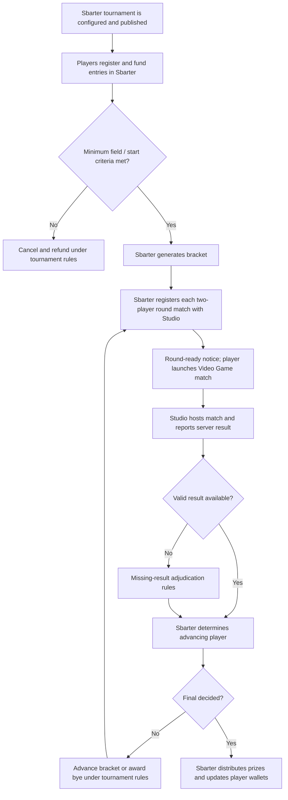

# Tournament Integration

This guide translates the supplied *1v1 and tournament player journey v8*, page 2, into a generic Video Game Studio integration. The journey's **16-player, four-round single-elimination tournament** is an **illustrative competition configuration**, not a universal limit or default for every Sbarter tournament.

> **Integration status:** The published Game Studio API currently registers **two-player sessions**. It can describe the individual matches within a tournament, but does not currently define tournament creation, bracket management, in-game round-ready messages, direct match launch, missing-result presence lookup or tournament-specific settlement endpoints. Sbarter manages tournament logic internally; any studio-facing extensions are **under development**.

## Operating model

Sbarter manages tournament discovery, registration, eligibility, the prize pool, brackets, opponent assignment, round progression and payouts. The **Video Game Studio** owns the game environment and authoritative server-side results. Players discover, join and manage tournament participation in the **Sbarter app**, then play their assigned matches in the **Video Game**.

## End-to-end tournament journey

*Generic adaptation of the tournament journey v8, page 2. Bracket policy, financial amounts and player-resolution rules may differ between tournament formats.*

## Tournament setup and registration

The source journey describes a publisher configuring a tournament through Sbarter's backend with a Video Game, competition mode, **16 participant slots**, entry fee, scheduled start and a completion window for each round. Players find the tournament either directly in Sbarter or through a Video Game link, and register and pay in the Sbarter app.

In this **example format only**:

- The tournament uses **single elimination with four rounds**.
- Players may withdraw with a full refund until **15 minutes before** the scheduled start. Later withdrawals are not permitted in the source policy.
- If all **16 slots** are not filled at the 15-minute cutoff, the example tournament is cancelled and paid entry fees are refunded.
- Otherwise Sbarter builds the bracket and registers the opening-round matches with the Studio.

These timings, thresholds and policies are drawn from the supplied example. They should be represented as **tournament configuration and approved product rules**, not hard-coded assumptions in the Studio integration.

## Publisher API mapping for each match

| Journey action | Responsible system | Published API / status |
| --- | --- | --- |
| Create tournament, register players, hold entry fees, generate bracket | Sbarter | Sbarter application/backend responsibility, not a Studio API operation. |
| Register each bracket match | Sbarter → Studio | [`POST /v1/session`](/client), **published Game Studio API**; schema currently specifies exactly two players per session. Operation permalink should be verified in Redocly. |
| Display next-round notification in Video Game | Sbarter → Studio | **Under Development:** publisher notification contract. |
| Open a specific pre-created match from the Sbarter app or Video Game | Sbarter and Studio | **Under Development:** match-launch / readiness contract. |
| Report game-server outcome for a match | Studio → Sbarter | [`POST /v1/webhooks/game-studio/match-result`](/server), **published Sbarter API**; operation permalink should be verified in Redocly. |
| Determine advancement, voids, byes, prizes | Sbarter | Internal competition adjudication and settlement. |
| Obtain presence evidence or reconcile missing results | Studio ↔ Sbarter | **Under Development:** no corresponding presence or result-retrieval operation in supplied OpenAPI contracts. |

The published `POST /v1/session` is a **two-player game-session registration** operation. Tournament membership, `tournamentId`, `roundId`, bracket location and match readiness should not be presumed to exist in its current schema. Sbarter will need to correlate each registered session with its own internal tournament/round records, and any extra Studio-side identifiers must be explicitly agreed and documented.

## Round execution and progression

1. Sbarter generates the bracket and determines the two linked Video Game accounts for each assigned match.
2. Sbarter registers the two-player session with the Studio using the published session contract.
3. In the proposed experience, Sbarter and the Video Game display a **Go to match** action. The player launches directly into the assigned match; this requires Studio support beyond the current published contract.
4. The Studio hosts the match and returns the authoritative outcome through the registered result callback.
5. Sbarter validates the result and marks the player as advanced or eliminated. The next round may begin early once every match has an outcome, or when the round's completion window closes, according to the source design.
6. Sbarter creates the next-round sessions and repeats the process until the final is resolved.

## Missing result and dispute paths

The source journey distinguishes **1v1 challenges** from **tournament matches**: tournaments may request player-submitted results when the game server cannot supply an outcome and both players were active. That request and the resulting resolution are performed in Sbarter, not by introducing a manual-results UI in the Video Game.

| Trusted game-server result | Presence evidence in match window | Proposed tournament outcome |
| --- | --- | --- |
| Present and valid | Not required for ordinary result path | Use validated server result. |
| Missing | Exactly one player logged in | Absent player forfeits; present player advances. |
| Missing | Neither player logged in | Void match, eliminate both; possible next-round bye. |
| Missing | Both players logged in | Ask both players to report outcome in Sbarter within the source's **3-minute** window. |

The source's manual reporting options are **“I won,” “I lost,” and “My opponent didn't show.”** The following decisions are from its example decision table:

| Report combination | Example outcome |
| --- | --- |
| “I won” / “I lost” | Reported winner advances. |
| “I won” / “I won” | Void. |
| “I lost” / “I lost” | Void. |
| “I won” / no response | Reporting player wins. |
| “I lost” / no response | Reporting player loses. |
| “My opponent didn't show” / no response | Reporting player wins by default. |
| No response / no response | Void. |
| Conflicting absence or win claims | Void, according to the full source decision table. |

**Important:** Studio login-window evidence, manual-result requests and reconciliation are not part of the supplied published API contracts. These procedures must not be presented as production-ready until implemented, tested and agreed.

## Example prize allocation and void final

The source's illustrative 16-player tournament pays:

| Placement | Share of configured prize pool |
| --- | ---: |
| Champion | 55% |
| Runner-up | 25% |
| Each losing semifinalist | 10% |

The source states that Sbarter's fee and the Studio's share are deducted from payouts. It also provides a **void-final** example where the combined first- and second-place allocations (80%) are split equally between the two finalists (40% each). This is **example-specific commercial and adjudication logic**, not a universal rule for every tournament on Sbarter.

## Studio implementation checklist

- [ ] Studio can receive and idempotently register each assigned two-player session.
- [ ] Match outcomes are authoritative, attributable to the correct `sessionId` and `matchId`, and delivered to the supplied `webhookUrl`.
- [ ] Studio supports agreed match launch and re-entry behaviour, where required.
- [ ] Round-ready notifications, deep links and account identities are agreed and tested.
- [ ] Studio and Sbarter agree on presence evidence and no-result recovery procedures before launch.
- [ ] Tournament-specific settings and the supported configuration envelope are confirmed.
- [ ] Error, retry, expiry and delayed-result scenarios are exercised in end-to-end testing.

## Related documentation

- [Integration Overview](./)
- [Account Linking](./account-linking/)
- [1v1 Challenge Integration](./one-v-one/)
- [Game Studio API](/client)
- [Sbarter API](/server)

> **Source:** *1v1 and tournament player journey v8*, pages 2–3, and the supplied `server.yaml` / `client.yaml`. A dedicated **Game Results & Reconciliation** guide will provide the full manual-report decision matrix and operational recovery rules.
